# Guia de Laboratório — Kafka, Apache Flink SQL, Dashboard e Avro

## 1. Objetivo

Este laboratório tem como objetivo disponibilizar um ambiente local para estudar processamento de eventos utilizando:

- Apache Kafka em modo KRaft
- Apache Flink 1.20
- Flink SQL
- Kafka UI
- Confluent Schema Registry
- Avro
- geração automática de eventos PIX
- event-time
- watermarks
- janelas
- deduplicação
- joins
- eventos out-of-order
- eventos incompletos
- late events
- checkpoints
- recovery
- replay

A ideia é evoluir de consultas exploratórias simples até pipelines streaming permanentes com correlação entre autorização, liquidação e antifraude.

---

## 2. Arquitetura do laboratório

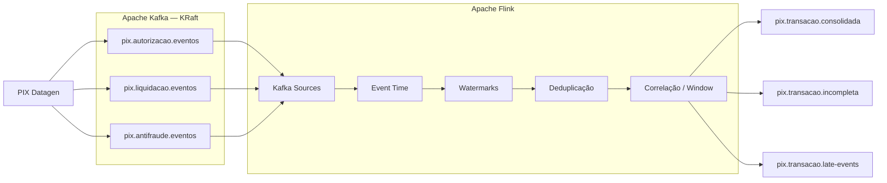

A chave de correlação usada no fluxo é:

```text
id_transacao_pix
```

---

## 3. Estrutura de diretórios

A organização recomendada é:

```text
kafka-flink-lab/
├── docker-compose.yml
├── datagen/
│   └── pix_datagen.py
└── flink/
    ├── Dockerfile
    └── sql/
        ├── init.sql
        ├── studies/
        │   ├── 01-inspect-sources.sql
        │   ├── 02-event-time-watermark.sql
        │   ├── 03-out-of-order.sql
        │   ├── 04-tumble-window.sql
        │   ├── 05-dedup.sql
        │   ├── 06-correlation-window.sql
        │   ├── 07-explain.sql
        │   └── 08-latency.sql
        └── pipelines/
            ├── 01-auth-approved.sql
            ├── 02-auth-metrics-15s.sql
            └── 03-pix-consolidated-window.sql
```

A responsabilidade de cada pasta é:

- `init.sql`: configurações da sessão e DDLs
- `studies/`: consultas exploratórias
- `pipelines/`: `INSERT INTO ... SELECT ...` que geram Jobs streaming

---

## 4. Infraestrutura Docker

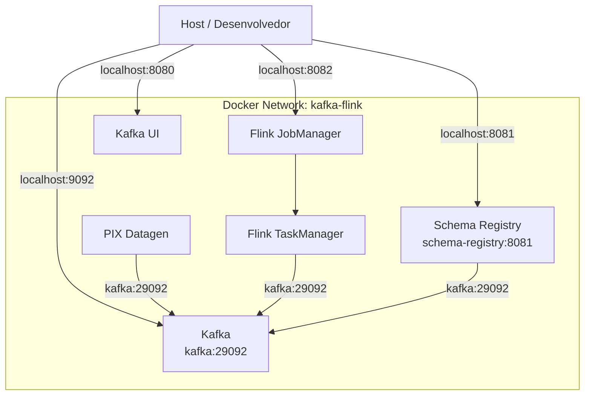

### Endereços no host

| Serviço | Endereço |
|---|---|
| Kafka | `localhost:9092` |
| Kafka UI | `http://localhost:8080` |
| Schema Registry | `http://localhost:8081` |
| Flink Dashboard | `http://localhost:8082` |
| PostgreSQL | `localhost:5432` |

Dentro do Docker:

```text
Kafka              kafka:29092
Schema Registry    schema-registry:8081
Flink JobManager   jobmanager:6123
```

Dentro de uma tabela Flink executando no Docker, use:

```text
kafka:29092
```

e não:

```text
localhost:9092
```

---

## 5. Inicialização do SQL Client

O SQL Client é aberto com:

```bash
docker compose run --rm sql-client
```

O serviço utiliza:

```bash
sql-client.sh -i /opt/flink/sql/init.sql
```

O `init.sql` é carregado automaticamente.

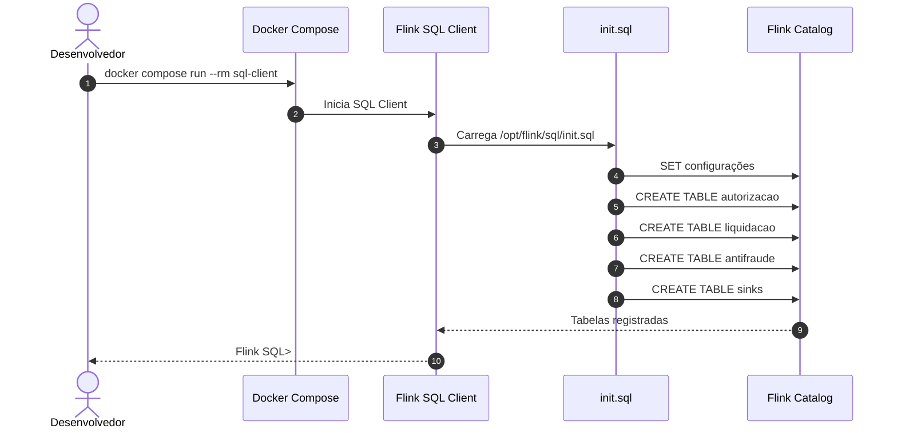

Teste:

```sql
SHOW TABLES;
```

---

## 6. Kafka Topic x Flink Table x Flink Job

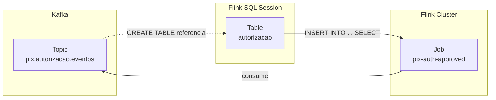

| Conceito | Exemplo | Responsabilidade |
|---|---|---|
| Kafka Topic | `pix.autorizacao.eventos` | Log/persistência de eventos |
| Flink Table | `autorizacao` | Representação SQL do stream |
| Flink Job | `pix-auth-approved` | Computação streaming |

`CREATE TABLE` no Flink não cria automaticamente um tópico Kafka.

---

## 7. Flink Dashboard

Acesse:

```text
http://localhost:8082
```

O Dashboard é usado principalmente para observar e administrar o cluster.

Principais áreas:

- Overview
- Running Jobs
- Completed Jobs
- Task Managers
- Job Manager
- métricas
- checkpoints
- backpressure
- exceptions

### Job Graph

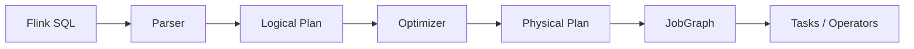

---

## 8. Query exploratória x Pipeline streaming

### Query exploratória

```sql
SELECT *
FROM autorizacao;
```

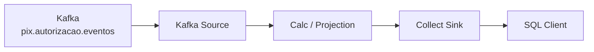

Uso:

- inspeção
- debug
- event-time
- watermark
- filtros
- validação de dados

### Pipeline streaming

```sql
INSERT INTO autorizacao_aprovada
SELECT ...
FROM autorizacao;
```

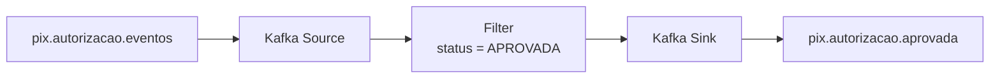

O pipeline permanece no cluster mesmo depois que o SQL Client usado para submetê-lo é encerrado.

---

## 9. Submissão de um pipeline

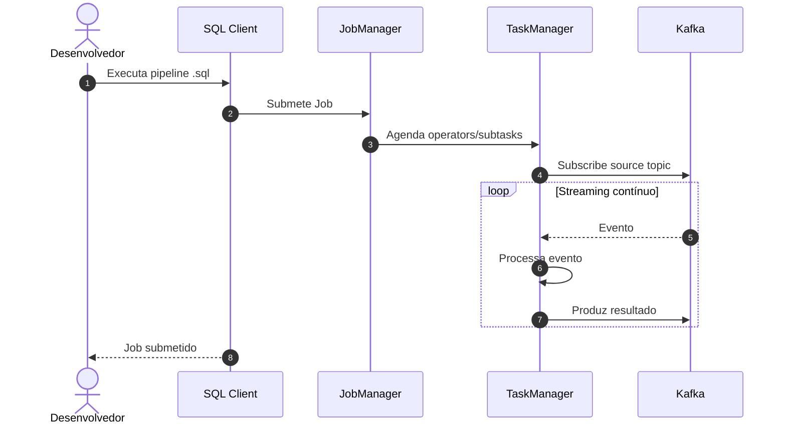

---

## 10. Event Time

Os eventos do laboratório possuem:

```text
event_time
produced_at
```

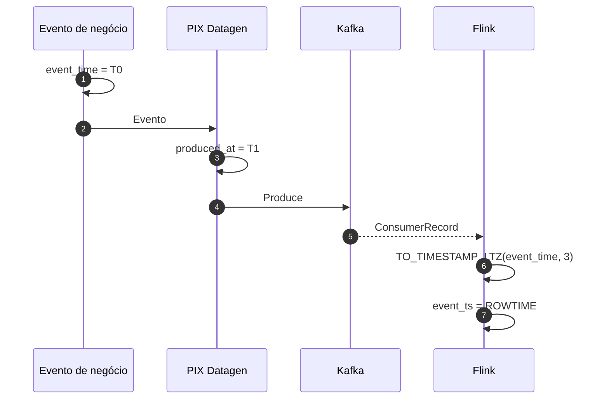

Logo:

```text
event_time != produced_at != processing_time
```

---

## 11. Out-of-order

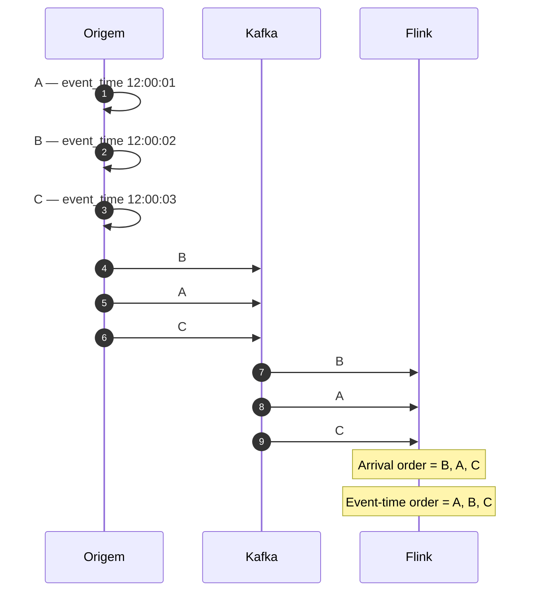

Portanto:

```text
arrival order != business time
```

---

## 12. Watermark

No laboratório:

```sql
WATERMARK FOR event_ts
AS event_ts - INTERVAL '5' SECOND
```

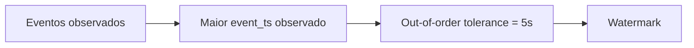

Conceitualmente:

```text
watermark ≈ max(event_time observado) - tolerância
```

O watermark representa o progresso do tempo lógico do stream.

---

## 13. Watermark não é Window Size

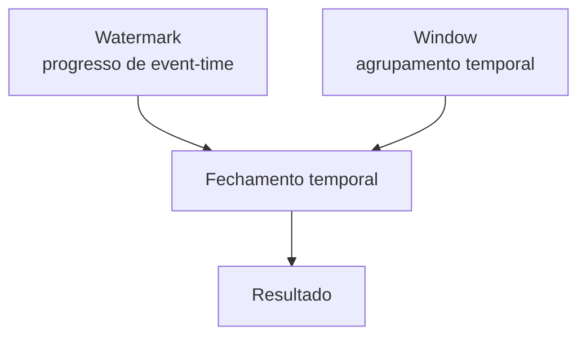

Exemplo:

```sql
WATERMARK FOR event_ts
AS event_ts - INTERVAL '5' SECOND
```

com:

```sql
TUMBLE(
    TABLE autorizacao,
    DESCRIPTOR(event_ts),
    INTERVAL '15' SECOND
)
```

São conceitos independentes:

```text
watermark delay = 5s
window size     = 15s
```

---

## 14. TUMBLE Window

```mermaid
gantt
    title TUMBLE de 15 segundos
    dateFormat HH:mm:ss
    axisFormat %H:%M:%S

    section Windows
    Window 1 : 12:00:00, 15s
    Window 2 : 12:00:15, 15s
    Window 3 : 12:00:30, 15s
```

As janelas são alinhadas globalmente.

Um `TUMBLE` de 15 segundos não significa “15 segundos a partir do primeiro evento da transação”.

---

## 15. Limitação do TUMBLE

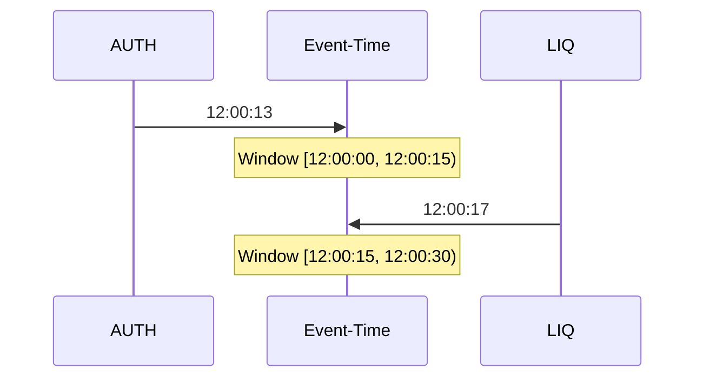

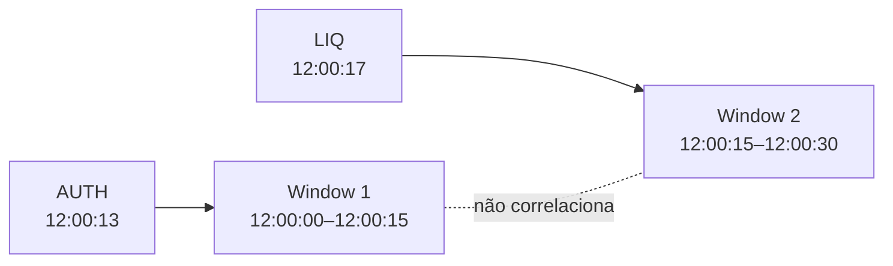

Mesmo com apenas quatro segundos entre os eventos, eles podem cair em janelas diferentes.

---

## 16. Deduplicação

O Datagen gera duplicatas mantendo o mesmo `event_id`.

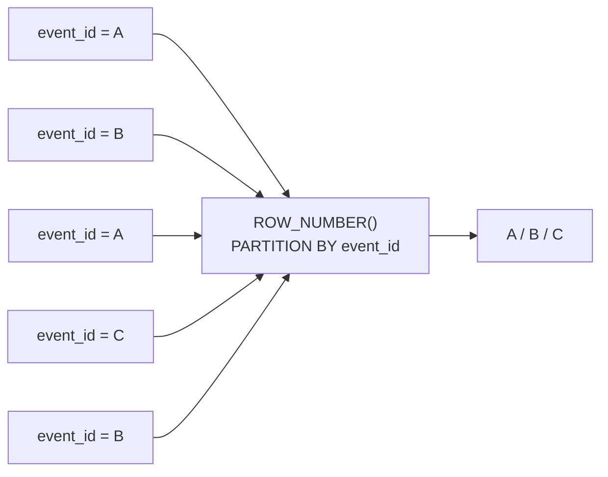

A chave preferida é:

```text
event_id
```

porque uma mesma transação pode ter múltiplos eventos/versões legítimos.

---

## 17. Correlação PIX

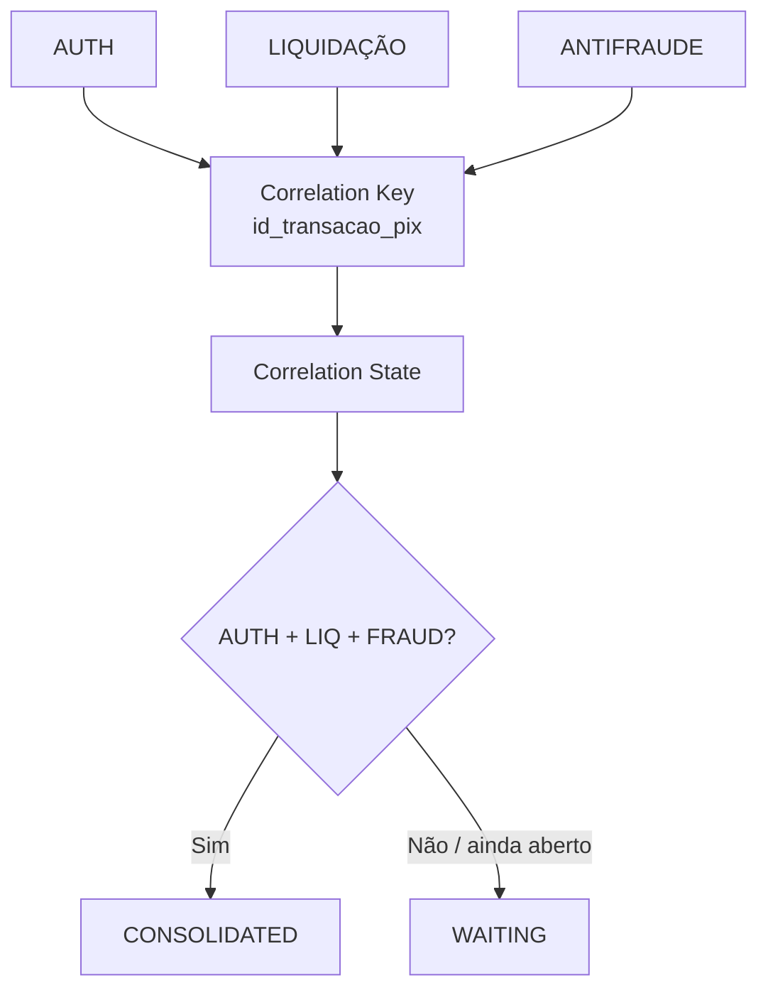

---

## 18. Sequência normal de consolidação

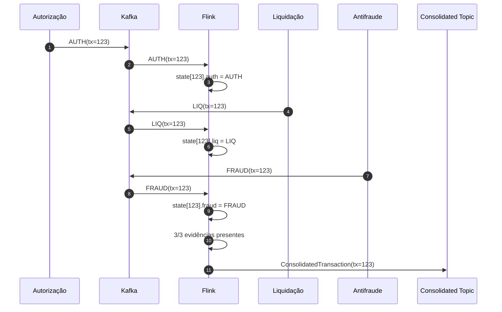

---

## 19. Consolidação out-of-order

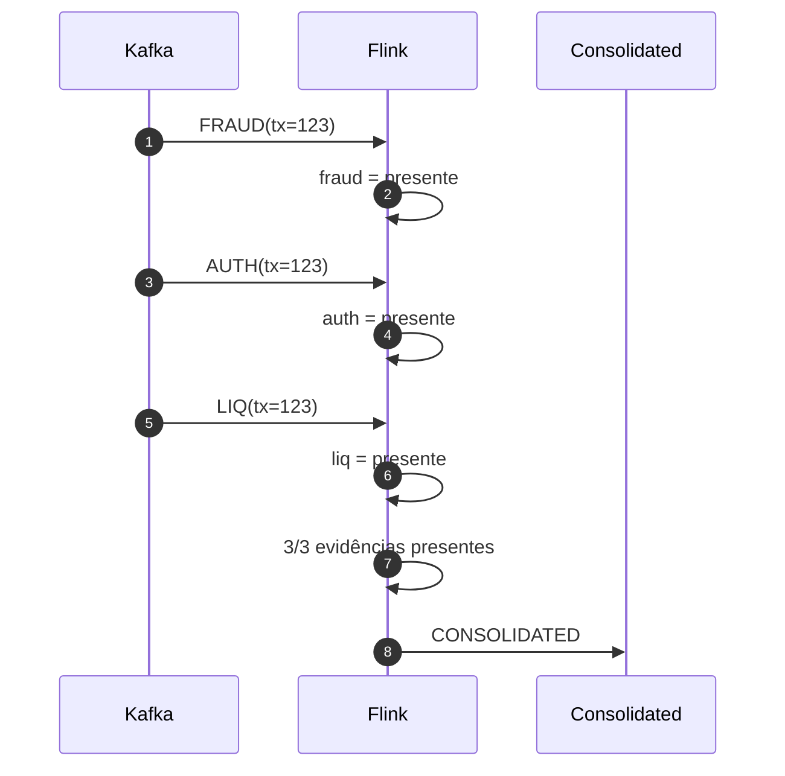

---

## 20. Fluxograma da decisão

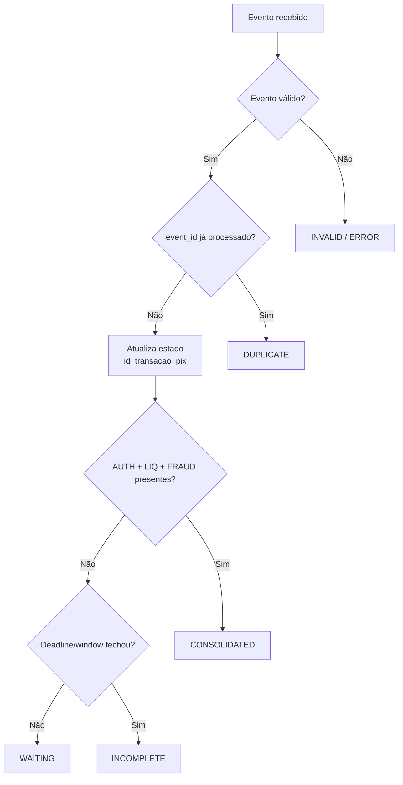

---

## 21. Transação incompleta

```mermaid
sequenceDiagram
    autonumber

    participant Kafka
    participant Flink
    participant Timer as Event-Time Timer
    participant OUT as Incomplete Topic

    Kafka->>Flink: AUTH(tx=123)
    Flink->>Flink: auth = presente
    Flink->>Timer: Registra deadline

    Kafka->>Flink: LIQ(tx=123)
    Flink->>Flink: liq = presente

    Note over Flink: FRAUD não chegou

    Timer-->>Flink: Deadline atingido
    Flink->>Flink: Verifica estado

    Note over Flink: AUTH ✓<br/>LIQ ✓<br/>FRAUD ✗

    Flink->>OUT: INCOMPLETE(tx=123, missing=FRAUD)
```

`INCOMPLETE` deve ser uma decisão tomada no fechamento, não um estado intermediário emitido a cada evento.

---

## 22. Late Event

```mermaid
sequenceDiagram
    autonumber

    participant Kafka
    participant Flink
    participant INC as Incomplete Topic
    participant LATE as Late Events Topic

    Kafka->>Flink: AUTH(tx=123)
    Kafka->>Flink: LIQ(tx=123)

    Flink->>Flink: Deadline encerrado
    Flink->>INC: INCOMPLETE(tx=123)

    Note over Flink: decisão = CLOSED

    Kafka->>Flink: FRAUD(tx=123)
    Flink->>Flink: Detecta decisão já encerrada
    Flink->>LATE: LATE_EVENT(tx=123, FRAUD)
```

Late event não significa apenas:

```text
produced_at > event_time
```

A semântica é dependente do progresso temporal e da decisão do fluxo.

---

## 23. TUMBLE x deadline por transação

```mermaid
flowchart TB
    REQ{"Qual é a semântica de negócio?"}

    GLOBAL["Janelas temporais globais/alinhadas"]
    PERKEY["15 segundos a partir<br/>do primeiro evento"]

    TUMBLE["TUMBLE / Window SQL"]
    STATE["Keyed State + Event-Time Timer"]

    REQ --> GLOBAL
    REQ --> PERKEY

    GLOBAL --> TUMBLE
    PERKEY --> STATE
```

Para o estudo inicial, usa-se TUMBLE.

Para uma janela individual iniciada pelo primeiro evento de cada `id_transacao_pix`, o desenho natural é estado por chave + timer.

---

## 24. Checkpoint

```mermaid
sequenceDiagram
    autonumber

    participant JM as JobManager
    participant Source
    participant Operator
    participant State as State Backend
    participant Sink

    JM->>Source: Trigger checkpoint
    Source->>Operator: Checkpoint Barrier
    Operator->>State: Snapshot state
    Operator->>Sink: Forward barrier
    Sink-->>JM: Checkpoint acknowledged
    State-->>JM: State persisted
    JM->>JM: Checkpoint COMPLETED
```

---

## 25. Checkpoint não é Replay

```mermaid
flowchart LR
    FAILURE["Falha"]
    DECISION{"Objetivo?"}

    CHECKPOINT["Recuperar execução<br/>e estado"]
    REPLAY["Reprocessar histórico<br/>de eventos"]

    CP["Checkpoint Recovery"]
    KAFKA["Kafka Replay"]

    FAILURE --> DECISION
    DECISION --> CHECKPOINT
    DECISION --> REPLAY

    CHECKPOINT --> CP
    REPLAY --> KAFKA
```

```text
checkpoint recovery != Kafka replay
```

---

## 26. Backpressure

```mermaid
flowchart LR
    K["Kafka Source<br/>100k eventos/s"]
    A["Operator A<br/>100k eventos/s"]
    B["Operator B<br/>20k eventos/s"]
    S["Sink<br/>20k eventos/s"]

    K --> A
    A --> B
    B --> S
```

Se o downstream não acompanha o upstream:

```mermaid
flowchart RL
    S["Sink lento"]
    B["Operator B"]
    A["Operator A"]
    K["Kafka Source"]

    S -->|"pressão"| B
    B -->|"backpressure"| A
    A -->|"backpressure"| K
```

No Dashboard, observe métricas como:

```text
numRecordsIn
numRecordsOut
busyTimeMsPerSecond
idleTimeMsPerSecond
backPressuredTimeMsPerSecond
currentInputWatermark
```

---

## 27. Scripts de estudo

### 27.1 `studies/01-inspect-sources.sql`

```sql
SELECT
    id_transacao_pix,
    event_id,
    event_type,
    event_version,
    valor,
    status_autorizacao,
    event_time,
    produced_at,
    event_ts
FROM autorizacao;
```

Execução:

```sql
SOURCE '/opt/flink/sql/studies/01-inspect-sources.sql';
```

---

### 27.2 `studies/02-event-time-watermark.sql`

```sql
SELECT
    id_transacao_pix,
    event_id,
    event_ts,

    TO_TIMESTAMP_LTZ(
        produced_at,
        3
    ) AS produced_ts,

    CURRENT_WATERMARK(
        event_ts
    ) AS current_watermark

FROM autorizacao;
```

---

### 27.3 `studies/03-out-of-order.sql`

```sql
SELECT
    id_transacao_pix,
    event_id,
    event_ts,

    TO_TIMESTAMP_LTZ(
        produced_at,
        3
    ) AS produced_ts,

    TIMESTAMPDIFF(
        SECOND,
        event_ts,
        TO_TIMESTAMP_LTZ(produced_at, 3)
    ) AS delay_seconds,

    CURRENT_WATERMARK(
        event_ts
    ) AS current_watermark

FROM autorizacao;
```

---

### 27.4 `studies/04-tumble-window.sql`

```sql
SELECT
    window_start,
    window_end,
    COUNT(*) AS quantidade,
    SUM(valor) AS valor_total,
    MIN(valor) AS menor_valor,
    MAX(valor) AS maior_valor,
    AVG(valor) AS valor_medio

FROM TABLE(
    TUMBLE(
        TABLE autorizacao,
        DESCRIPTOR(event_ts),
        INTERVAL '15' SECOND
    )
)

GROUP BY
    window_start,
    window_end;
```

---

### 27.5 `studies/05-dedup.sql`

```sql
SELECT
    id_transacao_pix,
    event_id,
    event_type,
    event_version,
    valor,
    status_autorizacao,
    event_ts

FROM (
    SELECT
        *,

        ROW_NUMBER() OVER (
            PARTITION BY event_id
            ORDER BY event_ts
        ) AS row_num

    FROM autorizacao
)

WHERE row_num = 1;
```

---

### 27.6 `studies/06-correlation-window.sql`

```sql
WITH auth_window AS (

    SELECT
        id_transacao_pix,
        event_id,
        valor,
        status_autorizacao,
        window_start,
        window_end

    FROM TABLE(
        TUMBLE(
            TABLE autorizacao,
            DESCRIPTOR(event_ts),
            INTERVAL '15' SECOND
        )
    )
),

liq_window AS (

    SELECT
        id_transacao_pix,
        event_id,
        status_liquidacao,
        window_start,
        window_end

    FROM TABLE(
        TUMBLE(
            TABLE liquidacao,
            DESCRIPTOR(event_ts),
            INTERVAL '15' SECOND
        )
    )
),

fraud_window AS (

    SELECT
        id_transacao_pix,
        event_id,
        score_risco,
        status_antifraude,
        window_start,
        window_end

    FROM TABLE(
        TUMBLE(
            TABLE antifraude,
            DESCRIPTOR(event_ts),
            INTERVAL '15' SECOND
        )
    )
)

SELECT
    a.id_transacao_pix,
    a.valor,
    a.status_autorizacao,
    l.status_liquidacao,
    f.status_antifraude,
    f.score_risco,
    a.event_id AS authorization_event_id,
    l.event_id AS settlement_event_id,
    f.event_id AS fraud_event_id,
    a.window_start,
    a.window_end

FROM auth_window a

JOIN liq_window l
    ON a.id_transacao_pix = l.id_transacao_pix
    AND a.window_start = l.window_start
    AND a.window_end = l.window_end

JOIN fraud_window f
    ON a.id_transacao_pix = f.id_transacao_pix
    AND a.window_start = f.window_start
    AND a.window_end = f.window_end;
```

---

### 27.7 `studies/07-explain.sql`

```sql
EXPLAIN PLAN FOR

SELECT
    window_start,
    window_end,
    COUNT(*) AS quantidade,
    SUM(valor) AS valor_total

FROM TABLE(
    TUMBLE(
        TABLE autorizacao,
        DESCRIPTOR(event_ts),
        INTERVAL '15' SECOND
    )
)

GROUP BY
    window_start,
    window_end;
```

---

### 27.8 `studies/08-latency.sql`

```sql
SELECT
    id_transacao_pix,
    event_id,
    event_ts,

    TO_TIMESTAMP_LTZ(
        produced_at,
        3
    ) AS produced_ts,

    TIMESTAMPDIFF(
        SECOND,
        event_ts,
        TO_TIMESTAMP_LTZ(produced_at, 3)
    ) AS event_to_produce_seconds,

    CURRENT_WATERMARK(
        event_ts
    ) AS current_watermark

FROM autorizacao;
```

---

## 28. Pipelines streaming

### 28.1 `pipelines/01-auth-approved.sql`

```sql
SET 'pipeline.name' = 'pix-auth-approved';

INSERT INTO autorizacao_aprovada

SELECT
    id_transacao_pix,
    event_id,
    event_type,
    event_version,
    valor,
    status_autorizacao,
    event_time,
    CURRENT_TIMESTAMP

FROM autorizacao

WHERE status_autorizacao = 'APROVADA';
```

Execução:

```bash
docker compose run --rm \
  sql-client \
  /opt/flink/bin/sql-client.sh \
  -i /opt/flink/sql/init.sql \
  -f /opt/flink/sql/pipelines/01-auth-approved.sql
```

---

### 28.2 `pipelines/02-auth-metrics-15s.sql`

```sql
SET 'pipeline.name' = 'pix-auth-metrics-15s';

INSERT INTO autorizacao_metricas

SELECT
    window_start,
    window_end,
    COUNT(*) AS quantidade,
    SUM(valor) AS valor_total

FROM TABLE(
    TUMBLE(
        TABLE autorizacao,
        DESCRIPTOR(event_ts),
        INTERVAL '15' SECOND
    )
)

GROUP BY
    window_start,
    window_end;
```

---

### 28.3 `pipelines/03-pix-consolidated-window.sql`

```sql
SET 'pipeline.name' = 'pix-correlation-tumble-15s';

INSERT INTO transacao_consolidada

WITH auth_window AS (

    SELECT
        id_transacao_pix,
        event_id,
        valor,
        status_autorizacao,
        window_start,
        window_end

    FROM TABLE(
        TUMBLE(
            TABLE autorizacao,
            DESCRIPTOR(event_ts),
            INTERVAL '15' SECOND
        )
    )
),

liq_window AS (

    SELECT
        id_transacao_pix,
        event_id,
        status_liquidacao,
        window_start,
        window_end

    FROM TABLE(
        TUMBLE(
            TABLE liquidacao,
            DESCRIPTOR(event_ts),
            INTERVAL '15' SECOND
        )
    )
),

fraud_window AS (

    SELECT
        id_transacao_pix,
        event_id,
        score_risco,
        status_antifraude,
        window_start,
        window_end

    FROM TABLE(
        TUMBLE(
            TABLE antifraude,
            DESCRIPTOR(event_ts),
            INTERVAL '15' SECOND
        )
    )
)

SELECT
    auth.id_transacao_pix,
    auth.valor,
    auth.status_autorizacao,
    liq.status_liquidacao,
    fraud.status_antifraude,
    fraud.score_risco,
    auth.event_id AS authorization_event_id,
    liq.event_id AS settlement_event_id,
    fraud.event_id AS fraud_event_id,
    auth.window_start,
    auth.window_end,
    CURRENT_TIMESTAMP

FROM auth_window auth

JOIN liq_window liq
    ON auth.id_transacao_pix = liq.id_transacao_pix
    AND auth.window_start = liq.window_start
    AND auth.window_end = liq.window_end

JOIN fraud_window fraud
    ON auth.id_transacao_pix = fraud.id_transacao_pix
    AND auth.window_start = fraud.window_start
    AND auth.window_end = fraud.window_end;
```

Este pipeline é didático e usa TUMBLE alinhado. Ele não representa uma janela individual iniciada pelo primeiro evento da transação.

---

## 29. Avro + Schema Registry

```mermaid
sequenceDiagram
    autonumber

    participant Producer as PIX Datagen
    participant Serializer as AvroSerializer
    participant SR as Schema Registry
    participant Kafka

    Producer->>Serializer: Python dict
    Serializer->>SR: Resolve/register schema
    SR-->>Serializer: Schema ID
    Serializer->>Serializer: Serializa Avro
    Serializer->>Kafka: Magic Byte + Schema ID + Payload
```

Registrar um `.avsc` no Schema Registry não transforma automaticamente um `json.dumps()` em Avro.

---

## 30. Consumo Avro pelo Flink

```mermaid
sequenceDiagram
    autonumber

    participant Kafka
    participant Source as Flink Kafka Source
    participant Format as avro-confluent
    participant SR as Schema Registry
    participant Table as Flink Table

    Kafka->>Source: Kafka record
    Source->>Format: Value bytes
    Format->>Format: Extrai Schema ID
    Format->>SR: Resolve Schema ID
    SR-->>Format: Writer Schema
    Format->>Format: Deserialize Avro
    Format->>Table: Flink Row
```

---

## 31. Schema Evolution

```mermaid
flowchart LR
    V1["AuthorizationEvent v1"]
    V2["AuthorizationEvent v2<br/>+ codigo_canal"]
    SR["Schema Registry<br/>Compatibility Check"]
    ACCEPT["Registrar nova versão"]
    REJECT["Rejeitar alteração"]

    V1 --> V2
    V2 --> SR

    SR -->|"compatível"| ACCEPT
    SR -->|"incompatível"| REJECT
```

Estratégias de compatibilidade que podem ser estudadas:

```text
BACKWARD
FORWARD
FULL
NONE
```

---

## 32. Fluxo completo

```mermaid
flowchart TB
    DG["PIX Datagen"]
    SR["Schema Registry"]

    subgraph KafkaIn["Kafka — Input"]
        AUTH["pix.autorizacao.eventos"]
        LIQ["pix.liquidacao.eventos"]
        FRAUD["pix.antifraude.eventos"]
    end

    subgraph Flink["Apache Flink"]
        SOURCES["Kafka Sources"]
        DESER["JSON / Avro<br/>Deserialization"]
        ET["Event Time"]
        WM["Watermarks"]
        DEDUP["Deduplication<br/>event_id"]
        STATE["Correlation State<br/>id_transacao_pix"]
        DECISION{"Decision"}

        SOURCES --> DESER
        DESER --> ET
        ET --> WM
        WM --> DEDUP
        DEDUP --> STATE
        STATE --> DECISION
    end

    subgraph KafkaOut["Kafka — Output"]
        CONS["pix.transacao.consolidada"]
        INC["pix.transacao.incompleta"]
        LATE["pix.transacao.late-events"]
    end

    DG --> AUTH
    DG --> LIQ
    DG --> FRAUD

    DG -. "Avro schema" .-> SR

    AUTH --> SOURCES
    LIQ --> SOURCES
    FRAUD --> SOURCES

    SR -. "schema resolution" .-> DESER

    DECISION -->|"COMPLETE"| CONS
    DECISION -->|"CLOSED + missing"| INC
    DECISION -->|"after closure"| LATE
```

---

## 33. Rotina de estudo

Subir ambiente:

```bash
docker compose up -d --build
```

Abrir SQL Client:

```bash
docker compose run --rm sql-client
```

Listar tabelas:

```sql
SHOW TABLES;
```

Executar estudo:

```sql
SOURCE '/opt/flink/sql/studies/02-event-time-watermark.sql';
```

Submeter pipeline:

```bash
docker compose run --rm \
  sql-client \
  /opt/flink/bin/sql-client.sh \
  -i /opt/flink/sql/init.sql \
  -f /opt/flink/sql/pipelines/02-auth-metrics-15s.sql
```

Listar Jobs:

```bash
docker compose exec jobmanager flink list
```

Listar inclusive Jobs finalizados:

```bash
docker compose exec jobmanager flink list -a
```

Consumir saída Kafka:

```bash
docker compose exec kafka \
  kafka-console-consumer \
  --bootstrap-server kafka:29092 \
  --topic pix.autorizacao.metricas \
  --from-beginning
```

Cancelar Job:

```bash
docker compose exec jobmanager \
  flink cancel <JOB_ID>
```

---

## 34. Mapa de estudos

```mermaid
flowchart TD
    S1["01 — Kafka Source"]
    S2["02 — Event Time"]
    S3["03 — Watermark"]
    S4["04 — Out-of-order"]
    S5["05 — TUMBLE Window"]
    S6["06 — Deduplicação"]
    S7["07 — AUTH + LIQ + FRAUD"]
    S8["08 — Window Correlation"]
    S9["09 — Incomplete"]
    S10["10 — Late Events"]
    S11["11 — Avro"]
    S12["12 — Schema Registry"]
    S13["13 — Schema Evolution"]
    S14["14 — Checkpoints"]
    S15["15 — Recovery"]
    S16["16 — Kafka Replay"]
    S17["17 — Per-Key State + Timer"]

    S1 --> S2 --> S3 --> S4 --> S5
    S5 --> S6 --> S7 --> S8
    S8 --> S9 --> S10
    S10 --> S11 --> S12 --> S13
    S13 --> S14 --> S15 --> S16
    S16 --> S17
```

---

## 35. Conceitos que não devem ser confundidos

```text
Kafka timestamp
       !=
event_time
       !=
processing_time
       !=
watermark
       !=
window size
```

Também:

```text
Avro schema registrado
       !=
mensagem automaticamente serializada em Avro
```

e:

```text
checkpoint recovery
       !=
Kafka replay
```

Essas distinções são fundamentais para entender corretamente aplicações stateful e event-time no Apache Flink.
