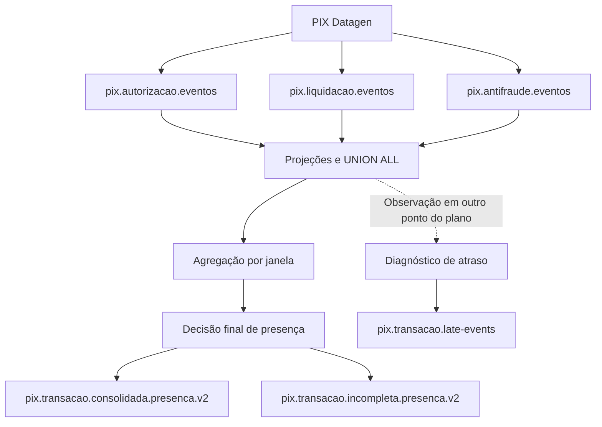
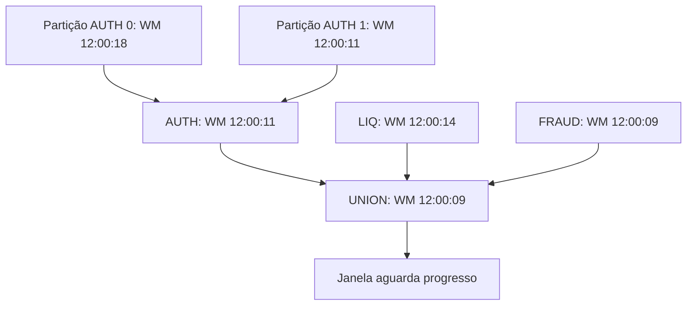
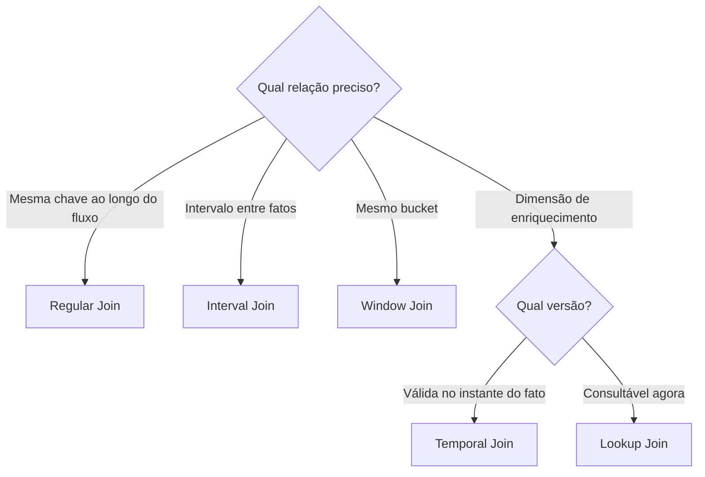
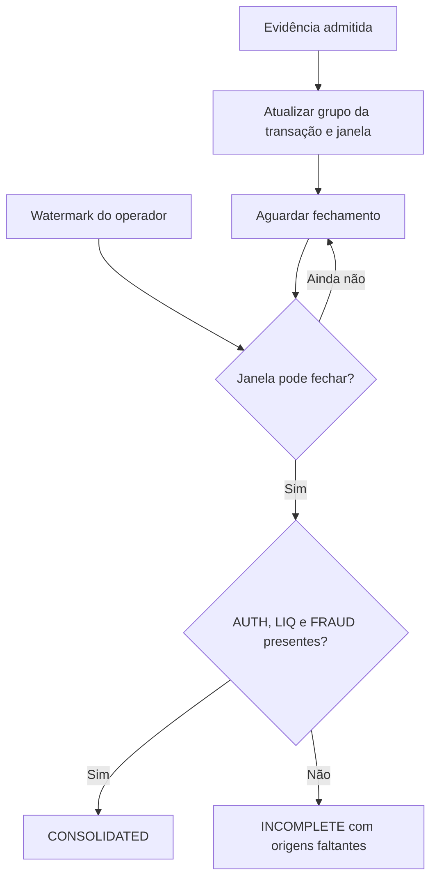
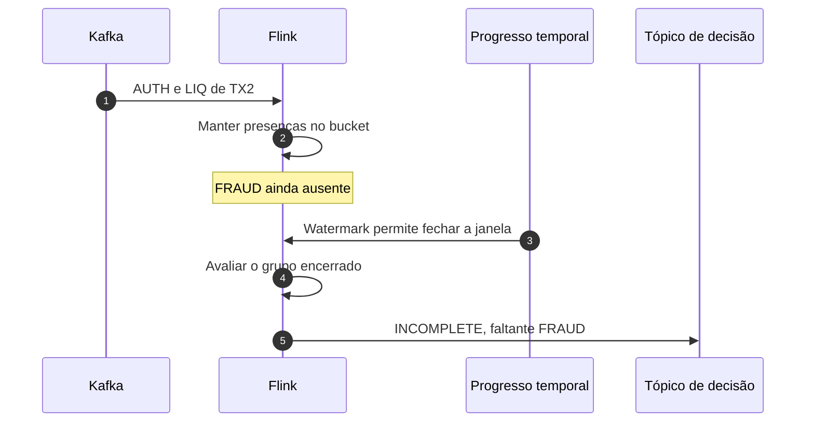
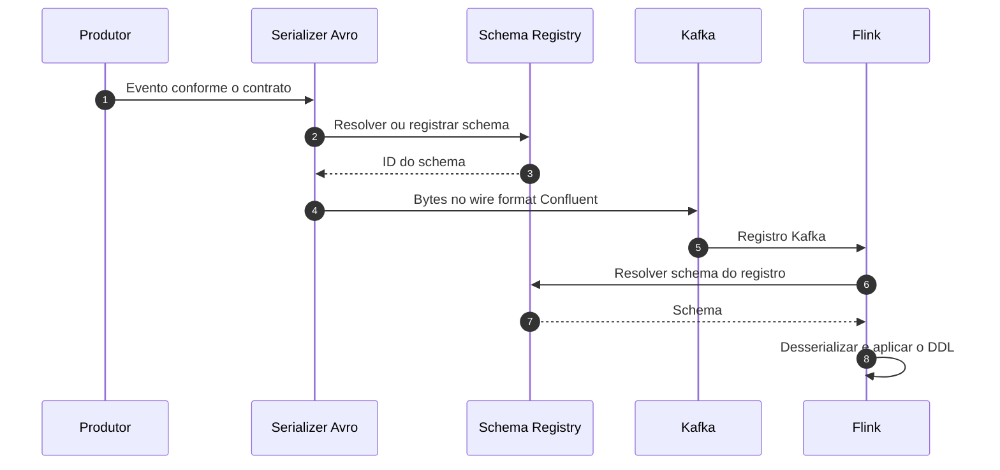
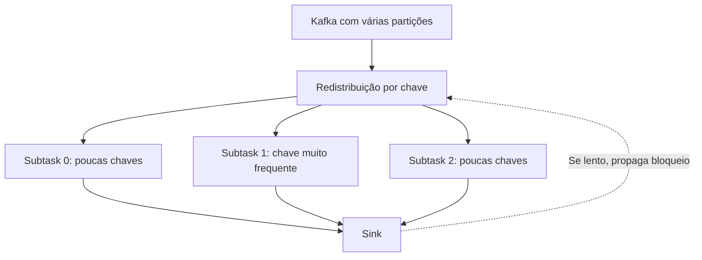
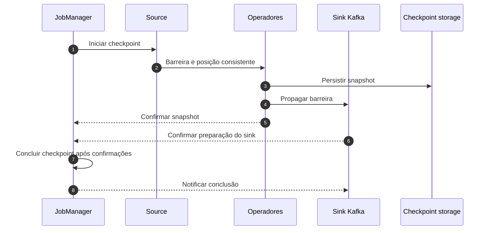

# Guia de Laboratório — Kafka, Apache Flink SQL, Dashboard e Avro

**Event time, watermarks, rowtime, Window TVFs, OVER, joins e correlação PIX**

**Versão:** 2.1 · **Revisão:** 27 de outubro de 2026  
**Ambiente principal:** Apache Flink 1.20, Kafka em KRaft e Schema Registry locais.  
**Destino de evolução:** Confluent Cloud for Apache Flink, com diferenças identificadas ao longo do texto.  
**Público:** desenvolvedores, engenharia de dados, arquitetura e plataforma de eventos.

## Abstract

Este guia apresenta um percurso de estudo de Flink SQL: começa pela leitura de eventos Kafka, explica como tabelas dinâmicas representam um fluxo e introduz tempo de evento, watermarks e estado. Em seguida, compara agregações por janela, análises por linha com OVER e diferentes famílias de joins. O caso PIX conecta os conceitos à correlação entre autorização, liquidação e antifraude, com regras explícitas para presença das evidências, seleção de payloads, fechamento e eventos tardios. A parte operacional cobre SQL Client, planos de execução, Dashboard, Avro, checkpoints, recuperação e replay. Os exemplos priorizam SQL e distinguem o Flink 1.20 local das capacidades documentadas no serviço da Confluent.

**Como interpretar os exemplos:** os contratos PIX, os intervalos de 5 e 15 segundos e os resultados esperados são propostas didáticas do laboratório. A revisão 2.1 alinha o bootstrap SQL, os estudos, os pipelines e o produtor ao mesmo contrato. O Compose local continua sendo um laboratório de nó único; as queries e o build precisam ser executados no ambiente antes de tratar os resultados como comprovados.

## Lista de siglas

| Sigla | Significado neste guia |
| --- | --- |
| AUTH / LIQ / FRAUD | Autorização, liquidação e antifraude no envelope normalizado |
| CDC | Change Data Capture: fluxo de alterações de uma base |
| CEP | Complex Event Processing: reconhecimento de padrões de eventos |
| CFU | Confluent Unit for Flink: unidade de capacidade do serviço |
| CTE | Common Table Expression: relação nomeada dentro de uma query |
| DDL / DML / DQL | Definição de objetos, manipulação de dados e consultas |
| KRaft | Modo de gestão de metadados Kafka baseado em Raft |
| PK | Primary Key: identidade lógica de uma linha |
| PTF | Nas Window TVFs do Flink 1.20: Polymorphic Table Function |
| SQL | Structured Query Language |
| TCO | Total Cost of Ownership: custo total de propriedade |
| TTL | Time to Live: política de expiração; depende do recurso |
| TVF | Table-Valued Function: função que retorna uma relação |
| UTC | Referência de fuso horário adotada nos exemplos |
| WM | Watermark: progresso lógico de event time |

**Atenção ao termo PTF:** materiais mais recentes também usam a sigla para *Process Table Function*, uma extensão programável com estado e timers. Esse recurso não é a Window TVF deste laboratório. Não se deve assumir disponibilidade de uma extensão do SaaS ou do Flink 2.x no Flink 1.20.

## Índice

1. [Objetivo e percurso de leitura](#1-objetivo-e-percurso-de-leitura)
   1.1. [Mapa de decisão das abordagens Flink](#11-mapa-de-decisão-das-abordagens-flink)
2. [Ajustes conceituais da revisão](#2-ajustes-conceituais-da-revisão)
3. [Arquitetura, serviços e arquivos](#3-arquitetura-serviços-e-arquivos)
4. [Preparação do ambiente e SQL Client](#4-preparação-do-ambiente-e-sql-client)
5. [Contrato dos eventos e dos relógios](#5-contrato-dos-eventos-e-dos-relógios)
6. [Bootstrap SQL das fontes](#6-bootstrap-sql-das-fontes)
7. [Queries básicas e tabelas dinâmicas](#7-queries-básicas-e-tabelas-dinâmicas)
8. [Event time, rowtime e $rowtime](#8-event-time-rowtime-e-rowtime)
9. [Watermarks, desordem e ociosidade](#9-watermarks-desordem-e-ociosidade)
10. [Window TVFs: TUMBLE, HOP, CUMULATE e SESSION](#10-window-tvfs-tumble-hop-cumulate-e-session)
11. [OVER: análise relativa a cada evento](#11-over-análise-relativa-a-cada-evento)
12. [Deduplicação e versões](#12-deduplicação-e-versões)
13. [Joins: escolher pela pergunta de negócio](#13-joins-escolher-pela-pergunta-de-negócio)
14. [Pipelines PIX e decisão de completude](#14-pipelines-pix-e-decisão-de-completude)
15. [Prazo de 15 segundos por transação](#15-prazo-de-15-segundos-por-transação)
16. [Late events e reconciliação](#16-late-events-e-reconciliação)
17. [Top-N e MATCH_RECOGNIZE](#17-top-n-e-match_recognize)
18. [Avro, Schema Registry e evolução](#18-avro-schema-registry-e-evolução)
19. [EXPLAIN, Dashboard, estado e backpressure](#19-explain-dashboard-estado-e-backpressure)
20. [Checkpoints, recovery e replay](#20-checkpoints-recovery-e-replay)
21. [De/para para Confluent Cloud](#21-depara-para-confluent-cloud)
   21.5. [Materialized Tables, CTAS e Statements](#215-materialized-tables-ctas-e-statements)
22. [Roteiro de estudos e resultados esperados](#22-roteiro-de-estudos-e-resultados-esperados)
23. [Diagnóstico dos erros do projeto](#23-diagnóstico-dos-erros-do-projeto)
24. [Considerações finais](#24-considerações-finais)
25. [Bibliografia consultada e recomendada](#25-bibliografia-consultada-e-recomendada)

## 1. Objetivo e percurso de leitura

O laboratório estuda como transformar três fluxos assíncronos em resultados que possam ser explicados, reproduzidos e operados. A unidade de correlação é `id_transacao_pix`; a identidade de cada fato é `event_id`.

Uma transação pode receber autorização, liquidação e antifraude em ordens diferentes. Antes de escrever SQL, é necessário responder:

1. Qual instante representa a ocorrência de cada fato?
2. Quais eventos podem pertencer à mesma correlação?
3. Quando uma decisão pode ser considerada encerrada?
4. Como duplicatas, versões e eventos posteriores afetam o resultado?

A trilha principal usa **janelas alinhadas de 15 segundos**. Ela permite estudar completude e emissão final inteiramente em SQL. O requisito alternativo, “15 segundos a partir do primeiro evento da transação”, é analisado separadamente porque representa outra regra.

| Etapa | Pergunta que o leitor deve conseguir responder |
| --- | --- |
| Fontes e contrato | Estou lendo os bytes e os tipos corretos? |
| Tempo e watermark | Qual relógio conduz a query e o que permite avançar? |
| Window TVF e OVER | Quero um resultado por período ou um resultado por evento? |
| Dedup e joins | Qual a identidade, a cardinalidade e a relação temporal? |
| Pipelines PIX | Minha saída representa presença, payload ou decisão final? |
| Operação e replay | Consigo verificar, recuperar e reconstruir esse resultado? |

### 1.1. Mapa de decisão das abordagens Flink

Comece pela pergunta do produto. O operador vem depois: a query correta depende de se você precisa de uma linha por evento, de uma decisão por janela, de uma correlação limitada no tempo ou da versão atual de uma chave.

| Abordagem | Pergunta que responde | Quando usar no laboratório | Atenção principal |
| --- | --- | --- | --- |
| `SELECT` / `WHERE` / projeção | “Quais eventos válidos chegaram?” | Inspecionar e filtrar AUTH, LIQ ou FRAUD antes de agregar | Não deduplica; filtros descartam linhas se não houver saída de rejeitados |
| Agregação contínua (`GROUP BY`) | “Qual é o total atual por chave?” | Contagem ou soma sempre atualizada por status | O estado pode crescer sem limite temporal; o sink deve aceitar updates, normalmente upsert |
| `TUMBLE` | “Qual foi o resultado em cada bucket fixo?” | Contar autorizações ou decidir presenças em `[início, fim)` de 15 s | Janelas são alinhadas ao relógio; duas evidências da mesma transação podem cair em buckets diferentes |
| `HOP` | “Qual é a tendência em janelas que avançam frequentemente?” | Métricas móveis; tamanho 15 s com novo cálculo a cada 5 s | Um evento aparece em várias janelas e multiplica estado/custo |
| `CUMULATE` | “Como o acumulado cresce desde um início comum?” | Comparar valores acumulados em 5, 10 e 15 s dentro de um período | Não representa janelas deslizantes arbitrárias; declare o início e o máximo |
| `SESSION` | “Quanto dura uma atividade até haver silêncio?” | Agrupar atividade por chave quando um gap de event time encerra a sessão | Novos eventos podem estender/reunir sessões; gap não é um deadline fixo |
| `OVER` | “Qual era a soma/contagem ao redor de cada evento?” | Saldo ou contagem móvel por transação com `RANGE` ou `ROWS` | Emite resultado por linha; `RANGE` agrupa peers com o mesmo timestamp |
| Deduplicação / Top-1 | “Qual cópia ou versão fica vigente?” | Selecionar um evento por `event_id` ou por maior `event_version` | ID de evento identifica retransmissão; versão e desempate são regras de negócio distintas |
| Regular Join | “Quais linhas da mesma chave combinam?” | Demonstrar join sem horizonte temporal ou relacionar fatos estáticos | Estado pode crescer indefinidamente e duplicatas multiplicam combinações |
| Interval Join | “Quais fatos ocorreram dentro do prazo relativo a uma âncora?” | Correlacionar LIQ/FRAUD com AUTH em um intervalo event-time explícito | A âncora e os limites inclusivo/exclusivo definem o significado |
| Window Join | “Quais fatos caíram no mesmo bucket?” | Montar payload das origens quando aceitar a semântica de janela alinhada | Duas transações próximas podem se separar na fronteira; múltiplas versões geram várias linhas |
| Temporal Join | “Qual versão da dimensão valia no instante do fato?” | Enriquecer eventos com cadastro versionado por event time | A tabela dimensão precisa manter histórico e chave temporal compatíveis |
| Lookup Join | “Qual é o valor atual no sistema externo?” | Consulta pontual a PostgreSQL ou outro provedor | Consulta externa e cache não equivalem a reproduzir o passado histórico |
| Window Top-N | “Quais são os maiores N dentro de cada janela encerrada?” | Ranking de risco ou volume por período | O ranking final depende do fechamento da janela |
| `MATCH_RECOGNIZE` | “Aconteceu uma sequência ordenada de eventos?” | Tentativas AUTH seguidas por LIQ/FRAUD quando a ordem é parte da regra | Não é a forma mais simples de testar mera presença de origens |

Regra prática: para **métrica móvel por evento**, comece por `OVER`; para **resumo fechado por período**, por Window TVF + agregação; para **correlação por transação**, defina primeiro âncora e prazo e escolha Interval Join, Window Join ou estado/timer conforme a regra. Não use `TUMBLE` como substituto de prazo individual.

## 2. Ajustes conceituais da revisão

A versão anterior tinha uma boa sequência de estudos, mas aproximava comportamentos que precisam de contratos distintos.

| Ponto | Tratamento nesta revisão |
| --- | --- |
| `produced_at` convertido sem tipo definido | O contrato-base passa a explicitar epoch em milissegundos; há orientação para instalações que usam TIMESTAMP |
| Atraso entre ocorrência e produção chamado de out-of-order | Atraso de publicação e inversão da ordem de eventos passam a ser medidos separadamente |
| `event_ts`, rowtime e `$rowtime` próximos demais | Coluna, propriedade temporal e coluna de sistema Cloud são explicadas individualmente |
| TVF apresentada como agregação | A atribuição de janelas é separada da computação sobre elas |
| Consolidação descrita como imediata e também por Window Join | O momento de emissão é informado em cada padrão |
| Join de três fontes sem discutir multiplicação de linhas | A revisão explicita o efeito de duplicatas e de múltiplas versões |
| Incompleto apenas em diagrama de timer | É acrescentada uma implementação SQL de incompletude por janela alinhada |
| Tópico de late events parecendo saída automática | A captura diagnóstica local é distinguida do descarte de operadores e das System Tables Cloud |
| Checkpoint associado a entrega única | Estado recuperável, transação Kafka e consumo `read_committed` são tratados em conjunto |
| Sintaxe local misturada com SaaS | Os exemplos Cloud têm identificação própria |
| Scripts com sinks implícitos | Os sinks dos pipelines principais passam a ter DDL explícito |
| Prazo individual tratado como equivalente a TUMBLE ou SESSION | A diferença entre bucket, inatividade e deadline é formalizada |

## 3. Arquitetura, serviços e arquivos

### 3.1. Fluxo principal

O datagen publica fatos; o Kafka os mantém; o Flink interpreta as fontes e executa consultas contínuas.



**Contrato do diagrama:** consolidada e incompleta recebem decisões de presença no pipeline da seção 14. A captura diagnóstica não é um side output automático da janela. A consolidação dos payloads completos é estudada no Window Join da seção 13.

### 3.2. Endereços

| Serviço | Acesso pelo host | Acesso entre containers | Uso |
| --- | --- | --- | --- |
| Kafka | `localhost:9092` | `kafka:29092` | Leitura e escrita dos tópicos |
| Schema Registry | [http://localhost:8081](http://localhost:8081) | `http://schema-registry:8081` | Schemas e compatibilidade |
| Kafka UI | [http://localhost:8080](http://localhost:8080) | Conforme o Compose | Inspeção de tópicos e mensagens |
| Flink Dashboard | [http://localhost:8082](http://localhost:8082) | `http://jobmanager:8081` | Jobs, métricas e exceções |
| JobManager RPC | Não é interface de consulta | `jobmanager:6123` | Comunicação do cluster |
| PostgreSQL, opcional | `localhost:5432` | Nome do serviço PostgreSQL | Extensão para lookup JDBC |

Dentro de um container, `localhost` é o próprio container. Por isso, as tabelas Kafka deste guia usam `kafka:29092`. A porta REST 8081 do JobManager e a porta 8081 do Schema Registry pertencem a serviços distintos; no host, o JobManager é publicado em 8082.

O PostgreSQL não é dependência da trilha principal. Só é necessário para um exercício que escolha uma fonte externa de lookup.

### 3.3. Organização do repositório

| Caminho relativo ao projeto | Responsabilidade |
| --- | --- |
| `docker-compose.yml` | Serviços, rede, portas, healthchecks e volumes |
| `datagen/pix_datagen.py` | Geração de fatos, duplicatas e cenários temporais |
| `datagen/pix_fixture_producer.py` | Casos determinísticos e progresso controlado das partições |
| `datagen/schemas/` | Contratos Avro usados no exercício com Schema Registry |
| `datagen/requirements.txt` e `datagen/Dockerfile` | Dependências fixadas e imagem reproduzível do produtor |
| `flink/Dockerfile` | Runtime e dependências compatíveis de conectores/formatos |
| `flink/sql/init.sql` | Configurações, fontes, sinks e view normalizada da sessão |
| `flink/studies/` | Queries exploratórias organizadas por janelas, joins e state |
| `flink/sql/pipelines/` | Queries que escrevem resultados continuamente |
| `README.md` | Exemplos Cloud, critérios de escolha e resultados esperados |

Os arquivos de `flink/studies/` são consultas de leitura: escolha uma query por vez e execute-a no SQL Client depois de carregar `init.sql`. Os arquivos em `flink/sql/pipelines/` submetem jobs contínuos e escrevem nos sinks declarados no bootstrap.

## 4. Preparação do ambiente e SQL Client

### 4.1. Pré-condições do Compose

Mantenha Kafka em KRaft, conforme a decisão do projeto. A referência de imagem do laboratório é `confluentinc/cp-kafka:7.6.13`; a revisão não muda essa escolha nem atesta a disponibilidade da tag no registry. JobManager, TaskManager e SQL Client devem usar a mesma imagem Flink 1.20 e o mesmo conjunto de dependências.

Para o broker único, verifique os listeners interno, externo e controller, o `CLUSTER_ID` associado ao volume e os fatores de replicação dos tópicos internos. O modo broker/controller combinado serve ao estudo local. [Configuração Docker Confluent][P01]

Para o Flink, confira:

- `jobmanager.rpc.address: jobmanager`;
- `rest.address: jobmanager` nos clientes;
- REST acessível entre containers e publicado como `8082:8081` no host;
- TaskManager registrado e slots disponíveis;
- conectores Kafka e formatos disponíveis também no runtime que executa o job;
- volume de checkpoints acessível no mesmo caminho pelo JobManager e pelos TaskManagers.

Trecho de configuração de referência, a integrar ao Compose existente:

```yaml
environment:
  FLINK_PROPERTIES: |
    jobmanager.rpc.address: jobmanager
    rest.address: jobmanager
    rest.bind-address: 0.0.0.0
    rest.port: 8081
    taskmanager.numberOfTaskSlots: 4
volumes:
  - ./flink/sql:/opt/flink/sql:ro
  - flink-checkpoints:/opt/flink/checkpoints
```

O volume nomeado também precisa ser declarado no Compose e montado nos serviços que persistem/restauram estado. Não basta montar a pasta apenas no SQL Client.

**SQL sem JAR de aplicação:** os pipelines são escritos em SQL, sem empacotar lógica de negócio Java. A imagem local inclui o conector Kafka `3.4.0-1.20` e os formatos Avro/Confluent Avro `1.20.3`; JobManager, TaskManager e SQL Client usam a mesma imagem. O Compose também configura checkpoints a cada 10 segundos e restart fixo de três tentativas. Isso permite estudar recuperação quando um checkpoint completou e o volume está disponível; não transforma o cluster de nó único em HA. [Dependências do SQL Client][F02]

### 4.2. Criar os tópicos antes dos estudos

Na trilha local, `CREATE TABLE` registra a descrição SQL da fonte ou do sink. Não é um provisionador de tópicos Kafka. O broker pode ter criação automática habilitada, mas o laboratório deve criar os tópicos explicitamente. Essa regra difere do catálogo gerenciado Cloud. [Kafka SQL Connector][F03]

Exemplo Bash, na raiz do projeto:

```bash
for topic in \
  pix.autorizacao.eventos \
  pix.liquidacao.eventos \
  pix.antifraude.eventos \
  pix.autorizacao.aprovada \
  pix.autorizacao.metricas \
  pix.transacao.consolidada.presenca.v2 \
  pix.transacao.incompleta.presenca.v2 \
  pix.transacao.late-events \
  pix.autorizacao.eventos.avro
do
  docker compose exec -T kafka kafka-topics \
    --bootstrap-server kafka:29092 \
    --create --if-not-exists \
    --topic "$topic" \
    --partitions 3 \
    --replication-factor 1
done
```

Use uma partição em um conjunto isolado de tópicos quando quiser estudar uma ordem de chegada controlada. Depois repita com três partições para observar o efeito da distribuição e da ociosidade.

### 4.3. Abrir a sessão

Se o serviço já define `sql-client.sh -i /opt/flink/sql/init.sql` como comando:

```bash
docker compose run --rm sql-client
```

Para tornar a invocação independente do comando padrão do serviço:

```bash
docker compose run --rm \
  --entrypoint /opt/flink/bin/sql-client.sh \
  sql-client \
  -i /opt/flink/sql/init.sql
```

No prompt, execute cada comando separadamente:

```sql
SHOW TABLES;
```

```sql
DESCRIBE autorizacao;
```

```sql
SHOW CREATE TABLE autorizacao;
```

`-i` prepara a sessão com DDLs e configurações. Queries e `INSERT` pertencem ao modo interativo ou ao arquivo passado por `-f`. Para scripts, esta revisão padroniza `-f`; não depende do comando `SOURCE` usado no material anterior. [Inicialização e arquivos SQL][F02]

### 4.4. Executar um arquivo

```bash
docker compose run --rm \
  --entrypoint /opt/flink/bin/sql-client.sh \
  sql-client \
  -i /opt/flink/sql/init.sql \
  -f /opt/flink/sql/pipelines/01-auth-approved.sql
```

O cliente processa as instruções do arquivo sequencialmente. Um erro interrompe a execução do restante; isso não desfaz automaticamente instruções já bem-sucedidas.

No catálogo em memória do laboratório, uma nova sessão precisa carregar os DDLs novamente. `CREATE TABLE` sem `TEMPORARY` não torna, por si só, um catálogo em memória persistente. Um job já submetido pode continuar executando no session cluster com a configuração compilada; registrar tabelas numa nova sessão não reconecta automaticamente ao job antigo.

### 4.5. Topic, table e job

| Objeto | O que existe após sua criação | O que ainda falta |
| --- | --- | --- |
| Tópico Kafka | Log particionado | Dados e/ou consumidores |
| Tabela Flink | Schema e configuração de acesso | Uma query para consumir/processar |
| View/CTE | Definição relacional | Execução dentro de uma query |
| Job | Operadores e tarefas em execução | Verificar resultado, saúde e recuperação |

Uma view não é um tópico intermediário e não executa como job independente. Um `SELECT` exploratório também pode criar um job, com resultado coletado pelo cliente.

## 5. Contrato dos eventos e dos relógios

### 5.1. Campos comuns

**Contrato proposto para os exemplos locais:**

| Campo | Tipo físico | Significado |
| --- | --- | --- |
| `id_transacao_pix` | STRING | Chave de correlação |
| `event_id` | STRING | Identidade global do fato; repetição idêntica mantém o ID |
| `event_type` | STRING | Tipo publicado pela origem |
| `event_version` | INT | Versão segundo uma regra explícita da origem |
| `event_time` | BIGINT | Instante do fato, epoch em milissegundos |
| `produced_at` | BIGINT | Instante de publicação definido pelo produtor, epoch em milissegundos |

Campos específicos:

| Fonte | `event_type` esperado neste guia | Campos específicos |
| --- | --- | --- |
| Autorização | `AUTHORIZATION` | `valor DECIMAL(12,2)`, `status_autorizacao STRING` |
| Liquidação | `SETTLEMENT` | `status_liquidacao STRING` |
| Antifraude | `FRAUD` | `score_risco DOUBLE`, `status_antifraude STRING` |

O datagen e os DDLs do repositório usam esses literais diretamente; a view `pix_evidencias` no `init.sql` os normaliza para `AUTH`, `LIQ` e `FRAUD`. Se outro produtor usar valores diferentes, faça o de/para na view e valide uma mensagem de cada origem antes de iniciar a correlação.

**Adaptação do ambiente existente:** o histórico do projeto inclui `produced_at` como TIMESTAMP em algumas versões. Execute `DESCRIBE` e inspecione a mensagem. `TO_TIMESTAMP_LTZ(produced_at, 3)` só deve ser usado aqui se `produced_at` for numérico em milissegundos. Para um TIMESTAMP já interpretado corretamente, use a própria coluna; para uma string, defina o parsing e o fuso do contrato. Não altere apenas o DDL sobre mensagens incompatíveis.

### 5.2. Relógios diferentes

| Relógio/coluna | De onde vem | O que informa |
| --- | --- | --- |
| `event_time` / `event_ts` | Payload | Ocorrência do fato de negócio |
| `produced_at` / `produced_ts` | Payload | Publicação, conforme instrumentação do produtor |
| `kafka_ts` | Metadado Kafka `timestamp` | Timestamp do registro |
| `proc_ts` | `PROCTIME()` | Tempo de processamento local ao operador |
| Watermark | Progresso propagado pelo plano | Fronteira temporal usada pela computação |

O timestamp Kafka pode ser `CreateTime`, definido pelo produtor, ou `LogAppendTime`, atribuído pelo broker. Ele não prova sozinho a hora de chegada ao broker. Os relógios podem ter o mesmo valor em um teste, mas continuam representando conceitos distintos. [Metadados do Kafka][F03]

### 5.3. Contrato para duplicatas e versões

Uma retransmissão idêntica mantém `event_id` e os campos que definem o fato. Se o produtor atualizar `produced_at` a cada tentativa, duas mensagens com o mesmo ID deixam de ser idênticas no envelope; decida se esse campo é metadado da tentativa ou parte do evento.

Uma correção de negócio precisa de identidade e ordenação de versão bem definidas. Deduplicar por `id_transacao_pix` eliminaria eventos legítimos de outras fontes. Deduplicar por `event_id` não escolhe automaticamente a versão vigente de cada origem.

## 6. Bootstrap SQL das fontes

Salve os blocos desta seção, seguidos dos DDLs de sinks da seção 14.1, em `flink/sql/init.sql`. As tabelas abaixo leem **JSON simples**. A trilha Avro usa tabelas e tópicos próprios na seção 18.

### 6.1. Configurações da sessão

```sql
SET 'execution.runtime-mode' = 'streaming';
SET 'table.local-time-zone' = 'UTC';
SET 'parallelism.default' = '1';
SET 'sql-client.execution.result-mode' = 'tableau';
SET 'table.dml-sync' = 'false';

SET 'pipeline.auto-watermark-interval' = '200 ms';
SET 'table.exec.source.idle-timeout' = '30 s';

SET 'execution.checkpointing.interval' = '10 s';
SET 'execution.checkpointing.mode' = 'EXACTLY_ONCE';
SET 'state.checkpoints.dir' = 'file:///opt/flink/checkpoints';
SET 'execution.checkpointing.externalized-checkpoint-retention'
  = 'RETAIN_ON_CANCELLATION';

SET 'restart-strategy.type' = 'fixed-delay';
SET 'restart-strategy.fixed-delay.attempts' = '3';
SET 'restart-strategy.fixed-delay.delay' = '10 s';
```

Os valores são hipóteses de laboratório. O timeout de ociosidade é tempo de parede; a tolerância do watermark é uma distância em event time. O checkpoint exige diretório gravável e compartilhado entre os componentes do cluster local. [Atributos de tempo][F01], [Checkpoints][F04], [Recuperação de tarefas][F05]

**Não configure um TTL curto global como substituto do fechamento.** Primeiro entenda o horizonte de cada operador. A seção 19 explica as consequências de expirar estado.

### 6.2. Autorização

```sql
CREATE TABLE autorizacao (
    id_transacao_pix STRING,
    event_id STRING,
    event_type STRING,
    event_version INT,
    valor DECIMAL(12, 2),
    status_autorizacao STRING,
    event_time BIGINT,
    produced_at BIGINT,
    kafka_partition INT METADATA FROM 'partition' VIRTUAL,
    kafka_offset BIGINT METADATA FROM 'offset' VIRTUAL,
    kafka_ts TIMESTAMP_LTZ(3) METADATA FROM 'timestamp' VIRTUAL,
    event_ts AS TO_TIMESTAMP_LTZ(event_time, 3),
    produced_ts AS TO_TIMESTAMP_LTZ(produced_at, 3),
    proc_ts AS PROCTIME(),
    WATERMARK FOR event_ts AS event_ts - INTERVAL '5' SECOND
) WITH (
    'connector' = 'kafka',
    'topic' = 'pix.autorizacao.eventos',
    'properties.bootstrap.servers' = 'kafka:29092',
    'properties.group.id' = 'pix-lab-auth-v2',
    'properties.isolation.level' = 'read_committed',
    'scan.startup.mode' = 'earliest-offset',
    'format' = 'json',
    'json.fail-on-missing-field' = 'false',
    'json.ignore-parse-errors' = 'false'
);
```

### 6.3. Liquidação

```sql
CREATE TABLE liquidacao (
    id_transacao_pix STRING,
    event_id STRING,
    event_type STRING,
    event_version INT,
    status_liquidacao STRING,
    event_time BIGINT,
    produced_at BIGINT,
    kafka_partition INT METADATA FROM 'partition' VIRTUAL,
    kafka_offset BIGINT METADATA FROM 'offset' VIRTUAL,
    kafka_ts TIMESTAMP_LTZ(3) METADATA FROM 'timestamp' VIRTUAL,
    event_ts AS TO_TIMESTAMP_LTZ(event_time, 3),
    produced_ts AS TO_TIMESTAMP_LTZ(produced_at, 3),
    proc_ts AS PROCTIME(),
    WATERMARK FOR event_ts AS event_ts - INTERVAL '5' SECOND
) WITH (
    'connector' = 'kafka',
    'topic' = 'pix.liquidacao.eventos',
    'properties.bootstrap.servers' = 'kafka:29092',
    'properties.group.id' = 'pix-lab-liq-v2',
    'properties.isolation.level' = 'read_committed',
    'scan.startup.mode' = 'earliest-offset',
    'format' = 'json',
    'json.fail-on-missing-field' = 'false',
    'json.ignore-parse-errors' = 'false'
);
```

### 6.4. Antifraude

```sql
CREATE TABLE antifraude (
    id_transacao_pix STRING,
    event_id STRING,
    event_type STRING,
    event_version INT,
    score_risco DOUBLE,
    status_antifraude STRING,
    event_time BIGINT,
    produced_at BIGINT,
    kafka_partition INT METADATA FROM 'partition' VIRTUAL,
    kafka_offset BIGINT METADATA FROM 'offset' VIRTUAL,
    kafka_ts TIMESTAMP_LTZ(3) METADATA FROM 'timestamp' VIRTUAL,
    event_ts AS TO_TIMESTAMP_LTZ(event_time, 3),
    produced_ts AS TO_TIMESTAMP_LTZ(produced_at, 3),
    proc_ts AS PROCTIME(),
    WATERMARK FOR event_ts AS event_ts - INTERVAL '5' SECOND
) WITH (
    'connector' = 'kafka',
    'topic' = 'pix.antifraude.eventos',
    'properties.bootstrap.servers' = 'kafka:29092',
    'properties.group.id' = 'pix-lab-fraud-v2',
    'properties.isolation.level' = 'read_committed',
    'scan.startup.mode' = 'earliest-offset',
    'format' = 'json',
    'json.fail-on-missing-field' = 'false',
    'json.ignore-parse-errors' = 'false'
);
```

### 6.5. Envelope normalizado

A view preserva `event_ts` por projeção direta, com o mesmo tipo temporal nos três ramos. Não aplica `CAST`, soma de intervalo ou formatação sobre o atributo usado na união.

```sql
CREATE TEMPORARY VIEW pix_evidencias AS
SELECT
    id_transacao_pix, event_id, event_version,
    'AUTH' AS origem,
    status_autorizacao AS status_evento,
    event_time, produced_at, event_ts
FROM autorizacao
WHERE id_transacao_pix IS NOT NULL
  AND event_id IS NOT NULL
  AND event_time IS NOT NULL
  AND event_type = 'AUTHORIZATION'

UNION ALL

SELECT
    id_transacao_pix, event_id, event_version,
    'LIQ' AS origem,
    status_liquidacao AS status_evento,
    event_time, produced_at, event_ts
FROM liquidacao
WHERE id_transacao_pix IS NOT NULL
  AND event_id IS NOT NULL
  AND event_time IS NOT NULL
  AND event_type = 'SETTLEMENT'

UNION ALL

SELECT
    id_transacao_pix, event_id, event_version,
    'FRAUD' AS origem,
    status_antifraude AS status_evento,
    event_time, produced_at, event_ts
FROM antifraude
WHERE id_transacao_pix IS NOT NULL
  AND event_id IS NOT NULL
  AND event_time IS NOT NULL
  AND event_type = 'FRAUD';
```

A normalização não é deduplicação. Os filtros também não formam uma quarentena: linhas rejeitadas deixam de participar da view. Se for necessário auditá-las, crie uma saída com o motivo da rejeição.

**Qualidade antes do watermark:** um timestamp absurdamente futuro pode avançar o progresso da fonte antes de ser rejeitado por um `WHERE` downstream. A validação temporal precisa ocorrer antes da geração do watermark, no produtor ou numa etapa de normalização com contrato próprio. Filtrar depois não faz o watermark retroceder.

## 7. Queries básicas e tabelas dinâmicas

### 7.1. Inspecionar a fonte

```sql
SELECT
    id_transacao_pix, event_id, event_type, event_version,
    valor, status_autorizacao,
    event_time, produced_at, event_ts, produced_ts,
    kafka_partition, kafka_offset, kafka_ts
FROM autorizacao;
```

Confira tipos, valores nulos, unidade temporal e offsets. `earliest-offset` lê desde o início ainda retido quando se inicia uma execução sem estado restaurado; uma recuperação por checkpoint usa os offsets restaurados.

Um `LIMIT` pode facilitar uma amostra, mas não seleciona “os últimos eventos” nem estabelece ordem global:

```sql
SELECT id_transacao_pix, event_id, valor
FROM autorizacao
LIMIT 10;
```

### 7.2. Filtrar e compor com CTE

```sql
WITH aprovadas AS (
    SELECT id_transacao_pix, event_id, valor, event_ts
    FROM autorizacao
    WHERE status_autorizacao = 'APROVADA'
)
SELECT id_transacao_pix, event_id, valor, event_ts
FROM aprovadas
WHERE valor >= 100.00;
```

`WHERE` atua sobre linhas; `HAVING` atua sobre grupos agregados. CTE organiza a leitura, mas não garante materialização ou compartilhamento físico entre jobs.

### 7.3. Agregação contínua sem janela

```sql
SELECT
    status_autorizacao,
    COUNT(*) AS quantidade,
    SUM(valor) AS valor_total
FROM autorizacao
GROUP BY status_autorizacao;
```

O resultado é uma tabela que muda: a quantidade de `APROVADA` pode passar de 10 para 11. O Flink comunica essas alterações por changelog. [Tabelas dinâmicas][F06]

| Alteração lógica | Marcador comum | Interpretação |
| --- | --- | --- |
| Inserção | `+I` | Nova linha |
| Valor anterior de atualização | `-U` | Versão anterior retirada |
| Novo valor de atualização | `+U` | Versão atual |
| Exclusão | `-D` | Linha removida |

Nem todo plano precisa transportar todos esses marcadores. Upsert usa uma chave para representar a versão atual; um sink append-only espera fatos novos.

### 7.4. DISTINCT e operações de conjunto

```sql
SELECT DISTINCT status_autorizacao
FROM autorizacao;
```

`DISTINCT` atua sobre a projeção inteira. Aplicá-lo a `event_id, produced_at` não colapsa mensagens cujo `produced_at` seja diferente. Ele exige lembrar os valores distintos; não é uma estratégia universal de dedup com retenção definida.

| Construção | Efeito | Cuidado no laboratório |
| --- | --- | --- |
| `UNION ALL` | Concatena relações | Mantém duplicatas |
| `UNION` | União com eliminação de linhas iguais | Estado e custo adicionais |
| `INTERSECT` / `EXCEPT` | Interseção/diferença de relações | Ausência momentânea não é timeout |
| `ORDER BY` global | Ordena a saída | Streaming impõe restrições; não equivale a ordenar um arquivo finito |
| `ROW_NUMBER` com filtro Top-N | Mantém um ranking | Pode produzir atualizações |

Em fontes append-only, `DISTINCT` pode somente acrescentar novos valores distintos. Com entrada que muda, a presença de um valor também pode ser retirada. Portanto, evite tabelas de referência que classifiquem toda query como append ou updating sem considerar a entrada e o plano.

### 7.5. Escolher o sink

| Resultado | Exemplo | Sink local apropriado |
| --- | --- | --- |
| Fatos append-only | Filtro de autorizações | `kafka` com JSON/Avro |
| Resultado final por janela | Contagem de 15 s | `kafka` com JSON/Avro |
| Última versão por chave | Total acumulado por status | `upsert-kafka` com PK |
| Mudanças completas da relação | CDC/retrações | Formato e consumidor que entendam o changelog |

Exemplo completo de sink para o total continuamente atualizado; crie antes o tópico `pix.autorizacao.totais`:

```sql
CREATE TABLE autorizacao_totais (
    status_autorizacao STRING,
    quantidade BIGINT,
    valor_total DECIMAL(38, 2),
    PRIMARY KEY (status_autorizacao) NOT ENFORCED
) WITH (
    'connector' = 'upsert-kafka',
    'topic' = 'pix.autorizacao.totais',
    'properties.bootstrap.servers' = 'kafka:29092',
    'key.format' = 'json',
    'value.format' = 'json'
);
```

```sql
INSERT INTO autorizacao_totais
SELECT status_autorizacao, COUNT(*), SUM(valor)
FROM autorizacao
WHERE status_autorizacao IS NOT NULL
GROUP BY status_autorizacao;
```

A PK controla a identidade e a chave Kafka; `NOT ENFORCED` não é uma validação física de unicidade das fontes. A leitura como upsert mantém o valor vigente de cada chave. [Upsert Kafka][F07]

### 7.6. INSERT VALUES e ordenação para estudos controlados

Uma tabela Kafka com formato gravável também pode receber um evento de teste. O exemplo abaixo usa epoch em milissegundos e a lista explícita das colunas físicas:

```sql
INSERT INTO autorizacao (
    id_transacao_pix, event_id, event_type, event_version,
    valor, status_autorizacao, event_time, produced_at
)
VALUES (
    'TX-ESTUDO-01', 'AUTH-ESTUDO-01', 'AUTHORIZATION', 1,
    CAST(123.45 AS DECIMAL(12, 2)), 'APROVADA',
    1789473604000, 1789473608000
);
```

O fato ocorre em 15/09/2026 às 12:00:04 UTC e foi publicado, segundo o payload, às 12:00:08 UTC. O timestamp Kafka dessa inserção é um metadado distinto. O INSERT pode iniciar um job bounded de escrita; uma fonte Kafka que o consome pode continuar unbounded.

Se os eventos atualmente processados já estiverem muito à frente desse horário, o teste pode ser late. Use um conjunto isolado de tópicos e a matriz temporal da seção 22.

Para estudar ordenação streaming:

```sql
SELECT event_id, event_ts, valor
FROM autorizacao
ORDER BY event_ts ASC;
```

Esse padrão ordena por atributo temporal ascendente e pode esperar progresso. Não equivale a `ORDER BY valor DESC` sobre um histórico infinito; para rankings, use Top-N. A execução de um SELECT não reordena os registros armazenados no Kafka.


## 8. Event time, rowtime e $rowtime

### 8.1. Um timestamp precisa de uma propriedade temporal

No DDL local:

```sql
event_ts AS TO_TIMESTAMP_LTZ(event_time, 3),
WATERMARK FOR event_ts AS event_ts - INTERVAL '5' SECOND
```

A primeira linha transforma epoch em timestamp. A segunda declara a coluna como atributo de tempo de evento e define como gerar progresso. **Rowtime é essa propriedade reconhecida pelo planejador**, não uma atribuição SQL como `event_ts = ROWTIME`. [Atributos de tempo][F01]

`TIMESTAMP_LTZ(3)` representa um instante e usa o fuso da sessão para apresentação/operações locais. `TIMESTAMP(3)` representa data e hora sem a mesma semântica de instante com fuso. Neste guia, UTC reduz ambiguidades.

Use `DESCRIBE` para verificar o marcador temporal e `EXPLAIN` para verificar a composição. Ter o nome `event_ts` ou o tipo TIMESTAMP não basta.

### 8.2. Preservação no plano

| Transformação | Consequência |
| --- | --- |
| `SELECT event_ts` | Pode preservar o atributo |
| `SELECT event_ts AS tempo_evento` | O alias direto pode preservar o atributo |
| `event_ts + INTERVAL '1' SECOND` | Produz timestamp calculado comum |
| `CAST(event_ts AS STRING)` | Produz texto, sem propriedade temporal |
| `MAX(event_ts)` em agregação comum | Não cria automaticamente um novo rowtime |
| `UNION ALL` | Precisa de atributos temporais compatíveis na mesma posição |
| Escrita e releitura por Kafka | Exige declarar novamente a semântica temporal na nova fonte |

O watermark é um sinal do fluxo de execução; não é um campo Avro automaticamente persistido. Uma fronteira Kafka pode transportar o timestamp desejado no payload ou no metadado do registro, mas o consumidor precisa definir sua estratégia.

### 8.3. A coluna $rowtime da Confluent Cloud

**Somente Cloud:**

```sql
DESCRIBE EXTENDED `pix.autorizacao.eventos`;
```

```sql
SELECT
    event_id,
    `$rowtime`,
    CURRENT_WATERMARK(`$rowtime`) AS watermark_observado
FROM `pix.autorizacao.eventos`;
```

A segunda query pressupõe que `$rowtime` seja o atributo temporal ativo da tabela inspecionada. Na estratégia padrão, a coluna de sistema se baseia no timestamp do registro Kafka. Ela deve ser selecionada explicitamente e não deve ser confundida com o `event_time` do payload. [CREATE TABLE Cloud][C01], [DESCRIBE Cloud][C02]

| Termo | Flink 1.20 local | Confluent Cloud |
| --- | --- | --- |
| `event_time` | Campo físico BIGINT deste contrato | Campo do payload, se existir no schema |
| `event_ts` | Nome escolhido para o atributo declarado | Pode ser criado como coluna calculada com watermark |
| Rowtime | Propriedade de um atributo | Mesma ideia conceitual |
| `$rowtime` | Não aparece automaticamente no Kafka connector comum | Coluna de sistema associada ao timestamp Kafka |
| `CURRENT_WATERMARK(...)` | Consulta progresso no operador atual | Também disponível; usar o atributo temporal correto |

Para estudar event time do payload no SaaS, um exemplo de **nova tabela Cloud** é:

```sql
CREATE TABLE pix_cloud_tempo (
    id_transacao_pix STRING,
    event_id STRING,
    event_time BIGINT,
    produced_at BIGINT,
    event_ts AS TO_TIMESTAMP_LTZ(event_time, 3),
    WATERMARK FOR event_ts AS event_ts - INTERVAL '5' SECOND
);
```

```sql
SELECT event_id, event_ts, CURRENT_WATERMARK(event_ts)
FROM pix_cloud_tempo;
```

Esse DDL pertence ao catálogo gerenciado; ele não usa `kafka:29092` nem o formato local `avro-confluent`. Criar a tabela no SaaS provisiona recursos do serviço. Para tabelas existentes, inspecione o schema e planeje a alteração de watermark, em vez de repetir um `CREATE`.

## 9. Watermarks, desordem e ociosidade

### 9.1. Três observações diferentes

| Observação | Exemplo | O que permite concluir |
| --- | --- | --- |
| Demora para publicar | Fato às 12:00:01, produção às 12:00:09 | Houve 8 s entre os dois relógios |
| Out-of-order | Chega evento de 12:00:09 e depois de 12:00:06 | A ordem observada não segue event time |
| Evento atrás do watermark | Chega 12:00:02 com WM observado em 12:00:04 | O evento ficou atrás da fronteira nesse ponto |

Um evento pode demorar 10 segundos para ser publicado e ainda estar dentro do progresso temporal da computação. Também pode chegar rapidamente e ficar atrás do watermark se houver grande diferença entre partições ou relógios incorretos.

O watermark não ordena fisicamente toda a saída de um `SELECT`. Ele permite que operadores temporais decidam quando há progresso suficiente.

### 9.2. Como a expressão de 5 segundos funciona

Para a estratégia proposta:

```sql
WATERMARK FOR event_ts AS event_ts - INTERVAL '5' SECOND
```

O produtor de watermark avalia os timestamps e emite progresso monotônico. No caso simples de uma partição ativa, a aproximação didática é:

**watermark ≈ maior event time observado − 5 segundos.**

A emissão periódica e a propagação introduzem diferenças entre esse cálculo e o valor visível no operador. Um evento antigo não faz o watermark voltar. [Tempo e watermarks][C03]

Exemplo próprio, com valores já emitidos antes da próxima linha:

| Ordem | Event time recebido | Maior observado | WM aproximado | Interpretação |
| --- | --- | --- | --- | --- |
| 1 | 12:00:09 | 12:00:09 | 12:00:04 | Progresso inicial |
| 2 | 12:00:06 | 12:00:09 | 12:00:04 | Fora de ordem, mas à frente do WM |
| 3 | 12:00:02 | 12:00:09 | 12:00:04 | Atrás do WM observado |
| 4 | 12:00:21 | 12:00:21 | 12:00:16 | Pode permitir fechar o bucket anterior |

### 9.3. Múltiplas partições e fontes

O operador é limitado pelo progresso das entradas ativas relevantes. Não se calcula o watermark global apenas com o maior timestamp de todos os tópicos.



A figura é uma situação hipotética: nenhum input está marcado como ocioso. O WM de `FRAUD` limita a união, mesmo que AUTH já tenha observado eventos mais recentes.

### 9.4. Consultar CURRENT_WATERMARK

```sql
SELECT
    id_transacao_pix,
    event_id,
    event_ts,
    produced_ts,
    kafka_partition,
    kafka_offset,
    CURRENT_WATERMARK(event_ts) AS watermark_observado,
    CASE
        WHEN CURRENT_WATERMARK(event_ts) IS NULL
            THEN 'SEM_WATERMARK_COMUM'
        WHEN event_ts <= CURRENT_WATERMARK(event_ts)
            THEN 'ATRASADO_NESTE_PONTO'
        ELSE 'A_FRENTE_DO_WATERMARK'
    END AS diagnostico
FROM autorizacao;
```

`CURRENT_WATERMARK` retorna `NULL` quando ainda não há watermark comum disponível para a operação. A expressão é avaliada ao processar linhas; essa query não é um painel que produz uma nova linha periodicamente quando os dados param. [Funções de data e tempo][F08]

O diagnóstico usa `<=` como fronteira operacional explícita. Não conclua, apenas por essa coluna, que uma Window Aggregation em outro ponto descartou o evento.

### 9.5. Watermark, tamanho da janela e periodicidade

| Parâmetro | Valor de estudo | Papel |
| --- | --- | --- |
| Tolerância na expressão | 5 s | Quanto o progresso fica atrás do maior tempo observado |
| Tamanho do TUMBLE | 15 s | Quais timestamps pertencem ao mesmo bucket |
| Emissão periódica | 200 ms | Frequência de propagação configurada |
| Idle timeout local | 30 s | Quando desconsiderar uma entrada sem dados |
| Checkpoint | 10 s | Frequência de snapshots/coordenação de entrega |

Esses intervalos não são intercambiáveis. Somá-los também não produz automaticamente uma garantia de latência.

Considere a janela `[12:00:00, 12:00:15)`. O evento de `12:00:14.999` pertence a ela; o de `12:00:15.000` pertence à seguinte. O fechamento ocorre quando o watermark do operador alcança a fronteira de disparo da janela; na representação em milissegundos, seu maior timestamp é `window_end − 1 ms`. Para os exercícios, avance claramente além de `window_end` e evite depender de uma igualdade de fronteira.

### 9.6. Ociosidade e silêncio total

No laboratório:

```sql
SET 'table.exec.source.idle-timeout' = '30 s';
```

Uma entrada sem dados pode ser retirada do cálculo do mínimo. Quando voltar a produzir, o watermark global não retrocede: seus registros antigos podem estar atrasados. O timeout exige teste com o padrão de tráfego real. [Ociosidade no Flink 1.20][F01]

**Se todas as fontes pararem, a simples passagem de 30 segundos não cria novos timestamps de evento.** Não conte com isso para encerrar a última janela. Um timer em event time também depende do avanço do watermark.

Para testes finitos, use uma fonte bounded apropriada ou publique estímulos posteriores em todas as partições relevantes. Esses estímulos pertencem ao cenário de teste e precisam ser separados das transações avaliadas.

Watermark alignment é outra função: limita o avanço relativo de fontes rápidas para reduzir acúmulo de estado enquanto outras avançam devagar. Não é sinônimo de idleness e depende do suporte do conector.

### 9.7. Medir atraso sem confundir indicadores

```sql
SELECT
    event_id,
    (produced_at - event_time) / 1000.0 AS evento_ate_publicacao_s,
    TIMESTAMPDIFF(SECOND, produced_ts, CURRENT_TIMESTAMP)
        AS publicacao_ate_observacao_s,
    CURRENT_WATERMARK(event_ts) AS watermark_observado,
    TIMESTAMPDIFF(
        SECOND, CURRENT_WATERMARK(event_ts), CURRENT_TIMESTAMP
    ) AS distancia_relogio_watermark_s
FROM autorizacao;
```

A primeira medida depende dos relógios do produtor e do fato. A segunda inclui o caminho até a observação no Flink; não é a latência até o consumidor final. A terceira diferença pode ficar enorme durante replay de dados antigos sem significar lentidão de processamento.

Para provar out-of-order em um teste, registre a sequência de publicação, partição, offset e event time. Offsets só estabelecem ordem dentro da própria partição.

## 10. Window TVFs: TUMBLE, HOP, CUMULATE e SESSION

### 10.1. Atribuir uma janela e calcular sobre ela

Uma Window TVF retorna as colunas de entrada e `window_start`, `window_end` e `window_time`. Em streaming, `window_time` pode preservar a propriedade temporal para computações seguintes; seu valor é o fim da janela menos 1 ms. O atributo temporal original passa a ser um timestamp comum na relação produzida. [Windowing TVFs 1.20][F09]

Exemplo de inspeção da atribuição:

```sql
SELECT
    event_id, event_ts, window_start, window_end, window_time
FROM TABLE(
    TUMBLE(TABLE autorizacao, DESCRIPTOR(event_ts), INTERVAL '15' SECOND)
);
```

Isso não conta eventos nem comprova que a janela terminou. A agregação, o Window Join ou outro operador posterior é que define a computação e a emissão do resultado.

| Campo | Uso |
| --- | --- |
| `window_start` | Limite inclusivo e parte da identidade da janela |
| `window_end` | Limite exclusivo e parte da identidade |
| `window_time` | Atributo temporal para encadeamento em streaming |
| `event_ts` após a TVF | Timestamp original para leitura/projeção; não presumir reutilização como rowtime |

### 10.2. Comparação dos quatro padrões

| Padrão | Pergunta de negócio | Exemplo | Participação de um evento |
| --- | --- | --- | --- |
| TUMBLE | Quanto aconteceu em cada período fixo? | 15 s sem sobreposição | Uma janela |
| HOP | Quanto ocorreu nos últimos 15 s, a cada 5 s? | Slide 5 s, size 15 s | Várias janelas |
| CUMULATE | Quanto acumulamos desde o início do ciclo? | Steps de 5 s num ciclo de 15 s | Acumulados subsequentes do ciclo |
| SESSION | Quais eventos ficaram separados por pequenos gaps? | Gap de 15 s por transação | Uma sessão resultante de possíveis merges |

TUMBLE, HOP e CUMULATE usam alinhamento temporal, com offset quando aplicável. SESSION acompanha atividade e pode estender seu fim. Não transforma um gap de 15 s em um prazo máximo de 15 s desde a abertura.

### 10.3. TUMBLE: uma linha por grupo e janela

```sql
SELECT
    window_start,
    window_end,
    COUNT(*) AS quantidade_registros,
    SUM(valor) AS valor_total,
    MIN(valor) AS menor_valor,
    MAX(valor) AS maior_valor,
    AVG(valor) AS valor_medio
FROM TABLE(
    TUMBLE(TABLE autorizacao, DESCRIPTOR(event_ts), INTERVAL '15' SECOND)
)
GROUP BY window_start, window_end;
```

Com entrada append-only e o plano de Window Aggregation reconhecido, o resultado final aparece no fechamento temporal. As medidas acima contam registros, inclusive duplicatas; não são automaticamente “quantidade de transações únicas”. [Window Aggregation][F10]

Para separar por status, inclua `status_autorizacao` no `SELECT` e no `GROUP BY`. Essa escolha também amplia o número de grupos mantidos.

### 10.4. HOP: janelas sobrepostas

```sql
SELECT window_start, window_end, COUNT(*) AS quantidade_registros
FROM TABLE(
    HOP(
        TABLE autorizacao,
        DESCRIPTOR(event_ts),
        INTERVAL '5' SECOND,
        INTERVAL '15' SECOND
    )
)
GROUP BY window_start, window_end;
```

A ordem dos parâmetros é **slide, size**. Um evento às 12:00:12 participa, por exemplo, de `[12:00:00,12:00:15)`, `[12:00:05,12:00:20)` e `[12:00:10,12:00:25)`.

Não some as três saídas para obter um total único de transações: os períodos se sobrepõem. Neste exemplo, a atribuição lógica ocorre em três janelas; isso não autoriza concluir que o estado físico será exatamente três vezes maior, porque o plano pode compartilhar computações.

### 10.5. CUMULATE: acumulados com início comum

```sql
SELECT window_start, window_end, SUM(valor) AS valor_acumulado
FROM TABLE(
    CUMULATE(
        TABLE autorizacao,
        DESCRIPTOR(event_ts),
        INTERVAL '5' SECOND,
        INTERVAL '15' SECOND
    )
)
GROUP BY window_start, window_end;
```

A ordem é **step, tamanho máximo**, e o tamanho máximo deve ser múltiplo do step. Num ciclo iniciado às 12:00:00, os resultados representam `[00,05)`, `[00,10)` e `[00,15)`.

Um evento em `12:00:07` pertence aos acumulados com fim em 10 e 15 segundos, não ao acumulado já encerrado em 5. As saídas também não são parcelas independentes para soma.

### 10.6. SESSION: fechamento após inatividade em event time

```sql
SELECT
    id_transacao_pix,
    window_start,
    window_end,
    COUNT(*) AS quantidade_registros
FROM TABLE(
    SESSION(
        TABLE pix_evidencias PARTITION BY id_transacao_pix,
        DESCRIPTOR(event_ts),
        INTERVAL '15' SECOND
    )
)
GROUP BY id_transacao_pix, window_start, window_end;
```

Esse exemplo é **streaming Flink 1.20**. Com eventos da mesma chave em `00 s`, `10 s` e `20 s`, a atividade pode manter uma sessão aberta até `35 s`. O primeiro evento não fixa um fim em `15 s`.

Não estenda a disponibilidade de SESSION para toda composição: a documentação 1.20 limita seu uso direto com Window Join e Window Deduplication. A seção de limitações de cada operador prevalece sobre uma descrição genérica da TVF. [Window TVFs][F09], [Limitações do Window Join][F11], [Window Deduplication][F12]

### 10.7. Janelas em cascata

Para agregar resultados de 15 segundos em períodos de um minuto, propague `window_time` da primeira agregação:

```sql
WITH por_15s AS (
    SELECT
        window_start,
        window_end,
        window_time,
        COUNT(*) AS quantidade
    FROM TABLE(
        TUMBLE(
            TABLE autorizacao, DESCRIPTOR(event_ts), INTERVAL '15' SECOND
        )
    )
    GROUP BY window_start, window_end, window_time
)
SELECT
    window_start,
    window_end,
    SUM(quantidade) AS quantidade_por_minuto
FROM TABLE(
    TUMBLE(TABLE por_15s, DESCRIPTOR(window_time), INTERVAL '1' MINUTE)
)
GROUP BY window_start, window_end;
```

Usar `MAX(event_ts)` para tentar recriar rowtime não é equivalente. Também não se deve reabrir um bucket de 15 s atribuindo `window_time` à próxima janela de 15 s e depois juntar com eventos crus que já foram descartados: o desenho do encadeamento precisa respeitar o progresso de todos os inputs. [Cascata de Window Aggregation][F10]


## 11. OVER: análise relativa a cada evento

### 11.1. O que muda em relação a uma janela agregada

Uma Window Aggregation reduz eventos a um resultado por grupo e janela. Uma agregação `OVER` mantém uma linha de resultado para cada linha de entrada admitida, acrescentando a análise relativa a ela. [OVER Aggregation 1.20][F13]

| Necessidade | Padrão |
| --- | --- |
| Total em cada bucket fechado de 15 s | TUMBLE + GROUP BY |
| Total dos 15 s anteriores a cada evento | OVER com RANGE |
| Total do evento atual e dos quatro anteriores | OVER com ROWS |
| Maior valor de cada grupo | Agregação ou Top-N, conforme a saída desejada |
| Falta de uma evidência após um prazo | Regra de fechamento; OVER isoladamente não cria a decisão de ausência |

### 11.2. RANGE: intervalo de tempo

```sql
SELECT
    event_id,
    status_autorizacao,
    event_ts,
    valor,
    COUNT(*) OVER w AS quantidade_15s,
    SUM(valor) OVER w AS valor_15s,
    AVG(valor) OVER w AS media_15s
FROM autorizacao
WINDOW w AS (
    PARTITION BY status_autorizacao
    ORDER BY event_ts
    RANGE BETWEEN INTERVAL '15' SECOND PRECEDING AND CURRENT ROW
);
```

Para cada autorização, a query considera eventos do mesmo status com timestamp entre `event_ts − 15 s` e o timestamp atual, inclusive. O exemplo usa status porque ele existe no contrato; num caso de prevenção a fraude, uma chave como conta ou dispositivo costuma expressar melhor o histórico individual, mas precisaria existir no schema.

**Exemplo próprio, mesmo grupo:**

| Evento | Instante relativo | Valor | Soma RANGE de 15 s |
| --- | --- | --- | --- |
| A | 0 s | 10 | 10 |
| B | 10 s | 20 | 60 |
| C | 10 s | 30 | 60 |
| D | 20 s | 40 | 90 |

B e C são *peers*: têm o mesmo valor de ordenação. O frame RANGE inclui ambos. A linha A já ficou fora do intervalo de D.

A saída em event time pode esperar o watermark para resolver a ordenação/grupo de timestamps. “Uma linha por evento” não significa emissão imediata no instante de chegada.

### 11.3. ROWS: quantidade de registros

```sql
SELECT
    event_id,
    event_ts,
    valor,
    SUM(valor) OVER (
        PARTITION BY status_autorizacao
        ORDER BY event_ts
        ROWS BETWEEN 4 PRECEDING AND CURRENT ROW
    ) AS soma_ultimos_5_registros
FROM autorizacao;
```

São até cinco registros, incluindo o atual. Eles podem cobrir milissegundos ou várias horas. `ROWS` não estabelece uma duração máxima.

Empates de timestamp merecem atenção: o frame depende da sequência entre registros empatados. Não acrescente simplesmente `event_id` ao `ORDER BY` de uma agregação OVER streaming no Flink 1.20, porque esse operador tem restrições de ordenação. Se a ordem entre peers for essencial, trate isso como requisito do contrato e da escolha do operador.

### 11.4. Restrições de OVER no laboratório

Para agregações OVER streaming, use ordenação ascendente por um atributo temporal, limite superior `CURRENT ROW` e a mesma definição de janela para as agregações do mesmo SELECT. Os exemplos usam uma entrada append-only. Saídas updating de agregações comuns ou Top-N não devem ser conectadas a OVER sem verificar suporte; no Cloud, a referência também exige entrada append-only. [OVER 1.20][F13], [OVER Cloud][C04]

Um frame `UNBOUNDED PRECEDING` não tem horizonte temporal para descartar o histórico por idade. O estado físico depende da função: uma soma incremental pode manter acumuladores, enquanto outras funções exigem estruturas diferentes. Evite concluir “guarda todas as linhas” ou “usa estado constante” para qualquer OVER.

### 11.5. A palavra OVER também aparece em Top-N

`ROW_NUMBER() OVER (...)` seguido de um filtro reconhecido é um padrão de ranking/deduplicação. Ele pode ser planejado como Top-N ou Deduplicate, e não como a agregação OVER descrita acima. Por isso, suas regras de ordenação e changelog não são idênticas. [Top-N][F14]

## 12. Deduplicação e versões

### 12.1. Dedup por event_id

```sql
SELECT
    id_transacao_pix, event_id, event_type, event_version,
    valor, status_autorizacao, event_time, produced_at, event_ts
FROM (
    SELECT
        id_transacao_pix, event_id, event_type, event_version,
        valor, status_autorizacao, event_time, produced_at, event_ts,
        ROW_NUMBER() OVER (
            PARTITION BY event_id
            ORDER BY event_ts ASC
        ) AS rn
    FROM autorizacao
    WHERE event_id IS NOT NULL
)
WHERE rn = 1;
```

O padrão seleciona a primeira linha por tempo de evento. `DESC` seleciona a última nesse critério. Não há um “contador de duplicatas” automático na saída, e uma PK declarada na fonte não substitui essa lógica. O planejador reconhece a combinação de `ROW_NUMBER`, partição, ordenação temporal e filtro. [Deduplication][F15]

As linhas mantidas podem exigir atualizações, conforme a estratégia e os dados. Uma versão com timestamp menor que chega depois pode mudar a escolha de “primeira”. Confira o changelog antes de enviar a um sink append-only ou a um Interval Join.

### 12.2. Dedup por janela

```sql
SELECT
    id_transacao_pix, event_id, valor, status_autorizacao,
    window_start, window_end, window_time
FROM (
    SELECT
        id_transacao_pix, event_id, valor, status_autorizacao,
        window_start, window_end, window_time,
        ROW_NUMBER() OVER (
            PARTITION BY event_id, window_start, window_end
            ORDER BY event_ts ASC
        ) AS rn
    FROM TABLE(
        TUMBLE(
            TABLE autorizacao, DESCRIPTOR(event_ts), INTERVAL '15' SECOND
        )
    )
)
WHERE rn = 1;
```

A forma é a reconhecida para Window Deduplication sobre a TVF, incluindo início e fim na partição. O plano especializado resolve a ordenação temporal desse padrão; não generalize isso para reutilizar o timestamp original como rowtime em qualquer operação posterior à TVF.

O operador emite a seleção final por janela e remove estado quando não é mais necessário. A dedup fica limitada ao bucket: se o mesmo ID aparecer com timestamps em janelas diferentes, não há dedup global. Nas limitações do Flink 1.20, use event time e TUMBLE/HOP/CUMULATE para esse padrão. [Window Deduplication][F12]

### 12.3. Escolher a versão vigente é outra query

```sql
SELECT
    id_transacao_pix,
    origem,
    event_id,
    event_version,
    status_evento,
    event_time
FROM (
    SELECT
        id_transacao_pix, origem, event_id, event_version,
        status_evento, event_time,
        ROW_NUMBER() OVER (
            PARTITION BY id_transacao_pix, origem
            ORDER BY event_version DESC, event_time DESC, event_id DESC
        ) AS rn
    FROM pix_evidencias
    WHERE event_version IS NOT NULL
)
WHERE rn = 1;
```

Essa é uma **visão corrigível por Top-1**. A proposta pressupõe versão comparável dentro de cada origem. O desempate por `event_id` só é aceitável se a regra de negócio aceitar essa convenção; não resolve mensagens conflitantes com o mesmo ID.

| Regra | Chave | Escolha |
| --- | --- | --- |
| Remover retransmissão | `event_id` | Um representante do mesmo fato |
| Versão vigente por origem | `id_transacao_pix, origem` | Maior versão segundo o contrato |
| Presença por janela | `id_transacao_pix, window_start, window_end` | Quais origens apareceram |
| Identidade de decisão final | Chave da janela + versão da política | Uma decisão sob uma regra definida |

### 12.4. O limite de retenção faz parte da semântica

Dedup global exata exige reconhecer IDs antigos enquanto puderem reaparecer. Se o estado do ID expirar, uma cópia posterior pode voltar a ser aceita.

Uma estratégia por janela limita estado, mas muda o domínio da unicidade. Escolha a retenção a partir do horizonte real de reenvio e replay. Não apresente um TTL de 15 segundos como “deduplicação global garantida”.

Também não use `MAX(status)` para selecionar “o status mais recente”: isso escolhe pelo valor ordenável da string, sem vincular o status à versão ou ao evento correto.


## 13. Joins: escolher pela pergunta de negócio

### 13.1. Mapa de decisão

| Família | Pergunta | Como limita a relação | Emissão e estado |
| --- | --- | --- | --- |
| Regular Join | Quais linhas correspondem pela chave? | Predicado relacional | Mantém dados para futuros matches; pode atualizar |
| Interval Join | Quais fatos ocorreram dentro de uma distância temporal? | Limites entre timestamps dos dois lados | Matches podem sair antes do encerramento; cleanup temporal |
| Window Join | Quais fatos pertencem ao mesmo bucket? | Mesma chave, início e fim de janela | Resultado final por janela |
| Temporal Join | Qual versão da dimensão valia no instante do fato? | `FOR SYSTEM_TIME AS OF` | Histórico versionado; depende dos watermarks em event time |
| Lookup Join | Qual informação consigo consultar agora na dimensão externa? | Consulta ao sistema externo | Depende de I/O, cache e disponibilidade |

A tabela descreve os padrões usados neste laboratório. A compatibilidade exata depende dos tipos de entrada e do plano. Um Regular INNER JOIN entre duas entradas append-only pode produzir apenas inserções; “regular join” não significa obrigatoriamente changelog updating em toda situação. [Joins 1.20][F16]



### 13.2. Regular Join: correlação sem horizonte temporal

```sql
SELECT
    a.id_transacao_pix,
    a.event_id AS authorization_event_id,
    l.event_id AS settlement_event_id
FROM autorizacao AS a
JOIN liquidacao AS l
  ON a.id_transacao_pix = l.id_transacao_pix;
```

A query não impõe limite de 15 segundos. Um evento pode encontrar uma linha antiga da mesma chave enquanto ela permanecer no estado.

Se houver duas autorizações e três liquidações elegíveis para a mesma transação, o join produz **seis combinações**. Para três fontes com cardinalidades `m`, `n` e `p`, podem surgir `m × n × p` linhas.

Um `LEFT JOIN` regular pode publicar uma linha com campos nulos porque ainda não há match, e depois corrigi-la. Filtrar esses nulos e chamá-los de “incompletos finais” introduz uma decisão prematura.

### 13.3. Interval Join: distância temporal ancorada em AUTH

```sql
SELECT
    a.id_transacao_pix,
    a.event_id AS authorization_event_id,
    l.event_id AS settlement_event_id,
    f.event_id AS fraud_event_id,
    a.valor,
    a.status_autorizacao,
    l.status_liquidacao,
    f.status_antifraude,
    f.score_risco,
    a.event_ts AS authorization_time,
    l.event_ts AS settlement_time,
    f.event_ts AS fraud_time
FROM autorizacao AS a
JOIN liquidacao AS l
  ON a.id_transacao_pix = l.id_transacao_pix
 AND l.event_ts >= a.event_ts
 AND l.event_ts < a.event_ts + INTERVAL '15' SECOND
JOIN antifraude AS f
  ON a.id_transacao_pix = f.id_transacao_pix
 AND f.event_ts >= a.event_ts
 AND f.event_ts < a.event_ts + INTERVAL '15' SECOND;
```

**Contrato proposto:** AUTH é a âncora; LIQ e FRAUD devem ter event time no intervalo `[AUTH, AUTH + 15 s)`. Ambos os limites superiores são relativos à mesma autorização.

Out-of-order na chegada é permitido dentro das condições temporais do processamento. Porém, FRAUD com timestamp anterior a AUTH não atende a esse predicado, mesmo que chegue depois. Se o domínio permitir essa ordem de ocorrência, defina um limite inferior negativo com significado de negócio.

A entrada precisa ser append-only e os atributos temporais compatíveis. Os bounds permitem remover estado quando não houver mais matches elegíveis. Inspecione os dois joins no plano; uma reescrita que perca rowtime pode alterar ou inviabilizar o desenho. [Interval joins][F16]

Esse INNER JOIN publica correspondências, não faltas. Ele também não escolhe a versão vigente das fontes.

### 13.4. Ausência de LIQ com uma âncora explícita

Um estudo adicional, limitado a duas fontes, é:

```sql
SELECT
    a.id_transacao_pix,
    a.event_id AS authorization_event_id,
    a.event_ts AS authorization_time
FROM autorizacao AS a
LEFT JOIN liquidacao AS l
  ON a.id_transacao_pix = l.id_transacao_pix
 AND l.event_ts >= a.event_ts
 AND l.event_ts < a.event_ts + INTERVAL '15' SECOND
WHERE l.event_id IS NULL;
```

**Pré-condições:** eventos válidos com `event_id` não nulo; o plano deve reconhecer o outer Interval Join. A ausência é resolvida quando o progresso temporal torna impossível um match elegível segundo o operador.

A query responde “qual AUTH ficou sem LIQ nesse intervalo?”. Não representa automaticamente “qual transação ficou sem alguma das três evidências 15 s depois do primeiro evento de qualquer fonte?”. Para esse contrato mais amplo, avalie a seção 15.

### 13.5. Window Join: três evidências no mesmo TUMBLE

```sql
WITH auth_window AS (
    SELECT
        id_transacao_pix, event_id, valor, status_autorizacao,
        window_start, window_end
    FROM TABLE(
        TUMBLE(
            TABLE autorizacao, DESCRIPTOR(event_ts), INTERVAL '15' SECOND
        )
    )
),
liq_window AS (
    SELECT
        id_transacao_pix, event_id, status_liquidacao,
        window_start, window_end
    FROM TABLE(
        TUMBLE(
            TABLE liquidacao, DESCRIPTOR(event_ts), INTERVAL '15' SECOND
        )
    )
),
fraud_window AS (
    SELECT
        id_transacao_pix, event_id, score_risco, status_antifraude,
        window_start, window_end
    FROM TABLE(
        TUMBLE(
            TABLE antifraude, DESCRIPTOR(event_ts), INTERVAL '15' SECOND
        )
    )
)
SELECT
    a.id_transacao_pix,
    a.valor,
    a.status_autorizacao,
    l.status_liquidacao,
    f.status_antifraude,
    f.score_risco,
    a.event_id AS authorization_event_id,
    l.event_id AS settlement_event_id,
    f.event_id AS fraud_event_id,
    a.window_start,
    a.window_end
FROM auth_window AS a
JOIN liq_window AS l
  ON a.id_transacao_pix = l.id_transacao_pix
 AND a.window_start = l.window_start
 AND a.window_end = l.window_end
JOIN fraud_window AS f
  ON a.id_transacao_pix = f.id_transacao_pix
 AND a.window_start = f.window_start
 AND a.window_end = f.window_end;
```

Inclua **as duas igualdades de limites**. Com o Window Join reconhecido, a saída é final no fechamento da janela, não assim que o terceiro evento chega. O operador suporta joins de janela com diferentes modalidades, mas este exemplo é INNER. [Window Join][F11]

**Este é um estudo de cardinalidade e payload.** Com duplicatas ou várias versões, pode produzir várias linhas. Para obter uma única consolidação, estabeleça antes a seleção de um evento elegível por origem e janela; use um padrão por janela compatível, como Window Top-N, e confira o encadeamento. A dedup regular updating da seção 12.1 não deve ser inserida nessa composição por suposição.

### 13.6. A fronteira que separa transações próximas

| Fonte | Event time | TUMBLE de 15 s |
| --- | --- | --- |
| AUTH | 12:00:13 | `[12:00:00,12:00:15)` |
| LIQ | 12:00:17 | `[12:00:15,12:00:30)` |
| FRAUD | 12:00:20 | `[12:00:15,12:00:30)` |

O Window Join não reúne essas três linhas. O Interval Join ancorado em AUTH pode reuni-las, porque 17 e 20 estão no intervalo `[13,28)`. Nenhuma dessas linhas é necessariamente late: pertencer a outro bucket é uma questão diferente de chegar atrás do watermark.

### 13.7. Temporal Join: dimensão versionada

Extensão local: uma dimensão descreve o significado de cada status ao longo do tempo. Crie o tópico `pix.dimensao.status` e alimente-o com registros upsert cuja chave JSON contenha `status_autorizacao`.

```sql
CREATE TABLE status_historico (
    status_autorizacao STRING,
    descricao STRING,
    atualizado_em BIGINT,
    atualizado_ts AS TO_TIMESTAMP_LTZ(atualizado_em, 3),
    WATERMARK FOR atualizado_ts
      AS atualizado_ts - INTERVAL '5' SECOND,
    PRIMARY KEY (status_autorizacao) NOT ENFORCED
) WITH (
    'connector' = 'upsert-kafka',
    'topic' = 'pix.dimensao.status',
    'properties.bootstrap.servers' = 'kafka:29092',
    'key.format' = 'json',
    'value.format' = 'json'
);
```

```sql
SELECT
    a.id_transacao_pix,
    a.event_id,
    a.event_ts,
    a.status_autorizacao,
    d.descricao
FROM autorizacao AS a
LEFT JOIN status_historico
    FOR SYSTEM_TIME AS OF a.event_ts AS d
  ON a.status_autorizacao = d.status_autorizacao;
```

A query busca a versão da descrição válida no instante da autorização. A PK da dimensão participa da igualdade do join. Os watermarks de ambos os lados importam para resolver o histórico. Uma mudança posterior da dimensão não reescreve, por si só, resultados já finalizados para fatos passados. [Temporal joins][F16], [Versioned Tables][F25]

Uma dimensão silenciosa pode bloquear a resolução até o tratamento de ociosidade; teste o avanço dos dois lados. Para replay histórico, retenção/compaction precisa preservar versões suficientes: a dimensão mais recente não reconstrói necessariamente o passado.

### 13.8. Lookup Join: dimensão externa

**Extensão com PostgreSQL e JDBC:** requer serviço acessível, tabela física, conector JDBC e driver compatíveis. O exemplo usa uma conta fictícia de laboratório; configure as credenciais do seu ambiente antes da execução.

```sql
CREATE TABLE status_lookup (
    status_autorizacao STRING,
    descricao STRING,
    PRIMARY KEY (status_autorizacao) NOT ENFORCED
) WITH (
    'connector' = 'jdbc',
    'url' = 'jdbc:postgresql://postgres:5432/pix_lab',
    'table-name' = 'public.status_pix',
    'username' = 'pix_lab',
    'password' = 'SUBSTITUIR_NO_AMBIENTE'
);
```

```sql
SELECT
    a.event_id,
    a.status_autorizacao,
    d.descricao
FROM autorizacao AS a
LEFT JOIN status_lookup
    FOR SYSTEM_TIME AS OF a.proc_ts AS d
  ON a.status_autorizacao = d.status_autorizacao;
```

O lookup consulta o estado disponível no sistema externo, sujeito a cache e configuração do conector. Não entrega automaticamente a versão histórica em `a.event_ts`. O mesmo replay pode encontrar outra descrição se a dimensão mudar. [Lookup joins][F16], [JDBC Connector][F26]

### 13.9. Perguntas para revisar qualquer join

| Verificação | Risco que ela evita |
| --- | --- |
| Cada lado tem uma ou várias linhas por chave? | Multiplicação inesperada de resultados |
| Há versão, duplicata ou CDC? | Seleção incorreta e changelog incompatível |
| Qual timestamp conduz o predicado? | Correlacionar por publicação quando o requisito é ocorrência |
| O prazo é relativo à mesma âncora? | Alongar acidentalmente a duração total |
| Existe regra de cleanup? | Estado sem horizonte definido |
| O que significa ausência? | Emitir incompleto antes do fechamento |
| Há universo de esperados? | Confundir “nada observado” com transação inexistente |


## 14. Pipelines PIX e decisão de completude

### 14.1. Sinks explícitos

Acrescente estes DDLs ao `init.sql` depois das fontes. Eles usam os tópicos criados na seção 4.2.

```sql
CREATE TABLE autorizacao_aprovada (
    id_transacao_pix STRING,
    event_id STRING,
    event_type STRING,
    event_version INT,
    valor DECIMAL(12, 2),
    status_autorizacao STRING,
    event_time BIGINT,
    produced_at BIGINT,
    processed_at TIMESTAMP_LTZ(3)
) WITH (
    'connector' = 'kafka',
    'topic' = 'pix.autorizacao.aprovada',
    'properties.bootstrap.servers' = 'kafka:29092',
    'format' = 'json',
    'sink.delivery-guarantee' = 'at-least-once'
);

CREATE TABLE autorizacao_metricas (
    window_start TIMESTAMP_LTZ(3),
    window_end TIMESTAMP_LTZ(3),
    quantidade BIGINT,
    valor_total DECIMAL(38, 2)
) WITH (
    'connector' = 'kafka',
    'topic' = 'pix.autorizacao.metricas',
    'properties.bootstrap.servers' = 'kafka:29092',
    'format' = 'json',
    'sink.delivery-guarantee' = 'at-least-once'
);

CREATE TABLE transacao_consolidada (
    id_transacao_pix STRING,
    window_start TIMESTAMP_LTZ(3),
    window_end TIMESTAMP_LTZ(3),
    tem_auth INT,
    tem_liq INT,
    tem_fraud INT,
    qtd_registros BIGINT,
    qtd_eventos_distintos BIGINT,
    status_correlacao STRING,
    origens_faltantes STRING,
    versao_politica STRING,
    emitido_em TIMESTAMP_LTZ(3)
) WITH (
    'connector' = 'kafka',
    'topic' = 'pix.transacao.consolidada.presenca.v2',
    'properties.bootstrap.servers' = 'kafka:29092',
    'key.format' = 'raw',
    'key.fields' = 'id_transacao_pix',
    'value.format' = 'json',
    'value.fields-include' = 'ALL',
    'sink.delivery-guarantee' = 'at-least-once'
);

CREATE TABLE transacao_incompleta
WITH (
    'connector' = 'kafka',
    'topic' = 'pix.transacao.incompleta.presenca.v2',
    'properties.bootstrap.servers' = 'kafka:29092',
    'key.format' = 'raw',
    'key.fields' = 'id_transacao_pix',
    'value.format' = 'json',
    'value.fields-include' = 'ALL',
    'sink.delivery-guarantee' = 'at-least-once'
)
LIKE transacao_consolidada (EXCLUDING OPTIONS);

CREATE TABLE transacao_late_events (
    id_transacao_pix STRING,
    event_id STRING,
    origem STRING,
    event_time BIGINT,
    produced_at BIGINT,
    watermark_observado TIMESTAMP_LTZ(3),
    classificacao STRING,
    observado_em TIMESTAMP_LTZ(3)
) WITH (
    'connector' = 'kafka',
    'topic' = 'pix.transacao.late-events',
    'properties.bootstrap.servers' = 'kafka:29092',
    'format' = 'json',
    'sink.delivery-guarantee' = 'at-least-once'
);
```

`LIKE ... EXCLUDING OPTIONS` reutiliza o schema sem herdar o tópico e as propriedades do sink anterior. [CREATE e LIKE][F17]

**Contrato de saída desta revisão:** `transacao_consolidada` e `transacao_incompleta` armazenam decisões de presença. Não transportam o payload completo das três fontes. O Window Join da seção 13.5 mostra a outra projeção, com valor, status e IDs individuais.

Para evitar misturar contratos, esta revisão publica nos tópicos `pix.transacao.consolidada.presenca.v2` e `pix.transacao.incompleta.presenca.v2`. Os tópicos sem sufixo `.presenca.v2` permanecem como legados no Compose e não são escritos pelos pipelines atuais.

Os sinks começam com `at-least-once` para deixar a garantia visível. A seção 20.2 mostra como estudar entrega transacional; `execution.checkpointing.mode = EXACTLY_ONCE` não altera sozinho a configuração desses sinks.

### 14.2. Pipeline 1: autorizações aprovadas

Arquivo `pipelines/01-auth-approved.sql`:

```sql
SET 'pipeline.name' = 'pix-auth-approved-v2';

INSERT INTO autorizacao_aprovada
SELECT
    id_transacao_pix,
    event_id,
    event_type,
    event_version,
    valor,
    status_autorizacao,
    event_time,
    produced_at,
    CURRENT_TIMESTAMP
FROM autorizacao
WHERE event_type = 'AUTHORIZATION'
  AND status_autorizacao = 'APROVADA';
```

O pipeline preserva o timestamp original de produção e acrescenta `processed_at`. A versão anterior substituía uma coluna temporal por `CURRENT_TIMESTAMP` sem explicitar se isso sobrescrevia `produced_at`.

Esse filtro mantém duplicatas de entrada. O resultado representa eventos de autorização aprovados; não comprova liquidação ou aprovação de antifraude.

### 14.3. Pipeline 2: métricas por janela

Arquivo `pipelines/02-auth-metrics-15s.sql`:

```sql
SET 'pipeline.name' = 'pix-auth-metrics-15s-v2';

INSERT INTO autorizacao_metricas
SELECT
    window_start,
    window_end,
    COUNT(*),
    SUM(valor)
FROM TABLE(
    TUMBLE(
        TABLE autorizacao, DESCRIPTOR(event_ts), INTERVAL '15' SECOND
    )
)
GROUP BY window_start, window_end;
```

A quantidade é de registros e a soma inclui repetições. O teste de duplicação precisa demonstrar isso antes de transformar a métrica em indicador de negócio.

### 14.4. Pipeline 3: completas e incompletas no fechamento

**Regra proposta:** para cada transação observada em um bucket alinhado de 15 segundos, emitir uma decisão final de presença das origens AUTH, LIQ e FRAUD.

Pré-condições:

- os três tipos de evento e seus timestamps foram interpretados corretamente;
- o negócio aceita o bucket alinhado como domínio da decisão;
- presença significa ter observado uma evidência válida da origem;
- o universo inclui transações observadas em pelo menos uma fonte;
- reversões ou cancelamentos posteriores exigem outra política.

Arquivo `pipelines/03-pix-decisoes-window.sql`:

```sql
SET 'pipeline.name' = 'pix-decisoes-tumble-15s-v2';

CREATE TEMPORARY VIEW pix_presencas_15s AS
SELECT
    id_transacao_pix,
    window_start,
    window_end,
    MAX(CASE WHEN origem = 'AUTH' THEN 1 ELSE 0 END) AS tem_auth,
    MAX(CASE WHEN origem = 'LIQ' THEN 1 ELSE 0 END) AS tem_liq,
    MAX(CASE WHEN origem = 'FRAUD' THEN 1 ELSE 0 END) AS tem_fraud,
    COUNT(*) AS qtd_registros,
    COUNT(DISTINCT event_id) AS qtd_eventos_distintos
FROM TABLE(
    TUMBLE(
        TABLE pix_evidencias, DESCRIPTOR(event_ts), INTERVAL '15' SECOND
    )
)
GROUP BY id_transacao_pix, window_start, window_end;

CREATE TEMPORARY VIEW pix_decisoes_15s AS
SELECT
    id_transacao_pix,
    window_start,
    window_end,
    tem_auth,
    tem_liq,
    tem_fraud,
    qtd_registros,
    qtd_eventos_distintos,
    CASE
        WHEN tem_auth = 1 AND tem_liq = 1 AND tem_fraud = 1
            THEN 'CONSOLIDATED'
        ELSE 'INCOMPLETE'
    END AS status_correlacao,
    CONCAT(
        CASE WHEN tem_auth = 0 THEN 'AUTH;' ELSE '' END,
        CASE WHEN tem_liq = 0 THEN 'LIQ;' ELSE '' END,
        CASE WHEN tem_fraud = 0 THEN 'FRAUD;' ELSE '' END
    ) AS origens_faltantes,
    'tumble-15s-wm5s-presenca-v2' AS versao_politica
FROM pix_presencas_15s;

EXECUTE STATEMENT SET
BEGIN
    INSERT INTO transacao_consolidada
    SELECT
        id_transacao_pix, window_start, window_end,
        tem_auth, tem_liq, tem_fraud,
        qtd_registros, qtd_eventos_distintos,
        status_correlacao, origens_faltantes, versao_politica,
        CURRENT_TIMESTAMP
    FROM pix_decisoes_15s
    WHERE status_correlacao = 'CONSOLIDATED';

    INSERT INTO transacao_incompleta
    SELECT
        id_transacao_pix, window_start, window_end,
        tem_auth, tem_liq, tem_fraud,
        qtd_registros, qtd_eventos_distintos,
        status_correlacao, origens_faltantes, versao_politica,
        CURRENT_TIMESTAMP
    FROM pix_decisoes_15s
    WHERE status_correlacao = 'INCOMPLETE';
END;
```

O Statement Set permite planejar os dois INSERTs como um job; examine se as partes comuns foram reutilizadas. As views apenas nomeiam relações, e sua criação isolada não inicia o processamento. [Statement Set no SQL Client][F02]

A decisão final decorre da **Window Aggregation**, não do `CASE`. O mesmo `CASE` sobre uma agregação contínua sem janela produziria uma visão provisória e revisável. [Window Aggregation][F10]

### 14.5. Por que flags de presença?

| Entradas no mesmo bucket | `COUNT(*)` | Origens distintas | Decisão |
| --- | --- | --- | --- |
| AUTH, AUTH, AUTH | 3 | 1 | INCOMPLETE |
| AUTH, LIQ, FRAUD | 3 | 3 | CONSOLIDATED |
| AUTH, LIQ, FRAUD, FRAUD | 4 | 3 | CONSOLIDATED |
| AUTH, LIQ | 2 | 2 | INCOMPLETE |

`COUNT(*) = 3` não prova presença das três origens. `COUNT(DISTINCT origem) = 3` é equivalente às três flags somente quando o domínio já está restrito a AUTH/LIQ/FRAUD. A view normalizada faz essa restrição.

As flags toleram repetição da mesma evidência, mas não deduplicam valores monetários nem selecionam payload. `qtd_registros − qtd_eventos_distintos` é um indicador de repetições de ID no bucket; não prova que os payloads repetidos sejam idênticos.

### 14.6. Fluxo de decisão implementado



Mesmo que as três flags estejam presentes cedo, este pipeline espera o fechamento. Publicação antecipada de completos seria uma variante com outro momento de decisão, que precisa tratar versões posteriores.



### 14.7. Identidade, aprovação e invisibilidade

A identidade lógica proposta para a decisão é:

`(id_transacao_pix, window_start, window_end, versao_politica)`.

A chave Kafka do sink é apenas `id_transacao_pix` para particionamento. Ela não substitui essa identidade composta nem impede publicação repetida.

**CONSOLIDATED significa evidências presentes.** Não significa que autorização, liquidação e antifraude tiveram resultados positivos. Uma decisão financeira exigiria outra regra sobre os status e as versões escolhidas.

Se nenhuma das três fontes apresentar uma transação, não haverá grupo para avaliar. Detectar essa ausência total requer um registro externo das transações esperadas.

## 15. Prazo de 15 segundos por transação

### 15.1. Definir “primeiro” antes do operador

| Possível definição | Consequência |
| --- | --- |
| Primeiro evento que chegou ao operador | Depende da execução; replay pode mudar a âncora |
| Menor event time das evidências | Um evento anterior que chega depois pode mudar a abertura enquanto ela não estiver estabilizada |
| Evento explícito de abertura | Fornece âncora identificável e reproduzível |
| Primeiro AUTH válido | É um contrato ancorado em AUTH; transações sem AUTH precisam de outra regra |

A frase “primeiro evento inicia uma janela” é insuficiente para garantir determinismo. Também é necessário definir o limite inclusivo/exclusivo e o tratamento de eventos anteriores à âncora, correções e reaberturas.

### 15.2. O que cada opção resolve

| Opção | Adequação ao requisito |
| --- | --- |
| TUMBLE de 15 s | Bucket global; muda o requisito se o prazo for individual |
| HOP de 15 s | Produz sobreposições; não escolhe uma única abertura por transação |
| SESSION com gap de 15 s | Fecha por inatividade; eventos podem prolongar a sessão |
| Interval Join ancorado | Relaciona fatos dentro de uma distância da âncora |
| Outer Interval Join com âncora | Pode expressar ausência de um match específico após progresso suficiente |
| Estado por chave e timer | Expressa ciclo de vida próprio, com código e testes adicionais |
| Process Table Function, quando disponível no ambiente | Expõe uma extensão com estado/timers pela interface SQL; não é SQL nativo sem implementação |

**Ordem de avaliação recomendada:** esclarecer a âncora, tentar uma composição SQL com semântica comprovada e analisar o plano. Só recorrer a uma extensão programável quando houver uma limitação demonstrada.

No Flink 1.20, keyed state e timers são recursos de APIs de programação, não algo implementado automaticamente por um diagrama dentro do SQL Client. No destino Cloud, avalie a capacidade específica documentada de Process Table Functions e suas restrições; ela não equivale às Polymorphic Table Functions das Window TVFs. [Process Table Functions Cloud][C05]

### 15.3. Prazo de negócio e prazo de parede

“Fechar quando o event time ultrapassar abertura + 15 s” e “responder em até 15 s de relógio, mesmo sem novos dados” são requisitos distintos.

Para o segundo, é necessário um mecanismo que progrida por tempo de parede e uma política de reconciliação. A decisão pode ser provisória ou final por contrato, mas não deve ser apresentada como garantia de um timer em event time.

Uma máquina de estados para a variante individual deve contemplar abertura, evidências admitidas, deadline, fechamento, evidências posteriores e retenção do registro de encerramento. Expirar todo esse registro cedo demais pode permitir reabertura indevida da mesma transação.


## 16. Late events e reconciliação

### 16.1. Atrasado em relação a quê?

| Situação | Exemplo | Tratamento |
| --- | --- | --- |
| Atrás do watermark observado | `event_ts <= CURRENT_WATERMARK(event_ts)` | Diagnóstico nesse ponto do plano |
| Janela já encerrada | Evento para um bucket cujo estado já foi finalizado | Comportamento do operador de janela |
| Fora do intervalo do join | FRAUD após AUTH + 15 s em event time | Não satisfaz o predicado |
| Após decisão de negócio encerrada | Nova evidência de uma transação já finalizada | Política de reabertura, correção ou reconciliação |
| Demora de publicação | `produced_at > event_time` | Medida de atraso; não define late por si só |

Exemplo: com watermark em 12:00:10, um evento de 12:00:06 está atrás do watermark, mas seu TUMBLE `[12:00:00,12:00:15)` ainda pode estar aberto. Uma Window Aggregation pode aceitá-lo enquanto a janela não tiver sido encerrada. Por isso, filtrar todos os eventos atrás do watermark na fonte pode ser mais restritivo que deixar o operador aplicar sua política.

### 16.2. Captura diagnóstica local em SQL

Arquivo `pipelines/04-late-diagnostic.sql`, dependente de `pix_evidencias` e `transacao_late_events`:

```sql
SET 'pipeline.name' = 'pix-late-diagnostic-v2';

INSERT INTO transacao_late_events
SELECT
    id_transacao_pix,
    event_id,
    origem,
    event_time,
    produced_at,
    CURRENT_WATERMARK(event_ts),
    'ATRASADO_NO_PONTO_DE_OBSERVACAO',
    CURRENT_TIMESTAMP
FROM pix_evidencias
WHERE CURRENT_WATERMARK(event_ts) IS NOT NULL
  AND event_ts <= CURRENT_WATERMARK(event_ts);
```

O tópico recebe observações feitas por **esse job**. Ele não é o conjunto certificado de descartes do job de correlação: há outro plano, outro consumo e possivelmente outro progresso temporal. Até dentro do mesmo job, o watermark observado num ramo não precisa ser o mesmo de um operador de múltiplas entradas downstream.

O Flink SQL local não conecta automaticamente os descartes da Window TVF a `pix.transacao.late-events`. A API DataStream oferece mecanismos de tratamento de atraso/side outputs em operadores apropriados; usá-los introduz uma implementação além dos scripts SQL deste guia. [Janelas e tratamento de atraso na API][F18]

### 16.3. Fonte de verdade para auditoria

Para explicar por que uma transação ficou incompleta, preserve:

- identificação e versão da política;
- janela ou âncora/deadline da decisão;
- IDs e versões das evidências consideradas;
- origem, partição e offset das entradas relevantes;
- instante da decisão e, quando instrumentado, o watermark observado;
- identificador da execução/reconstrução.

O sink de presença da seção 14 é deliberadamente simples e não contém todo esse histórico. Uma trilha auditável precisa acrescentar evidências ou manter um produto específico de auditoria.

### 16.4. Late handling na Confluent Cloud

**Somente Cloud, sobre uma tabela existente de estudo:**

```sql
ALTER TABLE `pix.autorizacao.eventos`
SET ('late-handling.mode' = 'filter');
```

```sql
SELECT *
FROM `pix.autorizacao.eventos$late`;
```

Na documentação consultada, `pass-through` é o padrão; os eventos seguem para os operadores. Com `filter`, a fonte separa os atrasados e disponibiliza a System Table com sufixo `$late`. A alteração vale para novos statements; os já em execução preservam a configuração inicial até serem reiniciados. [Handle Late-Arriving Data][C06]

A System Table é uma visão virtual, não um novo tópico físico com retenção independente. Para reter os dados por mais tempo, publique-os explicitamente em uma tabela de destino. A disponibilidade do histórico depende da retenção da origem. Esse mecanismo também não equivale a “evento posterior ao fechamento de uma decisão PIX”.

### 16.5. Reconciliação

A reconciliação usa as evidências completas disponíveis para recalcular a decisão segundo uma regra identificada. Ela deve registrar se mantém a decisão online, publica uma correção ou abre uma nova versão.

Não some simplesmente um agregado online aos eventos tardios: alguns eventos classificados como atrasados podem já ter sido aceitos por uma janela aberta. Reconcilie por identidade e cobertura, evitando contagem dupla.

## 17. Top-N e MATCH_RECOGNIZE

### 17.1. Top-N contínuo

```sql
SELECT id_transacao_pix, event_id, valor, status_autorizacao, rn
FROM (
    SELECT
        id_transacao_pix, event_id, valor, status_autorizacao,
        ROW_NUMBER() OVER (
            PARTITION BY status_autorizacao
            ORDER BY valor DESC, event_id ASC
        ) AS rn
    FROM autorizacao
)
WHERE rn <= 5;
```

A query acompanha os cinco maiores registros por status e pode atualizar a saída quando o ranking muda. O desempate é explícito, mas cópias do mesmo evento ainda podem ocupar posições. Ela exige um sink compatível com atualizações se for materializada. [Top-N][F14]

### 17.2. Window Top-N

```sql
SELECT
    window_start, window_end, event_id, valor, rn
FROM (
    SELECT
        window_start, window_end, event_id, valor,
        ROW_NUMBER() OVER (
            PARTITION BY window_start, window_end
            ORDER BY valor DESC, event_id ASC
        ) AS rn
    FROM TABLE(
        TUMBLE(
            TABLE autorizacao, DESCRIPTOR(event_ts), INTERVAL '15' SECOND
        )
    )
)
WHERE rn <= 5;
```

O ranking é limitado à janela e fica final no fechamento. As colunas de fronteira na partição fazem parte do reconhecimento do padrão. A pergunta é “os cinco maiores registros de cada bucket”, não os cinco maiores registros de todo o histórico. [Window Top-N][F19]

### 17.3. MATCH_RECOGNIZE: padrão com ordem de ocorrência

```sql
SELECT
    id_transacao_pix,
    authorization_event_id,
    settlement_event_id,
    fraud_event_id
FROM pix_evidencias
MATCH_RECOGNIZE (
    PARTITION BY id_transacao_pix
    ORDER BY event_ts
    MEASURES
        A.event_id AS authorization_event_id,
        L.event_id AS settlement_event_id,
        F.event_id AS fraud_event_id
    ONE ROW PER MATCH
    AFTER MATCH SKIP PAST LAST ROW
    PATTERN (A L F) WITHIN INTERVAL '15' SECOND
    DEFINE
        A AS A.origem = 'AUTH',
        L AS L.origem = 'LIQ',
        F AS F.origem = 'FRAUD'
);
```

**Contrato do exercício:** sequência estrita AUTH, LIQ, FRAUD em event time, dentro do limite proposto. A ordem de chegada pode diferir enquanto o processamento temporal ainda admitir os eventos, mas a ordem de ocorrência exigida pelo padrão continua existindo.

Esse padrão não representa “qualquer permutação das três origens”. Também não produz automaticamente uma linha de timeout para sequências que nunca completaram o match. `WITHIN` limita a busca do padrão; não é uma instrução genérica para publicar incompletos. [Pattern Recognition][F20]

Use MATCH_RECOGNIZE quando a sequência for parte do significado do caso de uso, por exemplo tentativas sucessivas de autorização. Para mera presença das três fontes, a agregação da seção 14 é mais direta.

## 18. Avro, Schema Registry e evolução

### 18.1. O que muda ao ativar Avro

O contrato define a estrutura; o serializer produz bytes no formato correspondente; o Schema Registry resolve versões e compatibilidade. Registrar um schema não transforma uma string de `json.dumps()` em Avro.



Na forma clássica baseada em schema ID no payload, o wire format inclui byte de identificação, schema ID e payload Avro. Esta é a forma usada neste exercício; recursos adicionais de versões mais recentes do ecossistema não devem ser presumidos compatíveis com o conector local. [Formato Avro Confluent no Flink][F21]

### 18.2. Usar um tópico separado

O `kafka-init` já cria `pix.autorizacao.eventos.avro`. Mantenha os tópicos JSON da trilha principal com seu formato original: trocar o DDL para Avro sobre um histórico JSON causa erro de desserialização.

```bash
docker compose exec kafka kafka-topics \
  --bootstrap-server kafka:29092 \
  --create --if-not-exists \
  --topic pix.autorizacao.eventos.avro \
  --partitions 3 \
  --replication-factor 1
```

### 18.3. Contrato Avro de autorização

O contrato executável está em `datagen/schemas/authorization-event.avsc` e corresponde aos campos físicos abaixo:

```json
{
  "type": "record",
  "name": "AuthorizationEvent",
  "namespace": "br.com.novapay.pix.lab",
  "fields": [
    {"name": "id_transacao_pix", "type": "string"},
    {"name": "event_id", "type": "string"},
    {"name": "event_type", "type": "string"},
    {"name": "event_version", "type": "int"},
    {
      "name": "valor",
      "type": {
        "type": "bytes",
        "logicalType": "decimal",
        "precision": 12,
        "scale": 2
      }
    },
    {"name": "status_autorizacao", "type": "string"},
    {"name": "event_time", "type": "long"},
    {"name": "produced_at", "type": "long"}
  ]
}
```

O contrato mantém `event_time` e `produced_at` como epoch em milissegundos. `valor` usa decimal lógico, alinhado ao `DECIMAL(12,2)` do Flink. No produtor Python, use `Decimal` com escala adequada, em vez de float para representar o valor monetário.

### 18.4. Registrar e consultar o schema

Comandos no host, executados a partir da raiz do projeto:

```bash
python3 -c 'import json; from pathlib import Path; p = Path("datagen/schemas/authorization-event.avsc"); print(json.dumps({"schemaType": "AVRO", "schema": p.read_text()}))' \
  > /tmp/pix-authorization-schema-request.json
```

```bash
curl --fail --request POST \
  --header 'Content-Type: application/vnd.schemaregistry.v1+json' \
  --data @/tmp/pix-authorization-schema-request.json \
  http://localhost:8081/subjects/pix.autorizacao.eventos.avro-value/versions
```

```bash
curl --fail \
  http://localhost:8081/subjects/pix.autorizacao.eventos.avro-value/versions/latest
```

O subject `<topic>-value` corresponde à estratégia de nomeação por tópico adotada no exercício. [Schema Registry API][P04] O serializer também pode registrar o schema automaticamente; registro manual é útil para observar a API e a compatibilidade.

### 18.5. Produzir Avro de verdade

O produtor pronto para executar está em `datagen/produce_authorization_avro.py`; a dependência `confluent-kafka[avro]` já é fixada na imagem do datagen. [API Python e AvroSerializer][P03]

```python
import os
import time
import uuid
from decimal import Decimal
from pathlib import Path

from confluent_kafka import Producer
from confluent_kafka.schema_registry import SchemaRegistryClient
from confluent_kafka.schema_registry.avro import AvroSerializer
from confluent_kafka.serialization import MessageField, SerializationContext

topic = "pix.autorizacao.eventos.avro"
schema_path = Path(__file__).parent / "schemas" / "authorization-event.avsc"

registry = SchemaRegistryClient({
    "url": os.environ.get("PIX_SCHEMA_REGISTRY_URL", "http://localhost:8081")
})
serializer = AvroSerializer(registry, schema_path.read_text())
producer = Producer({
    "bootstrap.servers": os.environ.get(
        "PIX_BOOTSTRAP_SERVERS", "localhost:9092"
    )
})

now_ms = time.time_ns() // 1_000_000
event = {
    "id_transacao_pix": str(uuid.uuid4()),
    "event_id": str(uuid.uuid4()),
    "event_type": "AUTHORIZATION",
    "event_version": 1,
    "valor": Decimal("123.45"),
    "status_autorizacao": "APROVADA",
    "event_time": now_ms - 4_000,
    "produced_at": now_ms
}
delivery_errors = []

def on_delivery(error, message):
    if error is not None:
        delivery_errors.append(str(error))

producer.produce(
    topic=topic,
    key=event["id_transacao_pix"].encode("utf-8"),
    value=serializer(
        event,
        SerializationContext(topic, MessageField.VALUE)
    ),
    on_delivery=on_delivery
)
pending = producer.flush(10)
if pending or delivery_errors:
    raise RuntimeError({
        "pending": pending,
        "delivery_errors": delivery_errors
    })
print(event["event_id"])
```

No host, os defaults apontam para as portas publicadas. Dentro do Docker, configure `PIX_BOOTSTRAP_SERVERS=kafka:29092` e `PIX_SCHEMA_REGISTRY_URL=http://schema-registry:8081`. Execute o produtor no container que instala a dependência opcional `confluent-kafka[avro]`:

```bash
docker compose run --rm \
  -e PIX_BOOTSTRAP_SERVERS=kafka:29092 \
  -e PIX_SCHEMA_REGISTRY_URL=http://schema-registry:8081 \
  pix-datagen \
  python -u produce_authorization_avro.py
```

### 18.6. Consumir pelo Flink

Execute o DDL na sessão ou adicione-o a um init específico para Avro:

```sql
CREATE TABLE autorizacao_avro (
    id_transacao_pix STRING,
    event_id STRING,
    event_type STRING,
    event_version INT,
    valor DECIMAL(12, 2),
    status_autorizacao STRING,
    event_time BIGINT,
    produced_at BIGINT,
    event_ts AS TO_TIMESTAMP_LTZ(event_time, 3),
    produced_ts AS TO_TIMESTAMP_LTZ(produced_at, 3),
    WATERMARK FOR event_ts AS event_ts - INTERVAL '5' SECOND
) WITH (
    'connector' = 'kafka',
    'topic' = 'pix.autorizacao.eventos.avro',
    'properties.bootstrap.servers' = 'kafka:29092',
    'properties.group.id' = 'pix-lab-auth-avro-v2',
    'scan.startup.mode' = 'earliest-offset',
    'format' = 'avro-confluent',
    'value.avro-confluent.url' = 'http://schema-registry:8081'
);
```

```sql
SELECT event_id, valor, event_ts, produced_ts
FROM autorizacao_avro;
```

Além do Kafka connector, disponibilize o bundle do formato `avro-confluent` compatível com o runtime. Um consumidor de console textual comum não desserializa Avro; use Kafka UI com Schema Registry configurado, um consumidor Avro ou a tabela Flink. [Confluent Avro format][F21]

Produzir uma única mensagem basta para testar desserialização com SELECT. Para testar fechamento de janela, ainda é necessário progresso temporal posterior.

### 18.7. Schema evolution

| Compatibilidade | Pergunta |
| --- | --- |
| BACKWARD | Um leitor novo consegue ler dados antigos? |
| FORWARD | Um leitor antigo consegue ler dados novos? |
| FULL | As duas direções são compatíveis? |
| Sufixo `_TRANSITIVE` | A verificação cobre todas as versões anteriores? |
| NONE | A validação de compatibilidade fica desativada? |

A compatibilidade considera as regras do formato e a estrutura efetiva dos campos. Um campo Avro adicional opcional com default pode servir ao exercício:

```json
{"name": "codigo_canal", "type": ["null", "string"], "default": null}
```

Acrescente-o ao array `fields` de uma nova versão do schema. Configure a política local de estudo, por exemplo:

```bash
curl --fail --request PUT \
  --header 'Content-Type: application/vnd.schemaregistry.v1+json' \
  --data '{"compatibility":"BACKWARD_TRANSITIVE"}' \
  http://localhost:8081/config/pix.autorizacao.eventos.avro-value
```

Teste consumidores antigos e novos com dados das duas versões. Compatibilidade de serialização não comprova compatibilidade de significado; mudar unidade monetária ou significado de status pode quebrar o negócio sem quebrar o schema. [Schema evolution][P02]

Para Cloud, confira as exigências do serviço e do tipo de tabela, incluindo compatibilidade FULL/FULL_TRANSITIVE quando exigida. A configuração local de estudo não é uma prescrição de compatibilidade para o SaaS.


## 19. EXPLAIN, Dashboard, estado e backpressure

### 19.1. Ler o plano antes de submeter

```sql
EXPLAIN PLAN FOR
SELECT
    window_start, window_end, COUNT(*) AS quantidade
FROM TABLE(
    TUMBLE(
        TABLE autorizacao, DESCRIPTOR(event_ts), INTERVAL '15' SECOND
    )
)
GROUP BY window_start, window_end;
```

Para inspecionar também o changelog:

```sql
EXPLAIN CHANGELOG_MODE
SELECT
    status_autorizacao, COUNT(*) AS quantidade
FROM autorizacao
GROUP BY status_autorizacao;
```

Os nomes concretos dos nós podem variar. Procure o tipo de computação reconhecido, os exchanges por chave, as propriedades temporais e a capacidade do sink. `EXPLAIN` valida aspectos do planejamento; não comprova conectividade, disponibilidade de tópicos, conteúdo Avro ou desempenho. [EXPLAIN][F22]

| Query esperada | Evidência a procurar |
| --- | --- |
| TUMBLE + GROUP BY | Agregação especializada por janela |
| ROW_NUMBER com filtro | Dedup/Rank/Top-N, conforme a regra |
| Interval Join | Predicado temporal reconhecido e atributos preservados |
| Window Join | Igualdades de início/fim mantidas |
| Agregação contínua | Changelog de atualização compatível com o sink |
| Statement Set | Um job com sinks e eventual reutilização de partes comuns |

### 19.2. Dashboard: uma ordem útil de inspeção

Abra o [Flink Dashboard](http://localhost:8082).

1. Verifique se há TaskManagers registrados e slots para executar o job.
2. Abra o job e identifique fontes, redistribuições, operadores com estado e sinks.
3. Veja se os contadores de entrada e saída avançam.
4. Inspecione os watermarks por operador e subtask.
5. Confira checkpoints concluídos, duração e falhas.
6. Compare ocupação e backpressure entre subtasks.
7. Leia a causa original em Exceptions e nos logs.

O Dashboard administra e observa o cluster. Neste laboratório, SQL é submetido pelo SQL Client; a existência da interface web não implica um editor SQL embutido no Dashboard.

### 19.3. Métricas

| Métrica/observação | Interpretação |
| --- | --- |
| `numRecordsIn` / `numRecordsOut` | Registros atravessando o operador |
| `currentInputWatermark` | Progresso recebido; inspecionar escopo e subtasks |
| `currentOutputWatermark`, quando exposta | Progresso propagado |
| `busyTimeMsPerSecond` | Tempo ocupado por segundo |
| `idleTimeMsPerSecond` | Tempo ocioso da tarefa |
| `backPressuredTimeMsPerSecond` | Tempo bloqueado pelo downstream |
| Tamanho e duração de checkpoint | Custo/saúde da persistência do estado |
| Contagem de descartes tardios, quando exposta | Sinal específico do operador |
| Lag Kafka | Distância de offsets; não equivale a atraso de event time |

Os nomes e a exposição variam por operador e reporter. Não trate métricas de negócio como `incomplete_transactions_total` como contadores nativos universais; derive-as das saídas com identidade adequada. [Métricas do Flink][F23]

### 19.4. Backpressure e skew



Backpressure é um efeito: pode começar num sink lento, numa operação cara ou numa subtask sobrecarregada. Skew é a distribuição desigual da carga/estado entre chaves ou partições.

No exercício OVER particionado por status, uma quantidade muito alta de `APROVADA` pode concentrar trabalho. Aumentar paralelismo não divide automaticamente o estado de uma única chave lógica.

Salting, pré-agregação ou redistribuição precisam preservar a semântica. Dividir arbitrariamente `id_transacao_pix` entre chaves quebra a correlação; uma agregação em duas fases só é válida quando a função e a recombinação permitem.

### 19.5. Estado, TTL e horizontes

| Operação | O que precisa lembrar | O que limita a retenção |
| --- | --- | --- |
| Filtro/projeção simples | Em geral, não mantém histórico da regra | Buffers e infraestrutura do plano |
| GROUP BY contínuo | Acumuladores por chave | Cardinalidade e eventual política de retenção |
| Dedup global | IDs/escolhas anteriores | Horizonte de reenvio e política do produto |
| Regular Join | Linhas candidatas a futuros matches | Predicado, evolução dos dados e eventual TTL |
| Interval Join | Candidatos no intervalo | Bounds e progresso temporal |
| Window Aggregation | Grupos das janelas abertas | Fechamento por watermark |
| OVER RANGE limitado | Informações do frame por chave | Horizonte e funções usadas |
| Temporal Join | Versões necessárias da dimensão | Progresso temporal e chaves |

No Flink 1.20, `table.exec.state.ttl` configura retenção ociosa de estado para operadores que a utilizam. Expirar estado pode fazer uma dedup aceitar outra vez um ID, uma agregação reiniciar um total ou um join perder um match. TTL não publica uma decisão de timeout e não substitui o watermark. [Configuração Table API/SQL][F24]

**Estimativa de engenharia:** avalie taxa de entrada, horizonte aberto, número de chaves, tamanho por registro/acumulador, sobreposição de janelas e custo das estruturas do runtime. Meça também normalização de changelog e buffers. A soma dos payloads Kafka não estima, sozinha, todo o estado.

## 20. Checkpoints, recovery e replay

### 20.1. O que um checkpoint recupera

Um checkpoint permite restaurar estado gerenciado e posições de leitura consistentes. O state backend mantém o estado usado na computação; o checkpoint storage guarda os snapshots. São responsabilidades relacionadas, mas diferentes. [Checkpoints][F04]



O diagrama simplifica o protocolo para estudo; a modalidade do sink determina o efeito da conclusão sobre a publicação.

### 20.2. Entrega exactly-once ao Kafka

Para o exercício transacional, altere os sinks **antes de submeter novos jobs**:

```sql
ALTER TABLE transacao_consolidada SET (
    'sink.delivery-guarantee' = 'exactly-once',
    'sink.transactional-id-prefix' = 'pix-lab-cons-v2-'
);
```

```sql
ALTER TABLE transacao_incompleta SET (
    'sink.delivery-guarantee' = 'exactly-once',
    'sink.transactional-id-prefix' = 'pix-lab-inc-v2-'
);
```

As condições incluem checkpointing funcionando, sink transacional, prefixos que não colidam entre produtores concorrentes e consumidores configurados para `read_committed`. Verifique também os timeouts de transação no cliente/broker em relação a checkpoints e recuperação. Num broker único, os tópicos internos de transação precisam de fatores de replicação compatíveis com esse laboratório. [Garantias do Kafka connector][F03]

Para consumir a saída confirmada:

```bash
docker compose exec kafka kafka-console-consumer \
  --bootstrap-server kafka:29092 \
  --topic pix.transacao.consolidada.presenca.v2 \
  --from-beginning \
  --consumer-property isolation.level=read_committed
```

O evento pode já ter sido calculado e ainda não estar visível a esse consumidor enquanto aguarda commit. Por isso, latência observada inclui mais que o momento em que a janela fecha.

**Exactly-once não elimina duplicatas de negócio já presentes na entrada.** Também não impede que um novo replay publique novamente o mesmo resultado lógico. A garantia do processamento deve ser combinada com a identidade da saída e a política de reconstrução.

Um Statement Set com dois sinks não torna as duas saídas uma transação de negócio única para todos os consumidores externos. Avalie a leitura e a reconciliação dos dois tópicos.

### 20.3. Recuperar uma falha de TaskManager

Roteiro local, com um job de estudo identificado:

1. Espere ao menos um checkpoint `COMPLETED`.
2. Registre o Job ID, o checkpoint e as saídas já observadas.
3. Reinicie o TaskManager do laboratório.
4. Confira a recuperação e compare saídas por identidade.

```bash
docker compose restart taskmanager
```

A estratégia de restart determina tentativas e intervalos. `NoRestartBackoffTimeStrategy` explica por que a recuperação foi suprimida, mas a causa original pode ser desserialização, classpath, conexão ou outro erro anterior. [Task Failure Recovery][F05]

### 20.4. Falha do JobManager e savepoint

Um volume com checkpoints preserva arquivos; ele não implementa sozinho high availability do JobManager nem garante ressubmissão automática do job após a perda do coordenador.

Savepoints servem a uma operação planejada de parada/evolução. A restauração depende de compatibilidade de estado, operadores e plano; alterar SQL pode mudar esse plano. Registre a versão exata do SQL, as dependências e a configuração associados ao savepoint.

O SQL Client documenta restauração com `execution.savepoint.path`. Essa propriedade deve apontar para um estado existente e compatível antes da submissão. Não use o nome do pipeline como se fosse o Job ID ou o caminho do estado. [Restauração de SQL jobs][F02]

### 20.5. Recovery, replay e reconstrução

| Operação | Ponto de leitura/estado | Objetivo |
| --- | --- | --- |
| Recovery de checkpoint | Posições e estado restaurados | Continuar a mesma computação após falha |
| Restauração planejada | Savepoint/checkpoint compatível | Retomar uma implantação controlada |
| Replay Kafka | Histórico ainda retido, a partir de fronteiras definidas | Reexecutar os dados |
| Reconstrução de produto | Histórico + regra identificada + destino controlado | Produzir uma nova versão verificável |

Mudar `scan.startup.mode` ou o group ID não substitui os offsets de um estado restaurado. Para um replay independente, crie uma execução sem restaurar o estado antigo e determine explicitamente as fronteiras de leitura. Um group ID novo sozinho não muda a política temporal nem recupera dados removidos por retenção.

### 20.6. Determinismo que pode ser demonstrado

Uma comparação de replay deve registrar:

- corpus de entrada e disponibilidade dos dados;
- versão da regra e dos schemas;
- âncoras, timestamps e desempates;
- tratamento de duplicatas e versões;
- política de atraso, idleness e retenção de estado;
- versões históricas das dimensões;
- identidade e destino da reconstrução.

Watermarks dependentes do fluxo observado podem admitir ou descartar conjuntos diferentes se a execução alterar a ordem entre entradas ou a ociosidade. Event time melhora a relação com a ocorrência do fato, mas não prova sozinho igualdade de resultados em qualquer replay.

Campos como `emitido_em` e `processed_at` são metadados de execução e naturalmente mudam. Compare o conteúdo de negócio pela identidade da decisão, separando esses campos. Para mudar regras, publique primeiro num destino de reconstrução versionado e compare antes de substituir o produto consumido.

## 21. De/para para Confluent Cloud

### 21.1. O que migra e o que precisa ser adaptado

| Tema | Laboratório Flink 1.20 | Confluent Cloud |
| --- | --- | --- |
| Infraestrutura | Compose, JobManager e TaskManager | Compute pools e runtime gerenciado |
| Catálogo | Objetos registrados no catálogo da sessão | Integração entre tabelas, tópicos e schemas |
| Bootstrap Kafka | `kafka:29092` | Integração do ambiente/cluster no serviço |
| Avro | `avro-confluent` e URL do Registry | Formatos/opções do conector gerenciado |
| Tempo padrão | Watermark explícito no DDL local | Estratégia padrão associada a `$rowtime` |
| Fuso | `table.local-time-zone` | `sql.local-time-zone` |
| Ociosidade | `table.exec.source.idle-timeout` | `sql.tables.scan.idle-timeout` e comportamento do serviço |
| Late path | Diagnóstico SQL ou implementação específica | `late-handling.mode` e System Tables `$late` |
| Recuperação | Configuração e armazenamento administrados pelo laboratório | Ciclo de vida administrado pelo serviço |
| Recursos/custo | CPU, memória, disco, rede e operação local | Capacidade, uso do serviço e recursos Kafka associados |

O de/para preserva conceitos, não promete equivalência de todas as opções ou do otimizador. O SaaS tem seu próprio contrato de suporte. [Comparação com Apache Flink][C07]

### 21.2. Valores padrão não são o contrato PIX

Na documentação Cloud consultada em 27/10/2026, a estratégia padrão usa tolerância de **180 ms por partição Kafka**, sobre `$rowtime`. Isso não reproduz a tolerância de 5 s do exemplo local nem define um horizonte de correlação de 15 s.

A documentação também descreve progressive idleness, começando em 10 s e aumentando com a idade do statement até 5 min. Valide o comportamento ou configure a opção do serviço; não transplante os 30 s locais por suposição. Pelo menos uma partição precisa continuar recebendo dados para sustentar avanço. [Boas práticas Cloud][C08]

### 21.3. Diferença de submissão de SET

No SQL Client local, o problema observado de múltiplas instruções é tratado executando cada statement separadamente ou usando `-f`.

No **Cloud Console workspace**, a documentação de `SET` orienta enviá-lo junto de outra instrução SQL. Exemplo:

```sql
SET 'sql.local-time-zone' = 'UTC';

SELECT event_id, `$rowtime`
FROM `pix.autorizacao.eventos`;
```

Essa diferença é do cliente/ambiente de submissão. Não transforme a regra de um cliente numa limitação universal da linguagem. [SET no Cloud][C09]

### 21.4. Critério para levar o estudo ao SaaS

Para cada query candidata:

1. Inspecione schema, PK, changelog e atributo temporal reais.
2. Confirme o suporte do operador e de sua composição na documentação Cloud.
3. Valide o plano e o sink com dados representativos.
4. Repita os cenários de atraso, ociosidade, fronteira e versões.
5. Registre a política de replay, retenção e migração.
6. Meça custo e latência sob o mesmo contrato de resultado.

Queries interativas e pipelines persistentes têm finalidades e ciclo de vida diferentes no serviço. Para pipelines longos no Cloud, use a comparação da seção 21.5; no laboratório local, versione o DDL e os `INSERT`s executáveis. [Queries overview Cloud][C10]

Para discutir TCO, compare também estado, retenção Kafka, fan-out, leitura repetida, operação e reconstrução. Não escolha watermark agressivo ou TTL curto apenas para reduzir recursos sem medir a perda de cobertura.

### 21.5. Materialized Tables, CTAS e Statements

“Materialized Table” é um recurso gerenciado do **Confluent Cloud for Apache Flink**. Não é sinônimo de uma tabela comum do Flink, de `CREATE TABLE AS SELECT` (CTAS) nem de um `INSERT` contínuo no Flink local 1.20. A comparação a seguir evita misturar produtos e ciclos de vida. [Materialized Tables][C14], [Statements Cloud][C15]

| Opção | Onde existe | O que passa a ser gerenciado | Use quando | Cuidado |
| --- | --- | --- | --- | --- |
| `CREATE TABLE` + `INSERT INTO` | Apache Flink local 1.20 e Cloud | Schema/connector registrado; o `INSERT` submete o job contínuo | Quer controlar explicitamente tópico, formato, watermark e sink; é o padrão recomendado neste Compose | Evolução e substituição do job/tópico ficam por conta do operador |
| `EXECUTE STATEMENT SET` | Apache Flink SQL, inclusive no laboratório local | Agrupa vários `INSERT`s em um plano/job | A mesma transformação alimenta, por exemplo, saídas de decisão completa e incompleta | Não é um objeto persistente de pipeline e não cria uma estratégia de migração de schema |
| CTAS (`CREATE TABLE ... AS SELECT`) | SQL Flink onde o conector/catálogo suporta CTAS | Cria uma tabela de destino a partir do resultado da query | Bootstrap rápido ou protótipo cujo schema inferido é aceitável | Schema inferido fica menos explícito; CTAS não fornece o ciclo de evolução do Cloud Materialized Table |
| Materialized Table | Confluent Cloud for Apache Flink | Objeto declarativo persistente: query contínua, tabela/tópico de saída e schema | Pipeline longo em Cloud que precisa evoluir mantendo o ativo e o tópico de saída | Uma evolução descarta o state e reprocessa conforme `START_MODE`; consumidores append podem ver duplicatas e upsert pode reter chaves que a nova query filtrou |
| Statement interativo Cloud | Workspace/SQL statements do Cloud | Execução e estado de um statement identificado | Exploração, snapshot/batch e análise interativa | Não escolha como ativo duradouro de produção; statements contínuos têm ciclo de vida próprio e precisam ser geridos |

**Escolha para este repositório:** use DDL explícito em `init.sql` e `INSERT INTO` nos pipelines. O pipeline de decisões usa `EXECUTE STATEMENT SET` porque a mesma agregação de janela alimenta dois tópicos. Esse padrão funciona no Flink local, deixa visíveis os contratos dos sinks e não depende de funcionalidade exclusiva do Cloud.

Exemplo local: registrar a tabela não inicia sozinho uma transformação; o `INSERT` submete a computação contínua. Use a estrutura do pipeline 1 como referência:

```sql
CREATE TABLE autorizacao_aprovada (
    id_transacao_pix STRING,
    event_id STRING,
    event_time BIGINT,
    produced_at BIGINT,
    processed_at TIMESTAMP_LTZ(3)
) WITH (
    'connector' = 'kafka',
    'topic' = 'pix.autorizacao.aprovada',
    'properties.bootstrap.servers' = 'kafka:29092',
    'format' = 'json'
);

INSERT INTO autorizacao_aprovada
SELECT id_transacao_pix, event_id, event_time, produced_at, CURRENT_TIMESTAMP
FROM autorizacao
WHERE event_type = 'AUTHORIZATION'
  AND status_autorizacao = 'APROVADA';
```

Para duas saídas que compartilham a agregação, o pipeline 3 agrupa os `INSERT`s:

```sql
EXECUTE STATEMENT SET
BEGIN
    INSERT INTO transacao_consolidada SELECT ... FROM pix_decisoes_15s
      WHERE status_correlacao = 'CONSOLIDATED';
    INSERT INTO transacao_incompleta SELECT ... FROM pix_decisoes_15s
      WHERE status_correlacao = 'INCOMPLETE';
END;
```

CTAS é uma forma curta de criar o sink e iniciar a query numa única instrução; é útil para protótipo quando os tipos inferidos servem como contrato:

```sql
CREATE TABLE autorizacao_aprovada_ctas
WITH (
    'connector' = 'kafka',
    'topic' = 'pix.autorizacao.aprovada.ctas',
    'properties.bootstrap.servers' = 'kafka:29092',
    'format' = 'json'
)
AS
SELECT id_transacao_pix, event_id, event_time, produced_at
FROM autorizacao
WHERE event_type = 'AUTHORIZATION'
  AND status_autorizacao = 'APROVADA';
```

O exemplo CTAS cria um sink separado para não competir com o pipeline 1. Em fluxos com contrato estável, prefira o DDL explícito do `init.sql`, revise precisão/nullable no schema e separe o `INSERT` para que registro de tabela e submissão do job fiquem visíveis.

No Cloud, uma Materialized Table junta a query e a tabela de saída num ativo:

```sql
CREATE MATERIALIZED TABLE pix_auth_approved (
    id_transacao_pix STRING,
    event_id STRING,
    event_time BIGINT,
    produced_at BIGINT
)
AS
SELECT id_transacao_pix, event_id, event_time, produced_at
FROM `pix.autorizacao.eventos`
WHERE event_type = 'AUTHORIZATION'
  AND status_autorizacao = 'APROVADA';
```

Quando a regra mudar, a versão Cloud pode ser evoluída no mesmo ativo e tópico:

```sql
CREATE OR ALTER MATERIALIZED TABLE pix_auth_approved (
    id_transacao_pix STRING,
    event_id STRING,
    event_time BIGINT,
    produced_at BIGINT
)
START_MODE = RESUME_OR_FROM_BEGINNING
AS
SELECT id_transacao_pix, event_id, event_time, produced_at
FROM `pix.autorizacao.eventos`
WHERE event_type = 'AUTHORIZATION'
  AND status_autorizacao = 'APROVADA'
  AND valor >= 100.00;
```

`CREATE OR ALTER MATERIALIZED TABLE` pode atualizar query/schema mantendo o tópico de saída, mas isso não significa que o state foi migrado. O serviço descarta o state do Flink e reconstrói conforme `START_MODE`; o padrão documentado tenta retomar na evolução e usa o início disponível na criação. Para mudanças que reprocessam o histórico, confira efeitos sobre duplicatas/upserts e retenção da origem antes de evoluir o pipeline. [CREATE MATERIALIZED TABLE][C16], [CREATE OR ALTER MATERIALIZED TABLE][C17]

Essa sintaxe **não roda no Flink local 1.20 deste projeto**. Ela é uma comparação de destino para Cloud; os scripts executáveis continuam usando `CREATE TABLE`, `INSERT INTO` e `STATEMENT SET`.


## 22. Roteiro de estudos e resultados esperados

### 22.1. Mapa dos scripts

| Arquivo que existe em `flink/studies/` | Abordagem Flink | O que observar |
| --- | --- | --- |
| `tumble01.sql` a `tumble03.sql` | TUMBLE + agregação | Bucket fixo, contagem e fechamento por watermark |
| `hop01.sql` a `hop10.sql` | HOP | Sobreposição, tamanho e passo de janela |
| `cumulate.sql` | CUMULATE | Acumulado em múltiplas fronteiras a partir do mesmo início |
| `window_aggregation.sql` | Window Aggregation | Agregação fechada por tempo de evento |
| `regular_join.sql` | Regular Join | Cardinalidade e estado sem limite temporal |
| `interval_join.sql` | Interval Join | Âncora, limites e horizonte event-time |
| `window_join.sql` | Window Join | Igualdade de `window_start`/`window_end` e multiplicação de linhas |
| `statefull.sql` / `stateless.sql` | Stateful / stateless | Diferença entre transformação por registro e estado por chave |

O guia também traz exemplos inline de `OVER`, deduplicação, Temporal/Lookup Join, Top-N e `MATCH_RECOGNIZE`; estes tópicos ainda não têm um arquivo próprio em `flink/studies/`. Execute uma query streaming exploratória por vez. O catálogo do SQL Client é de sessão, então carregue `init.sql` ao abrir uma sessão nova.

| Pipeline em `flink/sql/pipelines/` | Destino | Garantia funcional do exemplo |
| --- | --- | --- |
| `01-auth-approved.sql` | `pix.autorizacao.aprovada` | Filtro por status |
| `02-auth-metrics-15s.sql` | `pix.autorizacao.metricas` | Métricas de registros por janela |
| `03-pix-decisoes-window.sql` | `pix.transacao.consolidada.presenca.v2` e `pix.transacao.incompleta.presenca.v2` | Presença das três origens no bucket fechado |
| `04-late-diagnostic.sql` | `pix.transacao.late-events` | Observação de atraso no próprio plano |

### 22.2. Rotina operacional

Subir o ambiente local sem o gerador aleatório (que é opcional):

```bash
docker compose up -d --build
```

Para gerar tráfego aleatório de demonstração, inicie-o separadamente: `docker compose --profile random up -d pix-datagen`. Pause-o antes de rodar fixtures para que não misture eventos no mesmo tópico.

Confira os serviços e o registro do TaskManager antes de abrir o cliente:

```bash
docker compose ps
```

Submeter o pipeline de decisões (em um cluster/tópicos limpos ou depois de escolher o offset inicial apropriado):

```bash
docker compose run --rm \
  --entrypoint /opt/flink/bin/sql-client.sh \
  sql-client \
  -i /opt/flink/sql/init.sql \
  -f /opt/flink/sql/pipelines/03-pix-decisoes-window.sql
```

Listar jobs e observar logs:

```bash
docker compose exec jobmanager flink list -a
```

```bash
docker compose logs --tail=100 jobmanager taskmanager
```

Consumir incompletos:

```bash
docker compose exec kafka kafka-console-consumer \
  --bootstrap-server kafka:29092 \
  --topic pix.transacao.incompleta.presenca.v2 \
  --from-beginning \
  --consumer-property isolation.level=read_committed
```

Para cancelar, substitua `JOB_ID_AQUI` pelo identificador listado:

```bash
docker compose exec jobmanager flink cancel JOB_ID_AQUI
```

Não submeta novamente um pipeline só porque fechou o terminal do cliente. Primeiro confirme se o job anterior ainda está executando. Instâncias concorrentes podem duplicar saídas e, com configuração transacional incompatível, disputar IDs de produtor.

### 22.3. Contrato do datagen para os estudos

O serviço `pix-datagen` é o gerador aleatório, contínuo e voltado à demonstração. Ele agora é opcional (`--profile random`) para não interferir com os casos controlados. `pix_fixture_producer.py` publica uma única fixture e registros de controle de event time em cada partição das três fontes.

| Controle | Para que serve |
| --- | --- |
| `--run-id` no produtor de fixture | Repetir uma execução com a mesma identidade de negócio |
| Chave Kafka = `id_transacao_pix` | Observar particionamento relacionado à transação |
| Event time separado do envio | Produzir atrasos e inversões |
| Atrasos típicos de 4/6/10 s | Reproduzir o cenário AUTH/LIQ/FRAUD do projeto |
| `--scenario missing-fraud` | Validar uma decisão incompleta por origem ausente |
| `--scenario duplicate-auth` | Repetir o mesmo `event_id` sem confundir duplicata com nova versão |
| `--scenario out-of-order` | Publicar fora da ordem de negócio e observar admissibilidade temporal |
| `--scenario late-after-close` | Enviar AUTH depois que os controles avançaram o watermark |
| Controles enviados a cada partição | Permitir que o menor watermark de cada fonte avance |
| Tópico `.avro` separado | Testar serialização sem misturar bytes Avro com histórico JSON |

Os atrasos de 4/6/10 s podem representar latência de publicação ou instantes de ocorrência de etapas diferentes. Declare qual interpretação o cenário usa; a posição na janela depende de event time, não do tempo de espera do script.

### 22.4. Fixtures temporais

O produtor escolhe a próxima janela TUMBLE de 15 segundos no futuro e imprime os milissegundos usados. O watermark local está configurado com tolerância de 5 segundos.

**Procedimento:** confirme que o datagen aleatório está parado, depois publique um cenário com `docker compose run --rm pix-datagen python -u pix_fixture_producer.py --scenario normal --run-id caso-01 --bootstrap-servers kafka:29092`. Os registros `CTRL-*` avançam todas as partições; exclua esses IDs ao comparar os resultados da transação-alvo. Observe o watermark do operador antes de afirmar que a janela fechou.

Os controles devem usar IDs próprios, como `CTRL-*`, e não entrar na comparação das transações-alvo. Não remova esses registros antes da fonte gerar o progresso que o teste precisa observar.

| Caso | Entradas da transação-alvo | Resultado esperado |
| --- | --- | --- |
| normal | AUTH +2 s, LIQ +6 s, FRAUD +10 s | CONSOLIDATED; controle posterior fecha o bucket |
| missing-fraud | AUTH +2 s, LIQ +6 s | INCOMPLETE com `FRAUD;` |
| duplicate-auth | AUTH +2 s duas vezes com mesmo `event_id`, LIQ +6 s, FRAUD +10 s | CONSOLIDATED; contagem 4 e 3 IDs distintos |
| out-of-order | Publicação FRAUD, AUTH, LIQ; mesmos tempos do normal | CONSOLIDATED se as evidências chegarem antes do fechamento |
| late-after-close | normal, controles em todas as partições, depois AUTH antiga | A primeira decisão já foi fechada; a evidência tardia chega após o watermark |
| Próximos casos | T06–T27 abaixo | Permanecem como exercícios manuais, não como cenários do produtor |
| T06 — quebra de bucket | AUTH 13, LIQ 17, FRAUD 20 | Duas decisões incompletas por TUMBLE; match no Interval Join ancorado |
| T07 — fronteira exata | AUTH 14.999, LIQ 15.000, FRAUD 15.001 | AUTH fica no bucket anterior |
| T08 — nada observado | Nenhuma evidência da transação | Nenhuma decisão; requer universo de esperados |
| T09 — status negativo | Três origens, incluindo AUTH com status negativo | CONSOLIDATED por presença, sem afirmar aprovação |
| T10 — várias versões | Mais de um ID/versão da mesma origem | Flags estáveis; payload/ranking depende da regra de versão |

### 22.5. Testes que precisam observar o progresso

| Caso | Procedimento | Evidência esperada |
| --- | --- | --- |
| T11 — out-of-order admitido | Receber timestamp 9, depois 6, sem fechar o bucket | O timestamp 6 pode participar da janela |
| T12 — atrás do WM, janela aberta | Confirmar WM 10 e então enviar timestamp 6 para `[0,15)` | Diagnóstico pode marcar atraso; a janela ainda aberta pode admitir |
| T13 — janela encerrada | Confirmar WM além de 15, depois enviar evento para `[0,15)` | Window Aggregation padrão não reabre o resultado final |
| T14 — partição silenciosa | Manter uma partição sem dados e outras ativas | Comparar progresso antes/depois do idle timeout |
| T15 — silêncio total | Parar todas as fontes após evidências de uma janela aberta | Tempo de parede, sozinho, não garante fechamento |
| T16 — retorno da partição | Reativar partição com registros antigos | WM não retrocede; verificar classificação/admissão |
| T17 — futuro inválido | Em tópicos descartáveis de teste, enviar timestamp muito à frente | Mostrar por que a validação precisa preceder o WM |
| T18 — OVER peers | Usar os quatro eventos da seção 11.2 | Somas 10, 60, 60 e 90 no RANGE |
| T19 — SESSION estendida | Mesma chave em 0, 10 e 20 s, gap 15 s | Sessão pode terminar em 35 s, não em 15 s |
| T20 — deadline exclusivo | AUTH 13, LIQ 28 | LIQ não atende a `LIQ < AUTH + 15 s` |

### 22.6. Recuperação, schema e replay

| Caso | Procedimento | Evidência esperada |
| --- | --- | --- |
| T21 — falha de tarefa | Reiniciar TaskManager depois de checkpoint concluído | Estado/offsets recuperados segundo o job |
| T22 — entrega Kafka | Comparar at-least-once e transacional com read_committed | Comportamento coerente com a configuração, sem confundir IDs de negócio |
| T23 — replay | Reexecutar corpus identificado em destino versionado | Comparar conteúdo por identidade, excluindo timestamps de execução |
| T24 — versão da dimensão | Enriquecer fatos antes/depois de uma alteração | Temporal Join usa a versão histórica disponível |
| T25 — incompatibilidade de formato | Usar consumidor Avro sobre bytes JSON em tópico de teste | Erro de desserialização identificado |
| T26 — evolução Avro | Ler registros v1/v2 após adição opcional com default | Resultado coerente com schema e consumidor |
| T27 — schema inválido | Campo numérico inválido em tópico de teste | Falha identificada, sem descarte silencioso por configuração |

**Critério de conclusão:** registrar entradas, plano, configuração efetiva, watermark relevante e saídas dos casos aplicáveis. `RUNNING` comprova atividade do job, não correção da regra.

## 23. Diagnóstico dos erros do projeto

| Sintoma | Interpretação provável | Ação |
| --- | --- | --- |
| `ClassNotFoundException: KafkaSource` | Dependência Kafka ausente/incompatível | Conferir o bundle no SQL Client e no runtime do cluster |
| `Table autorizacao_aprovada not found` | Sink não criado na sessão | Carregar o init com os DDLs de saída |
| `only single statement supported` | A chamada de submissão aceitou uma instrução | Executar separadamente ou usar `-f` no SQL Client local |
| `SHOW TABLES` vazio após reabrir cliente | Nova sessão/catálogo em memória | Carregar init novamente ou adotar catálogo persistente |
| `Connection refused` | Endpoint/porta errados ou serviço indisponível | Identificar o endpoint exato na causa; verificar rede e readiness |
| Job aparece e depois some dos ativos | Falha, conclusão ou cancelamento | Consultar `flink list -a`, Dashboard e logs |
| `NoRestartBackoffTimeStrategy` | Restart não permitido naquela execução | Corrigir a causa original e configurar recuperação apropriada |
| `Unknown module: jdk.compiler` | Incompatibilidade/ausência de módulo na imagem Java | Conferir a imagem e a compatibilidade com Flink; distinguir aviso de erro fatal |
| COUNT sem janela não escreve no Kafka sink | Resultado updating com sink append-only | Usar upsert com chave ou mudar legitimamente a semântica |
| Janela sem resultado | WM parado, bucket aberto, fonte ociosa ou falta de dados | Inspecionar watermarks de todas as entradas ativas |
| Window Join sem match | Limites, chave, tempo, versão ou formato não coincidem | Inspecionar entradas e fronteiras das TVFs |
| Muitas linhas consolidadas | Múltiplas linhas elegíveis por origem | Revisar identidade, dedup e seleção de versões |
| Avro não legível no console | Consumidor textual sobre payload binário | Usar desserialização Avro e Registry |
| Tópico late vazio | Diagnóstico não observou atraso naquele plano | Não inferir ausência de descartes em outro operador |
| Eventos “antigos” descartados no replay | Progresso/admissão diferentes ou contexto incompleto | Revisar corpus, watermarks, idleness e horizonte |

### 23.1. Connection refused: separar os endpoints

| Conexão com falha | Verificação |
| --- | --- |
| SQL Client → JobManager REST | `jobmanager:8081` dentro da rede; serviço saudável |
| Componentes → JobManager RPC | `jobmanager:6123` e registro de TaskManagers |
| Kafka client → broker | `kafka:29092` no Docker e listeners anunciados acessíveis |
| Flink/producer → Schema Registry | `schema-registry:8081` no Docker |
| Browser do host → Dashboard | Mapeamento `8082:8081` |
| Lookup → PostgreSQL | Serviço, URL JDBC, credenciais e tabela física |

O SQL Client local é um processo cliente, não um servidor SQL que precisa expor uma porta para esses exercícios. Um SQL Gateway seria outro componente e exigiria configuração própria.

## 24. Considerações finais

O laboratório fica coerente quando cada query declara sua pergunta, identidade, tempo, horizonte e forma de saída. Watermark conduz progresso; Window TVF define pertencimento temporal; OVER acrescenta análise por linha; joins relacionam registros sob contratos diferentes.

Para o PIX, a trilha principal demonstra **presença das três origens por janela alinhada**, com completas e incompletas publicadas no fechamento. A montagem de payloads exige seleção de eventos e versões. Um prazo individual exige âncora explícita e análise própria. Eventos tardios exigem preservar evidências e distinguir o que foi observado do que foi efetivamente descartado.

A evolução para Confluent Cloud deve conservar esses contratos e adaptar catálogo, propriedades, formatos e operação ao serviço. A conclusão técnica é sustentada pelos testes de entrada e saída, não apenas pela aceitação da sintaxe ou pela existência de um job ativo.

## 25. Bibliografia consultada e recomendada

### 25.1. Materiais do projeto considerados

| Material | Uso nesta revisão |
| --- | --- |
| `README.md` | Guia principal e exemplos de queries, operação e Cloud |
| `flink/studies/*.sql` e `flink/studies/tumble_vs_hop.md` | Estudos existentes e suas diferenças temporais |
| `flink/sql/init.sql` e `flink/sql/pipelines/*.sql` | DDLs executáveis e fluxos contínuos |
| `docker-compose.yml` e `datagen/*.py` | Ambiente local, gerador aleatório e fixtures determinísticas |

Os materiais de fundamentos Flink 2.3 do projeto continuam úteis conceitualmente. Eles não alteram a versão-alvo dos SQLs locais deste guia: **Flink 1.20**.

### 25.2. Apache Flink 1.20 — documentação oficial consultada

| ID | Referência | Aplicação principal |
| --- | --- | --- |
| F01 | [Time Attributes][F01] | Rowtime, preservação, watermark, idleness e alignment |
| F02 | [SQL Client][F02] | Init, arquivos, dependências, Statement Set e execução |
| F03 | [Kafka SQL Connector][F03] | Metadados, offsets, formatos e entrega |
| F04 | [Checkpoints][F04] | Snapshot e armazenamento recuperável |
| F05 | [Task Failure Recovery][F05] | Restart e failover |
| F06 | [Dynamic Tables][F06] | Resultados contínuos e changelog |
| F07 | [Upsert Kafka][F07] | PK e materialização da versão atual |
| F08 | [System Functions][F08] | CURRENT_WATERMARK e funções temporais |
| F09 | [Windowing TVFs][F09] | TUMBLE, HOP, CUMULATE e SESSION |
| F10 | [Window Aggregation][F10] | Agregação final e cascata |
| F11 | [Window Join][F11] | Igualdade de fronteiras e limitações |
| F12 | [Window Deduplication][F12] | Dedup limitada à janela |
| F13 | [OVER Aggregation][F13] | RANGE, ROWS e restrições |
| F14 | [Top-N][F14] | Ranking e atualizações |
| F15 | [Deduplication][F15] | Padrão temporal de ROW_NUMBER |
| F16 | [Joins][F16] | Regular, interval, temporal e lookup |
| F17 | [CREATE Statements][F17] | DDL, colunas e LIKE |
| F18 | [DataStream Windows][F18] | Referência da API para atraso e side outputs |
| F19 | [Window Top-N][F19] | Ranking final por janela |
| F20 | [Pattern Recognition][F20] | MATCH_RECOGNIZE |
| F21 | [Confluent Avro Format][F21] | Integração de formato com Schema Registry |
| F22 | [EXPLAIN][F22] | Inspeção de planos e changelog |
| F23 | [Metrics][F23] | Observação do runtime |
| F24 | [Table API/SQL Configuration][F24] | Propriedades e retenção de estado |
| F25 | [Versioned Tables][F25] | Construção da dimensão temporal |
| F26 | [JDBC SQL Connector][F26] | Extensão local de lookup |

### 25.3. Confluent — documentação oficial consultada

As páginas `current` descrevem o estado consultado em **27 de outubro de 2026** e podem mudar.

| ID | Referência | Aplicação principal |
| --- | --- | --- |
| C01 | [CREATE TABLE Cloud][C01] | Colunas de sistema, schema e watermark |
| C02 | [DESCRIBE Cloud][C02] | Inspeção, incluindo propriedades estendidas |
| C03 | [Time and Watermarks][C03] | Progresso e processamento temporal |
| C04 | [OVER Aggregation Cloud][C04] | Contrato de entrada e frames |
| C05 | [Process Table Functions][C05] | Extensões com estado e timers |
| C06 | [Handle Late-Arriving Data][C06] | Filter, pass-through e System Tables |
| C07 | [Comparison with Apache Flink][C07] | Diferenças entre upstream e serviço |
| C08 | [Best Practices][C08] | Watermark, idleness e operação |
| C09 | [SET Statement][C09] | Configuração e comportamento no Console |
| C10 | [Queries Overview][C10] | Consultas interativas e persistentes |
| C11 | [Windowing TVFs Cloud][C11] | Consulta de compatibilidade no destino |
| C12 | [Joins Cloud][C12] | Famílias de joins no SaaS |
| C13 | [ALTER TABLE Cloud][C13] | Alterações de watermark e propriedades |
| C14 | [Materialized Tables Cloud][C14] | Pipeline contínuo persistente e limitações de evolução |
| C15 | [Statements Cloud][C15] | Escolha entre queries interativas e pipelines longos |
| C16 | [CREATE MATERIALIZED TABLE][C16] | Syntax, schema e START_MODE |
| C17 | [CREATE OR ALTER MATERIALIZED TABLE][C17] | Evolução in-place, replay e impacto nos consumidores |
| P01 | [Docker Image Configuration][P01] | KRaft no ambiente local |
| P02 | [Schema Evolution and Compatibility][P02] | Compatibilidade por formato e versão |
| P03 | [Confluent Kafka Python API][P03] | AvroSerializer e produção |
| P04 | [Schema Registry API][P04] | Registro de schemas e subjects |

### 25.4. Bibliografia recomendada por próximo passo

| Próximo estudo | Leitura |
| --- | --- |
| Diagnosticar WM parado | [Time Attributes][F01] e [Time and Watermarks][C03] |
| Entender sink incompatível | [Dynamic Tables][F06] e [Upsert Kafka][F07] |
| Selecionar versões antes de enriquecer | [Versioned Tables][F25] |
| Correlacionar com prazo | [Joins 1.20][F16] e [Joins Cloud][C12] |
| Avaliar exceção aos operadores nativos | [Process Table Functions][C05] |
| Tratar dados tardios no SaaS | [Handle Late-Arriving Data][C06] |
| Preparar implantação | [Best Practices][C08] |
| Evoluir o contrato Avro | [Schema Evolution][P02] e [Schema Registry API][P04] |

[F01]: https://nightlies.apache.org/flink/flink-docs-release-1.20/docs/dev/table/concepts/time_attributes/
[F02]: https://nightlies.apache.org/flink/flink-docs-release-1.20/docs/dev/table/sqlclient/
[F03]: https://nightlies.apache.org/flink/flink-docs-release-1.20/docs/connectors/table/kafka/
[F04]: https://nightlies.apache.org/flink/flink-docs-release-1.20/docs/ops/state/checkpoints/
[F05]: https://nightlies.apache.org/flink/flink-docs-release-1.20/docs/ops/state/task_failure_recovery/
[F06]: https://nightlies.apache.org/flink/flink-docs-release-1.20/docs/dev/table/concepts/dynamic_tables/
[F07]: https://nightlies.apache.org/flink/flink-docs-release-1.20/docs/connectors/table/upsert-kafka/
[F08]: https://nightlies.apache.org/flink/flink-docs-release-1.20/docs/dev/table/functions/systemfunctions/
[F09]: https://nightlies.apache.org/flink/flink-docs-release-1.20/docs/dev/table/sql/queries/window-tvf/
[F10]: https://nightlies.apache.org/flink/flink-docs-release-1.20/docs/dev/table/sql/queries/window-agg/
[F11]: https://nightlies.apache.org/flink/flink-docs-release-1.20/docs/dev/table/sql/queries/window-join/
[F12]: https://nightlies.apache.org/flink/flink-docs-release-1.20/docs/dev/table/sql/queries/window-deduplication/
[F13]: https://nightlies.apache.org/flink/flink-docs-release-1.20/docs/dev/table/sql/queries/over-agg/
[F14]: https://nightlies.apache.org/flink/flink-docs-release-1.20/docs/dev/table/sql/queries/topn/
[F15]: https://nightlies.apache.org/flink/flink-docs-release-1.20/docs/dev/table/sql/queries/deduplication/
[F16]: https://nightlies.apache.org/flink/flink-docs-release-1.20/docs/dev/table/sql/queries/joins/
[F17]: https://nightlies.apache.org/flink/flink-docs-release-1.20/docs/dev/table/sql/create/
[F18]: https://nightlies.apache.org/flink/flink-docs-release-1.20/docs/dev/datastream/operators/windows/
[F19]: https://nightlies.apache.org/flink/flink-docs-release-1.20/docs/dev/table/sql/queries/window-topn/
[F20]: https://nightlies.apache.org/flink/flink-docs-release-1.20/docs/dev/table/sql/queries/match_recognize/
[F21]: https://nightlies.apache.org/flink/flink-docs-release-1.20/docs/connectors/table/formats/avro-confluent/
[F22]: https://nightlies.apache.org/flink/flink-docs-release-1.20/docs/dev/table/sql/explain/
[F23]: https://nightlies.apache.org/flink/flink-docs-release-1.20/docs/ops/metrics/
[F24]: https://nightlies.apache.org/flink/flink-docs-release-1.20/docs/dev/table/config/
[F25]: https://nightlies.apache.org/flink/flink-docs-release-1.20/docs/dev/table/concepts/versioned_tables/
[F26]: https://nightlies.apache.org/flink/flink-docs-release-1.20/docs/connectors/table/jdbc/
[C01]: https://docs.confluent.io/cloud/current/flink/reference/statements/create-table.html
[C02]: https://docs.confluent.io/cloud/current/flink/reference/statements/describe.html
[C03]: https://docs.confluent.io/cloud/current/flink/concepts/timely-stream-processing.html
[C04]: https://docs.confluent.io/cloud/current/flink/reference/queries/over-aggregation.html
[C05]: https://docs.confluent.io/cloud/current/flink/concepts/process-table-functions.html
[C06]: https://docs.confluent.io/cloud/current/flink/how-to-guides/handle-late-arriving-data.html
[C07]: https://docs.confluent.io/cloud/current/flink/concepts/comparison-with-apache-flink.html
[C08]: https://docs.confluent.io/cloud/current/flink/operate-and-deploy/best-practices.html
[C09]: https://docs.confluent.io/cloud/current/flink/reference/statements/set.html
[C10]: https://docs.confluent.io/cloud/current/flink/reference/queries/overview.html
[C11]: https://docs.confluent.io/cloud/current/flink/reference/queries/window-tvf.html
[C12]: https://docs.confluent.io/cloud/current/flink/reference/queries/joins.html
[C13]: https://docs.confluent.io/cloud/current/flink/reference/statements/alter-table.html
[C14]: https://docs.confluent.io/cloud/current/flink/concepts/materialized-tables.html
[C15]: https://docs.confluent.io/cloud/current/flink/concepts/statements.html
[C16]: https://docs.confluent.io/cloud/current/flink/reference/statements/create-materialized-table.html
[C17]: https://docs.confluent.io/cloud/current/flink/reference/statements/create-or-alter-materialized-table.html
[P01]: https://docs.confluent.io/platform/current/installation/docker/config-reference.html
[P02]: https://docs.confluent.io/platform/current/schema-registry/fundamentals/schema-evolution.html
[P03]: https://docs.confluent.io/platform/current/clients/confluent-kafka-python/html/index.html
[P04]: https://docs.confluent.io/platform/current/schema-registry/develop/api.html
