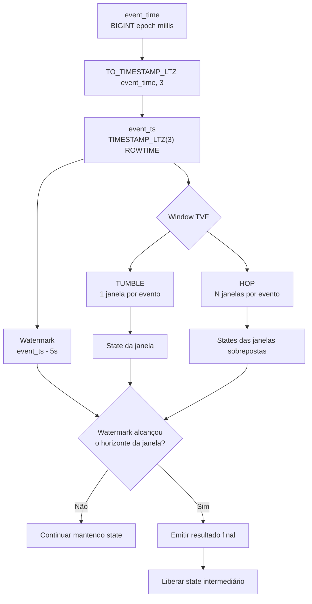
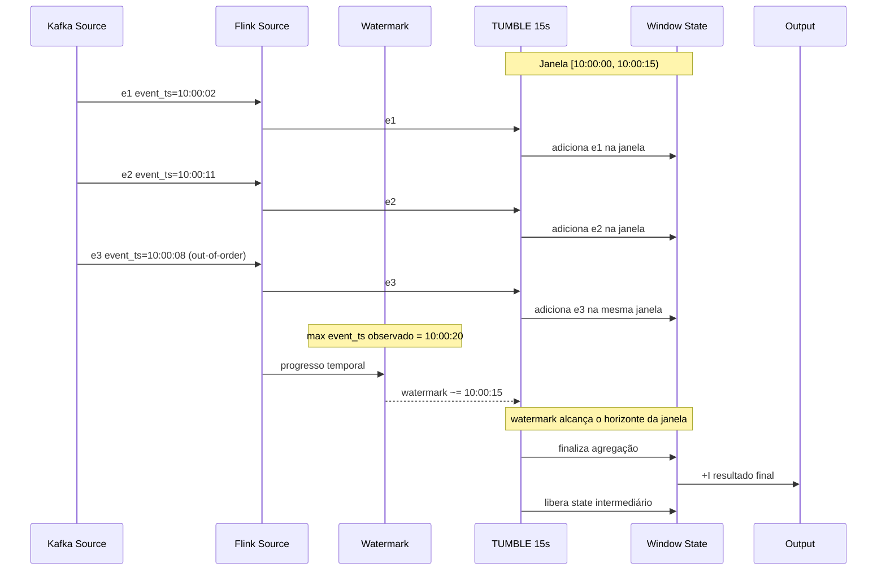
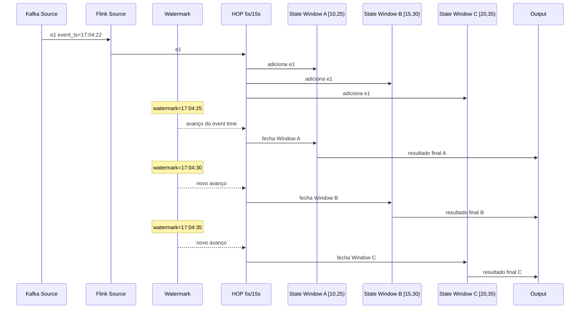
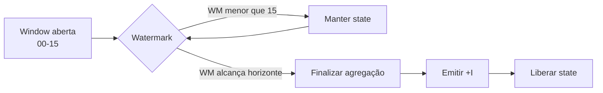
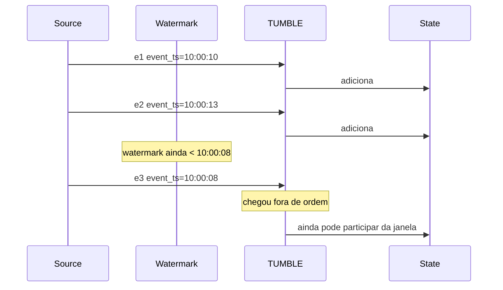
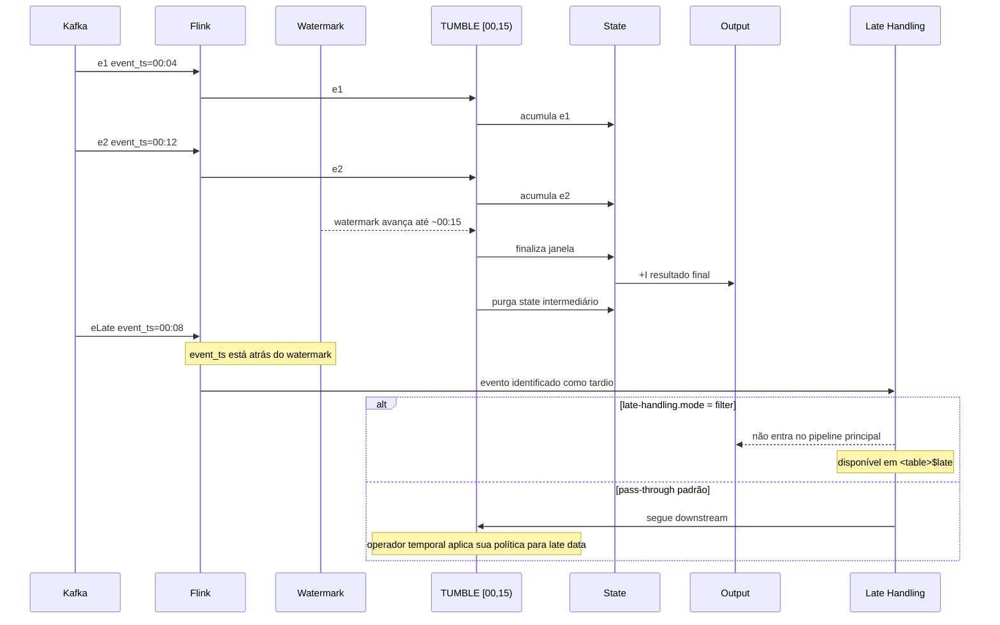
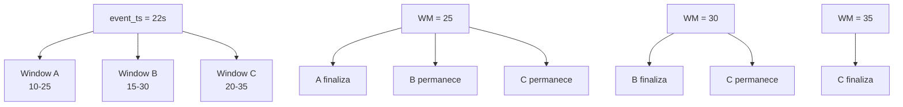
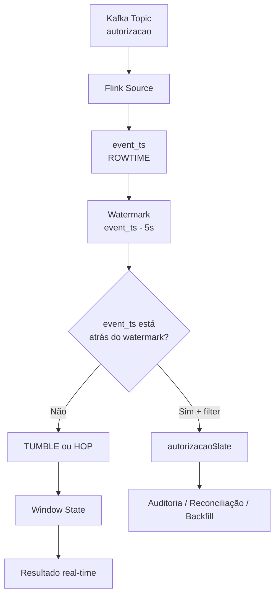
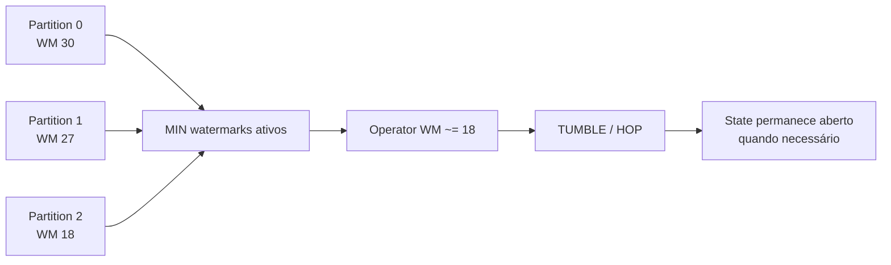
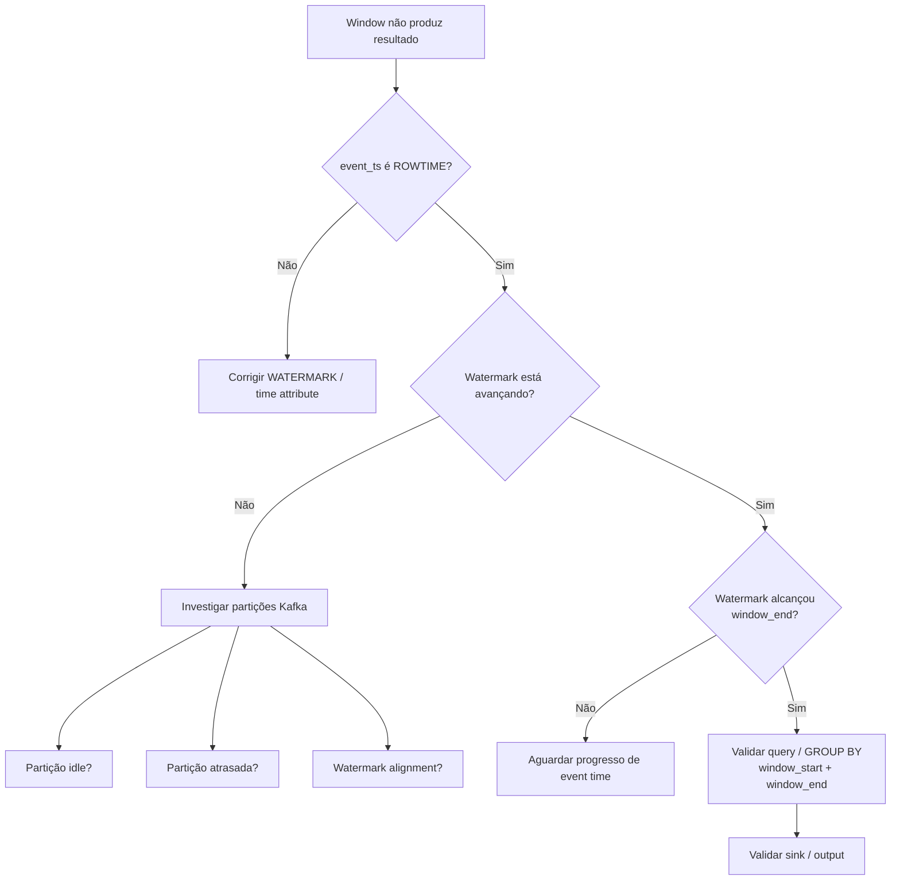

# Apache Flink SQL — TUMBLE x HOP, Event Time, Watermarks, State e Late Events

## 1. Objetivo

Este README consolida o modelo mental para uso de **Window TVFs stateful** no Apache Flink SQL, com foco em:

- `event_time` vindo do payload;
- `event_ts` como `TIMESTAMP_LTZ(3)` e atributo `ROWTIME`;
- watermark customizado com tolerância de 5 segundos;
- `TUMBLE` com janelas fixas de 15 segundos;
- `HOP` com `slide = 5s` e `size = 15s`;
- criação, retenção e fechamento de state;
- relação entre `window_start`, `window_end` e `window_time`;
- eventos out-of-order;
- eventos tardios (*late events*);
- comportamento com múltiplas partições Kafka;
- tratamento estrito de late events na Confluent Cloud.

A ideia central é separar quatro perguntas:

1. **Qual é o tempo de negócio do evento?** → `event_ts`
2. **Em qual(is) janela(s) o evento pertence?** → `TUMBLE` / `HOP`
3. **Até onde o tempo lógico do operador avançou?** → watermark
4. **Ainda existe state válido para receber esse evento?** → relação entre watermark e horizonte da janela

---

## 2. Definição temporal da tabela

Exemplo simplificado da tabela `autorizacao`:

```sql
CREATE TABLE autorizacao (
    id_transacao_pix STRING,
    event_id STRING,
    event_type STRING,
    valor DECIMAL(12,2),
    status_autorizacao STRING,

    -- Timestamp bruto em epoch milliseconds.
    event_time BIGINT,

    -- Converte o epoch milliseconds do payload para TIMESTAMP_LTZ(3).
    event_ts AS TO_TIMESTAMP_LTZ(event_time, 3),

    -- Define `event_ts` como atributo de EVENT TIME / ROWTIME.
    --
    -- A estratégia mantém o watermark aproximadamente 5 segundos
    -- atrás do progresso de event time observado.
    WATERMARK FOR event_ts AS
        event_ts - INTERVAL '5' SECOND
)
WITH (...);
```

Ao executar `DESCRIBE autorizacao`, a coluna deve aparecer conceitualmente como:

```text
event_ts | TIMESTAMP_LTZ(3) *ROWTIME* | ... | AS TO_TIMESTAMP_LTZ(event_time, 3)
```

O ponto importante não é apenas o tipo `TIMESTAMP_LTZ(3)`: é o marcador `ROWTIME`, indicando que a coluna é um **time attribute** válido para operações temporais.

---

## 3. O que é watermark

Em poucas palavras:

> **Watermark é a estimativa do Flink de até onde o event time já avançou.**

Com:

```sql
WATERMARK FOR event_ts AS
    event_ts - INTERVAL '5' SECOND
```

o Flink mantém uma margem temporal para absorver eventos fora de ordem.

Modelo mental simplificado:

```text
Maior event_ts observado: 10:00:20

Watermark aproximado:
10:00:20 - 5s = 10:00:15
```

Isso **não** significa que o evento precisa chegar em até 5 segundos de wall-clock time.

O watermark trabalha no domínio de **event time**.

### O watermark não define o tamanho da janela

Isto:

```text
TUMBLE = 15s
Watermark = 5s
```

não significa:

```text
janela = 20s
```

A janela continua com 15 segundos.

O watermark responde a uma pergunta diferente:

> **“Até onde o operador pode avançar no tempo lógico antes de continuar esperando eventos antigos?”**

---

## 4. Modelo temporal completo



Modelo mental:

```text
event_ts
   |
   +----> TUMBLE / HOP ----> onde guardar o evento?
   |
   +----> WATERMARK -------> até quando esperar?
```

---

# 5. TUMBLE

## 5.1 Definição

```sql
TUMBLE(
    TABLE autorizacao,
    DESCRIPTOR(event_ts),
    INTERVAL '15' SECOND
)
```

O `TUMBLE` cria janelas:

- fixas;
- consecutivas;
- não sobrepostas;
- com 15 segundos de duração.

```text
[00-------------15)
                   [15-------------30)
                                      [30-------------45)
```

Cada evento pertence a **uma única janela**.

---

## 5.2 Exemplo

Considere:

```text
event_ts = 10:00:12
```

Ele pertence a:

```text
[10:00:00, 10:00:15)
```

Não pertence a:

```text
[10:00:15, 10:00:30)
```

### Regra dos limites

A janela:

```text
[10:00:00, 10:00:15)
```

é inclusiva no início e exclusiva no final:

```text
10:00:00.000 -> pertence
10:00:14.999 -> pertence
10:00:15.000 -> próxima janela
```

---

## 5.3 Relação com state

Exemplo de agregação:

```sql
SELECT
    window_start,
    window_end,
    COUNT(*) AS quantidade
FROM TABLE(
    TUMBLE(
        TABLE autorizacao,
        DESCRIPTOR(event_ts),
        INTERVAL '15' SECOND
    )
)
GROUP BY
    window_start,
    window_end;
```

Modelo conceitual:

```text
Window [10:00:00, 10:00:15)

State:
  e1
  e2
  e3
  e4

COUNT = 4
```

Um evento alimenta apenas um contexto temporal de state:

```text
evento
   |
   v
TUMBLE
   |
   v
1 janela
   |
   v
1 contexto de state
```

---

## 5.4 Diagrama de sequência — TUMBLE + watermark



O evento `10:00:08` chegou depois de `10:00:11`, mas ainda foi associado corretamente à janela porque a atribuição usa **event time**, não ordem de chegada.

---

# 6. HOP

## 6.1 Definição

```sql
HOP(
    TABLE autorizacao,
    DESCRIPTOR(event_ts),
    INTERVAL '5' SECOND,
    INTERVAL '15' SECOND
)
```

Parâmetros:

```text
SLIDE = 5s
SIZE  = 15s
```

As janelas são:

```text
[00-------------15)
     [05-------------20)
          [10-------------25)
               [15-------------30)
                    [20-------------35)
```

Como:

```text
SLIDE < SIZE
```

as janelas se sobrepõem.

---

## 6.2 Um evento pode pertencer a várias janelas

Considere:

```text
event_ts = 12s
```

Ele pertence a:

```text
[00-------------15)
     [05-------------20)
          [10-------------25)
             ^
             |
            12s
```

Portanto:

```text
e1
 |
 +----> Window [00,15)
 |
 +----> Window [05,20)
 |
 +----> Window [10,25)
```

Com:

```text
SIZE / SLIDE = 15 / 5 = 3
```

um evento normalmente contribui para três janelas.

Isso é uma regra útil para raciocinar sobre sobreposição, mas não deve ser interpretado como uma estimativa exata de consumo de memória ou CFU.

---

## 6.3 Relação com state

No `HOP`, um único evento pode alimentar múltiplos contexts de state:

```text
                    e1
                     |
          +----------+----------+
          |          |          |
          v          v          v
       Window A   Window B   Window C
          |          |          |
        State      State      State
```

Consequência operacional:

```text
TUMBLE:
evento -> 1 janela -> 1 contribuição de agregação

HOP:
evento -> N janelas -> N contribuições de agregação
```

---

## 6.4 Diagrama de sequência — HOP + watermark



O watermark é único como progresso temporal do operador, mas cada janela possui seu próprio `window_end`.

Por isso, janelas sobrepostas são encerradas em momentos diferentes.

---

# 7. TUMBLE x HOP

| Característica | TUMBLE 15s | HOP slide=5s / size=15s |
|---|---|---|
| Tipo de janela | Fixa | Fixa e sobreposta |
| Janelas por evento | 1 | normalmente 3 |
| Sobreposição | Não | Sim |
| Usa `event_ts` | Sim | Sim |
| Usa watermark | Sim | Sim |
| Operação stateful quando agregada | Sim | Sim |
| Contextos temporais por evento | 1 | N |
| Resultado final | por janela | por janela sobreposta |
| Limpeza de state | após janela não ser mais necessária | individualmente para cada janela |

Resumo:

```text
TUMBLE
evento -> 1 janela

HOP
evento -> várias janelas

WATERMARK
governa o progresso temporal dos dois
```

---

# 8. `window_start`, `window_end` e `window_time`

Depois de aplicar uma Window TVF, o Flink adiciona:

```text
window_start
window_end
window_time
```

Exemplo:

```text
event_ts     = 10:00:12.350
window_start = 10:00:00.000
window_end   = 10:00:15.000
window_time  = 10:00:14.999
```

`window_time` equivale a:

```text
window_end - 1 ms
```

Em streaming, `window_time` é o time attribute da janela e pode ser propagado para outras operações temporais.

Depois da Window TVF, o `event_ts` original passa a ser tratado como timestamp regular naquela relação windowed; `window_time` é a coluna temporal relevante para encadeamentos posteriores.

---

# 9. Momento de fechamento da janela

A ideia mais importante é:

> **A Window Aggregation não precisa emitir updates intermediários continuamente. Ela mantém state e emite o resultado final quando a janela termina segundo o progresso de event time.**

Exemplo `TUMBLE 15s`:

```text
Window:
[10:00:00, 10:00:15)
```

Enquanto:

```text
watermark < 10:00:15
```

o operador ainda pode precisar manter a janela.

Quando o watermark alcança o horizonte da janela:

```text
watermark ~= 10:00:15
```

a agregação pode produzir o resultado final e o state intermediário deixa de ser necessário.



---

# 10. Out-of-order não é igual a late event

Considere esta ordem de chegada:

```text
ordem de chegada | event_ts
-----------------|---------
1                | 10:00:10
2                | 10:00:13
3                | 10:00:08
```

`10:00:08` chegou fora de ordem.

Isso não significa automaticamente que ele seja um late event.

Se o watermark ainda não avançou além do `event_ts` relevante, ele pode ser processado normalmente pelo operador temporal.



---

# 11. O que é um late event

Na Confluent Cloud, um evento é considerado tardio quando ele chega **depois que o watermark já avançou além do seu timestamp de evento**.

Exemplo:

```text
watermark atual = 10:00:20

chega:
event_ts = 10:00:12
```

Então:

```text
event_ts < watermark
```

O evento está atrasado em relação ao progresso temporal já assumido pelo sistema.

Isso é diferente de simplesmente estar “fora de uma janela”.

---

# 12. Evento fora da janela x evento tardio

Esses conceitos precisam ser separados.

## Caso A — evento pertence naturalmente a outra janela

```text
TUMBLE:
[10:00:00,10:00:15)
[10:00:15,10:00:30)

event_ts = 10:00:18
```

O evento não é tardio apenas porque não pertence à primeira janela.

Ele simplesmente pertence à segunda:

```text
[10:00:15,10:00:30)
```

## Caso B — evento deveria pertencer à janela antiga, mas chega depois do avanço do watermark

```text
Window:
[10:00:00,10:00:15)

watermark atual:
10:00:20

evento chega agora:
event_ts = 10:00:08
```

Temporalmente, o evento pertence à primeira janela.

Porém, ele chegou depois que o sistema já avançou temporalmente para além daquele ponto.

Esse é um **late event**.

---

# 13. Fechamento e late event no TUMBLE



---

# 14. Fechamento e late event no HOP

No `HOP`, a situação é mais interessante porque um evento pode pertencer a várias janelas, e cada janela fecha em um instante diferente.

Considere:

```text
event_ts = 22s

Janelas:
A = [10,25)
B = [15,30)
C = [20,35)
```

Quando:

```text
watermark = 25s
```

temos:

```text
A -> encerrada
B -> ainda aberta
C -> ainda aberta
```

Quando:

```text
watermark = 30s
```

temos:

```text
A -> encerrada
B -> encerrada
C -> ainda aberta
```

Quando:

```text
watermark = 35s
```

todas estão encerradas.



Portanto, o watermark não “fecha o HOP inteiro”.

Ele determina progressivamente quais janelas sobrepostas já alcançaram seu horizonte.

---

# 15. Como impedir late events de seguirem no pipeline principal na Confluent Cloud

A Confluent Cloud possui dois modos de tratamento de late data no source:

```text
pass-through  -> padrão
filter        -> filtra late events no source
```

No modo padrão:

```text
late event
   |
   v
source
   |
   v
downstream operator
```

A Window Aggregation e outros operadores temporais aplicam sua própria política.

Se a intenção do pipeline for:

> **“Depois que o watermark passou, esse evento não pode participar do fluxo real-time principal.”**

use o modo:

```sql
ALTER TABLE autorizacao SET (
    'late-handling.mode' = 'filter'
);
```

Nesse modo:

```text
evento on-time
   |
   +----> pipeline principal

evento late
   |
   +----> filtrado do pipeline principal
            |
            v
       autorizacao$late
```

Para consultar:

```sql
SELECT *
FROM `autorizacao$late`;
```

Isso permite preservar o late event para:

- auditoria;
- troubleshooting;
- reconciliação;
- backfill;
- reprocessamento posterior.

> Observação: a System Table `$late` é uma visão virtual da source; a disponibilidade dos registros continua dependente da retenção da tabela/tópico de origem.

---

# 16. Diagrama — pipeline real-time com late-event routing



---

# 17. Query de laboratório — TUMBLE

```sql
-- =============================================================================
-- TUMBLE 15s
--
-- Um evento pertence a apenas UMA janela.
--
-- event_ts:
--   define onde o evento pertence.
--
-- watermark:
--   define o progresso de event time usado pelo operador para
--   determinar quando pode concluir a janela.
--
-- =============================================================================

SELECT
    window_start,
    window_end,
    window_time,
    COUNT(*) AS quantidade,
    ARRAY_AGG(event_id) AS eventos
FROM TABLE(
    TUMBLE(
        TABLE autorizacao,

        -- ROWTIME usado para window assignment.
        DESCRIPTOR(event_ts),

        -- Janela fixa de 15 segundos.
        INTERVAL '15' SECOND
    )
)
GROUP BY
    window_start,
    window_end,
    window_time;
```

Exemplo:

```text
[17:04:15,17:04:30) -> 14 eventos
[17:04:30,17:04:45) -> 17 eventos
```

---

# 18. Query de laboratório — HOP

```sql
-- =============================================================================
-- HOP slide=5s / size=15s
--
-- Uma nova janela começa a cada 5 segundos.
-- Cada janela possui 15 segundos.
--
-- Como 5 < 15, as janelas se sobrepõem.
--
-- Um evento pode contribuir para múltiplos contexts de state.
--
-- =============================================================================

SELECT
    window_start,
    window_end,
    window_time,
    COUNT(*) AS quantidade,
    ARRAY_AGG(event_id) AS eventos
FROM TABLE(
    HOP(
        TABLE autorizacao,

        -- ROWTIME usado para window assignment.
        DESCRIPTOR(event_ts),

        -- SLIDE.
        INTERVAL '5' SECOND,

        -- SIZE.
        INTERVAL '15' SECOND
    )
)
GROUP BY
    window_start,
    window_end,
    window_time;
```

---

# 19. Query para visualizar a associação evento → janela no TUMBLE

```sql
-- =============================================================================
-- Não agrega.
--
-- Permite visualizar em qual janela cada evento foi colocado.
-- Útil para troubleshooting de event time.
-- =============================================================================

SELECT
    event_id,
    event_ts,
    window_start,
    window_end,
    window_time
FROM TABLE(
    TUMBLE(
        TABLE autorizacao,
        DESCRIPTOR(event_ts),
        INTERVAL '15' SECOND
    )
);
```

---

# 20. Query para visualizar a associação evento → janelas no HOP

```sql
-- =============================================================================
-- Não agrega.
--
-- O mesmo event_id aparecerá em várias linhas quando pertencer
-- a múltiplas janelas HOP.
--
-- Isso NÃO representa duplicidade do evento.
-- Representa sobreposição de janelas.
-- =============================================================================

SELECT
    event_id,
    event_ts,
    window_start,
    window_end,
    window_time
FROM TABLE(
    HOP(
        TABLE autorizacao,
        DESCRIPTOR(event_ts),
        INTERVAL '5' SECOND,
        INTERVAL '15' SECOND
    )
);
```

---

# 21. Múltiplas partições Kafka

O watermark do operador não é simplesmente o maior watermark de uma partição.

Quando existem múltiplas entradas/partições ativas, o progresso efetivo depende da mais atrasada.

Exemplo:

```text
Partition 0 -> WM 10:00:30
Partition 1 -> WM 10:00:27
Partition 2 -> WM 10:00:18
```

O operador fica limitado aproximadamente por:

```text
10:00:18
```

Modelo:



Consequência:

```text
partição atrasada
    ->
watermark atrasado
    ->
janelas permanecem abertas
    ->
state fica retido por mais tempo
```

---

# 22. Idle partitions

Uma partição Kafka pode parar de produzir eventos.

Se ela permanecer considerada ativa com watermark antigo, pode atrasar o watermark global.

A Confluent Cloud possui tratamento de idleness e permite configurar:

```text
sql.tables.scan.idle-timeout
```

Conceitualmente:

```text
Partition 0 -> ativa
Partition 1 -> ativa
Partition 2 -> sem eventos
```

Depois de considerada idle:

```text
Partition 2
   |
   +----> excluída temporariamente do cálculo do watermark
```

Isso evita que uma partição sem tráfego impeça indefinidamente o fechamento de windows.

A configuração deve ser testada com cuidado: um idle timeout muito agressivo pode fazer o watermark avançar cedo demais e aumentar a quantidade de eventos classificados como tardios.

---

# 23. Troubleshooting mental

Quando uma janela não fecha, valide nesta ordem:



---

# 24. Regras mentais

## Regra 1 — `event_ts`

```text
event_ts decide ONDE o evento pertence.
```

## Regra 2 — TUMBLE

```text
TUMBLE decide UMA janela.
```

## Regra 3 — HOP

```text
HOP decide MÚLTIPLAS janelas quando existe sobreposição.
```

## Regra 4 — watermark

```text
watermark mede ATÉ ONDE o event time avançou.
```

## Regra 5 — state

```text
enquanto o horizonte temporal ainda não foi alcançado,
o operador mantém state necessário para a janela.
```

## Regra 6 — fechamento

```text
watermark alcança o horizonte da janela
    ->
resultado final
    ->
state intermediário pode ser liberado
```

## Regra 7 — out-of-order

```text
chegar fora de ordem != necessariamente late event
```

## Regra 8 — late event

```text
evento chega com event_ts atrás do watermark
    ->
evento tardio
```

## Regra 9 — fora da janela

```text
event_ts fora de [window_start, window_end)
    ->
o evento pertence a outra janela

Isso não significa, por si só, que seja tardio.
```

## Regra 10 — política estrita na Confluent Cloud

```text
late-handling.mode = filter
    ->
late event não segue no pipeline principal
    ->
fica consultável em <table>$late
```

---

# 25. Resumo mental final

```text
                    event_time
                       |
                       v
              TO_TIMESTAMP_LTZ
                       |
                       v
                    event_ts
                    ROWTIME
                       |
          +------------+-------------+
          |                          |
          v                          v
   WINDOW ASSIGNMENT              WATERMARK
          |                     event_ts - 5s
     +----+----+                     |
     |         |                     |
     v         v                     |
  TUMBLE      HOP                    |
     |         |                     |
  1 window   N windows               |
     |         |                     |
     v         v                     |
   state     states                  |
     |         |                     |
     +---------+----------+----------+
                          |
                          v
                watermark alcança
                 horizonte temporal
                          |
                          v
                 resultado final
                          |
                          v
                  purge do state
```

A frase principal para consolidar o conceito é:

> **`event_ts` define onde o evento pertence; `TUMBLE` ou `HOP` define em quantas janelas ele participa; o operador mantém state dessas janelas; e o watermark determina até onde o Flink considera que o event time já avançou para concluir as operações temporais.**

Para late data:

> **Um evento tardio não é simplesmente um evento cujo timestamp está fora da janela atual. É um evento que chega depois que o watermark já avançou além do seu event time.**

---

# 26. Referências oficiais

Documentação oficial consultada:

- Confluent Cloud for Apache Flink — Time and Watermarks  
  https://docs.confluent.io/cloud/current/flink/concepts/timely-stream-processing.html

- Confluent Cloud for Apache Flink — Windowing Table-Valued Functions  
  https://docs.confluent.io/cloud/current/flink/reference/queries/window-tvf.html

- Confluent Cloud for Apache Flink — Window Aggregation Queries  
  https://docs.confluent.io/cloud/current/flink/reference/queries/window-aggregation.html

- Confluent Cloud for Apache Flink — Handle Late-Arriving Data  
  https://docs.confluent.io/cloud/current/flink/how-to-guides/handle-late-arriving-data.html

- Confluent Cloud for Apache Flink — Best Practices / Watermarks and Idleness  
  https://docs.confluent.io/cloud/current/flink/operate-and-deploy/best-practices.html